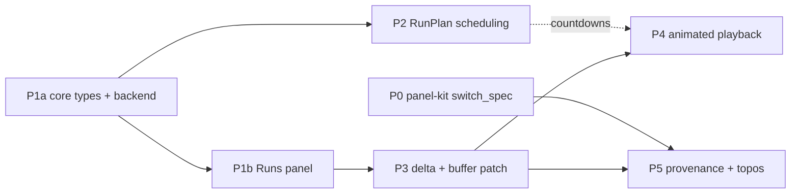

# Implementation Phases — Transform‑Package + Run‑Ledger + Topos

Status: plan, derived from `.specs/research/expanded-design.md` (section numbers
below refer to that document). Slicing follows the pruning spec's score_4 anchor
for *Incremental deliverability* (`jc-timeline-pruning-spec.yaml` §"Incremental
deliverability"):

| Phase | Anchor line | Lands on existing seam |
|-------|-------------|------------------------|
| P0 | `switch_spec()` in panel-kit + layout key namespacing | `WorkspaceSpec` (panel-kit libraryness design) |
| P1a | core types + backend (no UI) | tvix engine + `api_routes()` |
| P1b | Runs panel + knowledge map | panel conventions + `Panel` enum |
| P2 | RunPlan on the existing poll tick loop | `watcher.rs::spawn_poll` + `RescanGate` |
| P3 | delta-driven run history + buffer patching | `x-graph-revision` guard + `GraphData::id_to_idx` |
| P4 | animated playback over the existing buffers | `render::Scene` buffers + Timeline reduced-motion helper |
| P5 | node provenance fields on NodeMeta + topos registry wiring | `NodeMeta` + `GET /node/*id` + Inspector + `ToposRegistry` |

Every phase is independently mergeable, compiles for native and
`wasm32-unknown-unknown`, and leaves the previous behaviour intact when its
feature is unused (no transform packages ⇒ no runs ⇒ empty panel; no topos ⇒
default graph-exploration topos). No phase adds a crate, an engine tag, or a
timer thread (design §0).

Effort units: one engineer‑day ≈ 1d. Estimates include tests and the knowledge‑map
edit for that phase, exclude review latency and panel-kit upstream coordination.

---

## P0 — panel-kit `switch_spec()` + layout key namespacing

**Goal.** panel-kit gains `Workspace::switch_spec(&WorkspaceSpec<K>)` and the
persistence layer namespaces layouts by spec id. jump-cannon does not yet use
it — this phase unblocks all later topos work without blocking P1a.

### Owner
panel-kit repo (`panel-kit-core` + web crate). A jump-cannon engineer
implements it upstream (or the panel-kit team does, coordinated via the
libraryness work).

### Files changed (panel-kit repo)

| Path | Change |
|------|--------|
| `crates/panel-kit-core/src/layout.rs` | `LayoutStore` gains internal key namespacing: `{storage_root}/{spec_id}` instead of a single flat key. Existing single-spec consumers are unaffected — their `storage_root` stays their existing `storage_key`, and the spec id defaults to `"default"`. |
| `crates/panel-kit-core/src/spec.rs` | `WorkspaceSpec` gains a public `id: String` field (already present in the libraryness design). |
| `src/lib.rs` (web crate) | `Workspace<K>::switch_spec(&self, spec: &WorkspaceSpec<K>)` — saves current layout under old spec key, activates new spec's panel registry, applies default or restored layout. 300 ms crossfade animation gated by `prefers-reduced-motion`. |
| `src/lib.rs` (web crate) | `use_workspace` updated to accept `WorkspaceSpec<K>` (or `WebWorkspaceConfig` already carrying one per libraryness design). |
| `crates/panel-kit-core/tests/` | spec-switch integration test: two specs, switch back and forth, verify layout persistence per spec. |
| `examples/` | new `multi_spec` example demonstrating two workspace specs with distinct panel sets. |

### Kill criterion (observable)

1. `cargo test -p panel-kit-core` passes — layout key namespacing preserves
   existing single-spec behavior.
2. `cargo build --target wasm32-unknown-unknown -p panel-kit` succeeds.
3. The `multi_spec` example runs in-browser: switching between spec A (3 panels)
   and spec B (5 panels) hides/reveals panels, persists each spec's layout
   independently across page reloads.
4. Existing consumers (jump-cannon, apple-notes-ocr-flow) build against the
   updated panel-kit with zero code changes — the `storage_key` path still
   works as `{storage_key}/default`.

### Effort
≈ 3d. This is panel-kit work, not jump-cannon, but gates all topos features.

### Dependencies
None. First phase, parallel with P1a.

---

## P1a — Core types + backend: one-shot transform + RunLedger

**Goal.** An administrator can install a `role = "transform"` tvix package, hit
`POST /runs/trigger`, see the output graph published as the live snapshot, and
query `GET /runs` for run history. **No UI.** No scheduler, no delta, no
animation, no provenance.

### Files changed

| Path | Change |
|------|--------|
| `crates/vault-data/src/node.rs` | `RunId(pub u64)` newtype + `NodeId` alias (§1.1). `Provenance` is **not** added — P5. |
| `crates/vault-data/src/lib.rs` | re-export `RunId`, `NodeId`. |
| `crates/importer/src/transform.rs` | **new** — `Value`, `Transform`, `TransformDescriptor`, `TransformVariable`, `TransformError` (§1.2–1.3). wasm-clean. |
| `crates/importer/src/lib.rs` | `pub mod transform;` + re-exports; `ValidatedPackage::role()`, `::into_transform()` (§2.3). `run_plan()` deferred to P2. No new `ParserConfig` variant. |
| `crates/importer/src/tvix.rs` | `TvixParserToml::role`, `TvixVarType::Graph`, validation for `graph` var (§2.2), `inject_graph`, `TvixTransform` with `descriptor()`/`apply()` behind `native`; `CapExceeded` mapping from `convert_generated_graph` (§7). `schedule` key parsed but only `"manual"` accepted — anything else validation error until P2. |
| `crates/importer/tests/packages.rs` | validation cases: transform accepted; `source` package with a `graph` var rejected; transform without `graph` var rejected; `graph` var with default rejected. |
| `crates/tvix-wasm/src/nix/graph-transform.nix` | **new** — `{ graph }:` combinator file with `filterNodes`, `groupByLabel`, `contract`, `density` (§2.4, §5). |
| `crates/graph-api/src/runs.rs` | **new** — `Run`, `RunDelta` (type only; always empty in P1a), `RunStatus`, `RunLedger` (§1.4, §1.6). `RunPlan` deferred to P2. |
| `crates/graph-api/src/lib.rs` | `pub mod runs;`. |
| `crates/graph-api/src/state.rs` | `AppStateInner::run_ledger: Arc<RunLedger>`; opened in `new` and `new_with_importer_catalog` at `{packages_dir}/runs.jsonl`, cap from `JC_RUN_LEDGER_CAP` (§2.6). |
| `crates/graph-api/src/server.rs` | routes `GET /runs`, `POST /runs/trigger`, `GET /runs/:id/topos-state`; handlers `runs_list`, `runs_trigger`, `run_topos_state`. `trigger_run(transform_id, bindings)` (§2.5). `GET /runs/:id/diff` deferred to P3. 422 on `CapExceeded`, failed run recorded, snapshot not swapped (§7, §8). |
| `crates/graph-api/tests/regressions.rs` | integration: trigger → 200 + `RunId`; `GET /runs` lists it `Succeeded` with bumped `x-graph-revision`; cap breach → 422 + `Failed` entry + revision unchanged. |

### Kill criterion (observable)

With a fixture transform package `windowed-cluster.toml` (design §6) installed
under `JUMP_CANNON_IMPORTER_PACKAGES_DIR`, over a fixture graph of ≥ 1,000 nodes:

1. `curl -X POST /runs/trigger -d '{"transform_id":"windowed-cluster","variables":{}}'`
   returns `200` with `{"id": 1}` and `GET /graph/init` afterwards carries an
   `x-graph-revision` strictly greater than before.
2. `GET /runs` returns `[{"id":1,"status":{"state":"succeeded"},…}]` and survives
   server restart (JSONL replay).
3. With `JC_MAX_NODES=10`, same trigger → `422`, `GET /runs` shows
   `{"state":"failed","reason":"…nodes exceeded…"}`, `x-graph-revision` unchanged.
4. `GET /runs/42/topos-state` returns `404` for unknown id; `200` with JSON blob
   for a succeeded run whose transform declared `topos_state_template`.

**Hard stop:** if `inject_graph` + `eval_graph` on the 100k-node fixture takes
longer than the existing `POST /generate` wall-clock ceiling, or the rendered
Nix literal exceeds tvix's evaluable size — retire in-Nix transform path for
large graphs, revisit design before P3.

### Effort
≈ 3-4d.

### Dependencies
None. Parallel with P0.

---

## P1b — Runs panel + knowledge map

**Goal.** The app gets a Runs panel listing run history with status badges and
a trigger button for `Manual` transforms. Knowledge map pages document the
feature. Depends on P1a for the API; can start in parallel with P1a's
integration tests.

### Files changed

| Path | Change |
|------|--------|
| `app/ui/src/panels/runs.rs` | **new** — `loading_store("runs", …)`, `use_future` poll of `GET /runs`, newest-first rows (name, bound vars, status badge, red error badge on `Failed`), trigger button for transforms (§2.7). Delta counts render `—` until P3. No countdown (P2), no progress animation (P4). |
| `app/ui/src/panels/mod.rs` | `pub mod runs;`. |
| `app/ui/src/main.rs` | `Panel::Runs` variant, display name, render dispatch (§2.9). |
| `app/ui/src/workspace/catalog.rs` | tray entry for `Panel::Runs`. |
| `app/ui/src/palette.rs` | optional `Section::Runs` entry. |
| `app/ui/src/api.rs` | `runs_list()`, `runs_trigger()` fetch helpers. |
| `app/ui/assets/app.css` | `/* runs panel */` block. |
| `charts/jump-cannon/knowledge/Transformation Runs.md` | **new** page: package shape, `Run`/`RunLedger`, `/runs` + `/runs/trigger`, Runs panel, Nix closure workaround (§9). Scheduling/provenance/patching sections appended in later phases. |
| `charts/jump-cannon/knowledge/Backend API.md`, `Importer Runtime.md`, `Import and Generate.md`, `Frontend.md`, `Start Here.md`, `Maintaining This Map.md` | cross-links (§9). |

### Kill criterion (observable)

1. After P1a's integration tests pass (backend serving runs), the Tauri app
   shows a Runs panel with rows for each run, status badges, and a trigger
   button for `Manual` transforms.
2. `just test browser-rust` passes — app boots, canvas renders, Runs panel
   renders without crashing.

### Effort
≈ 2-3d. Parallel with P1a's integration test phase.

### Dependencies
P1a (backend API). P1a core types must land first; P1b can develop against a
running P1a server.

---

## P2 — RunPlan on the existing poll tick loop

**Goal.** A transform package declares `schedule = "every:1h"` or
`"daily:09:00"` and runs unattended, single-flight, using the watcher's
`spawn_poll` loop. No new scheduler.

**Why before P3:** P2 only needs P1a's `trigger_run`. It delivers
standalone value (unattended transform runs) without waiting for delta
computation or buffer patching. Shipping scheduling early lets users run
transforms on cadence while P3 builds the diff/patch machinery.

### Files changed

| Path | Change |
|------|--------|
| `crates/graph-api/src/runs.rs` | `RunPlan { Manual, Every(Duration), Daily(TimeOfDay) }`, `TimeOfDay`, `RunPlan::parse(&str)` (§1.5). |
| `crates/importer/src/tvix.rs` | `schedule` key fully parsed (`manual` / `every:<dur>` / `daily:HH:MM`); invalid → validation error. |
| `crates/importer/src/lib.rs` | `ValidatedPackage::run_plan() -> RunPlan` (§2.3). |
| `crates/importer/tests/packages.rs` | parse cases for all three forms + two malformed strings. |
| `crates/graph-api/src/watcher.rs` | at startup enumerate transform packages; `Every(d)` ⇒ `spawn_poll(state, d.as_millis(), gate)` whose tick calls `trigger_run`; `Daily(tod)` ⇒ 60 s poll firing once per local day when clock crosses `tod`; `RescanGate` ⇒ `SkipInFlight` on overlap (§3). |
| `crates/graph-api/src/state.rs` | hold per-transform `RescanGate` handles alongside existing importer gates. |
| `crates/graph-api/tests/regressions.rs` | with `every:1s` and transform that sleeps 3 s: after 5 s exactly 1–2 runs exist, none `Pending` concurrently (single-flight); `daily` fires once when mocked clock crosses `tod` and not again that day. |
| `app/ui/src/panels/runs.rs` | "next run in m:ss" static label per scheduled transform (countdown *animation* is P4). |
| `charts/jump-cannon/knowledge/Transformation Runs.md` | add "Scheduling" section; `Importer Runtime.md` note that watcher tick drives transforms. |

### Kill criterion (observable)

1. Start server with transform `schedule = "every:2s"`; without any HTTP call,
   `GET /runs` after 7 s returns ≥ 3 `Succeeded` entries with strictly
   increasing `started_at`.
2. Replace with transform that sleeps 5 s at `every:1s`; after 12 s, `GET /runs`
   shows ≤ 3 entries and server log contains `SkipInFlight` lines — no
   backlog, no overlapping `Running` entries.
3. `schedule = "daily:25:00"` fails package validation with message naming
   the field.

**Hard stop:** if `spawn_poll` cannot be reused without duplicating the loop
(e.g. tick hard-wired to `Importer::load`), add a thin `TickTarget` enum to
the *existing* loop rather than a second loop.

### Effort
≈ 3d.

### Dependencies
P1a (`trigger_run`, `RunLedger`). Independent of P1b (can land before or after
the UI). Independent of P3 — scheduling does not need deltas.

---

## P3 — Delta‑driven run history + buffer patching

**Goal.** Each successful run carries a node-level `RunDelta`; the UI fetches it
and patches only changed nodes in the GPU buffers instead of refetching the
whole graph. Rows in the Runs panel show real `added/removed/changed` counts.

### Files changed

| Path | Change |
|------|--------|
| `crates/graph-api/src/runs.rs` | `compute_delta(input: &VaultGraph, output: &VaultGraph) -> RunDelta` by node id; `changed` classified via 64-bit content hash of canonical node fields (hash **not** persisted on `NodeMeta` until P5). |
| `crates/graph-api/src/server.rs` | `GET /runs/:id/diff` → `RunDelta` + `input_revision`/`output_revision`, `x-graph-revision = output_revision` via `insert_graph_revision`, `404` on unknown id (§2.5). `trigger_run` fills `delta` on `update`. |
| `crates/graph-api/tests/regressions.rs` | delta correctness: fixture transform renames one node, drops one → `added=[new]`, `removed=[old]`, `changed=[]`; pure-metadata transform → `changed` only; 404 for unknown id. |
| `app/ui/src/api.rs` | `run_diff(id)` returning body + revision header. |
| `app/ui/src/graph_canvas.rs` | `apply_run_delta(delta, output_revision)`: if `added`+`removed` empty **and** `output_revision` succeeds mounted `graph_revision` → patch path via `id_to_idx`; else fall back to `load()` (§4). Coalesce changed indices into ascending runs. |
| `app/ui/src/render/data.rs` | `patch_nodes(queue, scene, &[(u32, NodeAttrs)])` issuing `queue.write_buffer` per contiguous index run on `positions`/`colors`/`sizes` (§4). No re-seed, no `mount_canvas`. |
| `app/ui/src/render/pipelines.rs` | expose sub-range write entry point used by `patch_nodes`. |
| `app/ui/src/panels/runs.rs` | rows show `+N −N ~N` counts; on newly observed `Succeeded` run, call `apply_run_delta`. "0 nodes" warning chip for all-removed delta (§8). |
| `charts/jump-cannon/knowledge/Transformation Runs.md` | add "Delta and incremental buffer patching" section; `Backend API.md` gains `GET /runs/:id/diff`. |

### Kill criterion (observable)

1. Fixture transform changes only node colors/sizes of 10 nodes on 100k-node
   graph: after run, browser console log shows exactly one `patch_nodes` call
   with ≤ 10 index runs, **zero** calls to `load()`, force-layout positions of
   untouched nodes byte-identical before/after (assert via `GraphData` snapshot
   in browser regression harness).
2. Transform adds one node: canvas takes `load()` fallback and mounted
   `graph_revision` equals run's `output_revision`.
3. `GET /runs/:id/diff` for run whose `output_revision` is older than canvas's
   mounted revision is rejected by existing revision guard (no patch, no crash).

**Hard stop:** if `patch_nodes` cannot write sub-ranges without full remount
under `graph_canvas::load` revision guard, P3 ships with diff-fetch +
full `load()` only, and P4 is re-scoped to full-frame reloads.

### Effort
≈ 4-5d. Dominated by wgpu sub-range write and browser regression test.

### Dependencies
P1a + P1b (`RunLedger`, `trigger_run`, Runs panel). Independent of P2.

---

## P4 — Animated playback over the existing buffers

**Goal.** The Runs panel animates scheduled countdowns and in-progress runs, and
a timeline scrubber replays run deltas against the live GPU buffers, respecting
`prefers-reduced-motion`. No new render pipeline.

### Files changed

| Path | Change |
|------|--------|
| `app/ui/src/panels/runs.rs` | countdown animation for upcoming runs; measured `ProgressBar` (nodes processed / total) while `Running`, indeterminate spinner only when progress unreported; reduced-motion ⇒ static labels (§2.7). Timeline scrubber: selecting run *k* replays deltas `k..=current` (or back) through `apply_run_delta`. |
| `app/ui/src/panels/timeline.rs` | export existing `prefers-reduced-motion` media-query helper for reuse (no behaviour change). |
| `app/ui/src/graph_canvas.rs` | `apply_run_delta` accepts `animate: bool`; when true, interpolates color/size toward target over N frames via successive `patch_nodes` writes; reduced-motion writes once. |
| `app/ui/src/render/data.rs` | `patch_nodes` reused unchanged; add `lerp_attrs` helper. |
| `crates/graph-api/src/server.rs` | `GET /runs` entries expose `progress: Option<{done,total}>` sourced from existing `ProgressLog` while `Running` (§3 item 5). |
| `crates/graph-api/src/runs.rs` | `Run::progress` field (`#[serde(default)]`, not persisted to JSONL). |
| `app/ui/assets/app.css` | animation keyframes under `/* runs panel */`, gated by `@media (prefers-reduced-motion: no-preference)`. |
| `charts/jump-cannon/knowledge/Transformation Runs.md`, `Frontend.md` | add "Playback" section. |

### Kill criterion (observable)

1. With three successful runs recorded, scrubbing timeline from run 3 to
   run 1 and back leaves canvas `graph_revision` equal to run 3's
   `output_revision` and colors of 10 fixture-changed nodes equal to their
   run-3 values (assert via browser regression harness; no `load()` calls
   during scrub when deltas are patch-eligible).
2. Frame time stays below 16 ms on 100k-node fixture during scrub (measured
   by existing performance harness in `Performance Engineering.md`).
3. With `prefers-reduced-motion: reduce` emulated, no CSS animation runs and
   `patch_nodes` is called exactly once per scrub step.
4. During `Running` transform reporting progress, bar fraction never fabricated:
   with transform reporting no progress, panel shows indeterminate spinner and
   no percentage text.

### Effort
≈ 4d.

### Dependencies
P3 (`apply_run_delta`, `patch_nodes`, `/runs/:id/diff`). P2 for countdowns
(the countdown feature degrades to "no scheduled runs" if P2 absent, so P4 is
mergeable after P3 alone).

---

## P5 — Node provenance + topos registry wiring

**Goal.** Every node carries `Provenance` (`first_seen_run`, `last_seen_run`,
`changed_in`, timestamps, `content_hash`), served through `GET /node/*id`, and
the Inspector shows it. The app wires `ToposRegistry` from importer packages
and activates topos on importer source switch.

### Files changed

| Path | Change |
|------|--------|
| `crates/vault-data/src/node.rs` | `Provenance` struct; `NodeMeta::provenance` with `#[serde(default)]` (§2.1). |
| `crates/vault-data/src/tests.rs` | pre-provenance JSON deserializes to `Provenance::default()`; round-trip with values. |
| `crates/graph-api/src/runs.rs` | `compute_delta` moves to use `NodeMeta::provenance.content_hash` (persisted) instead of on-the-fly hash from P3; `stamp_provenance(output, delta, run_id, now)` writes `first_seen_run`/`last_seen_run`/`changed_in`/timestamps. |
| `crates/graph-api/src/server.rs` | `trigger_run` calls `stamp_provenance` before publishing snapshot. `graph_init` gains optional `topos_state` field (protobuf) when active importer declares `[topos]`, enabling non-transform topos activation (§10.7). `GET /node/*id` unchanged — field rides `NodeMeta`. |
| `crates/graph-api/tests/regressions.rs` | after two runs where run 2 changes node X: `GET /node/X` shows `first_seen_run=1`, `last_seen_run=2`, `changed_in=[2]`; importer-only node shows `Provenance::default()`. |
| `crates/importer/src/tvix.rs` | `convert_generated_graph` preserves incoming `provenance` for nodes transform passes through unchanged (keyed by id). |
| `app/ui/src/panels/inspector.rs` | "Provenance" section: `RunId` chips linking to Runs panel filtered by id, `changed_in` count with expand, `m:ss` timestamps; hidden when default (§2.8). |
| `app/ui/src/panels/runs.rs` | accept filter-by-`RunId` signal from Inspector chip. |
| `app/ui/src/proto.rs` | `Provenance` mirror type for UI wire format. |
| `app/ui/src/workspace/topos.rs` | **new** — `ToposRegistry`, `ToposEntry`, `ToposState`, `VisualEncoding`, `ColorMapping`, `SizeMapping`, `ForceParams` (§10.4). Populated at boot from built-in topos + importer packages declaring `[topos]`. Wires importer source-switch → `workspace.switch_spec()`. |
| `app/ui/src/main.rs` | `Ctx.topos: Signal<Option<ToposState>>` + registry init in app startup. |
| `app/ui/src/graph_canvas.rs` | read `ctx.topos` to override categorical palette + force params. |
| `charts/jump-cannon/knowledge/Transformation Runs.md`, `Nodes Search and Documents.md` | add "Provenance" and "Topos" sections. |

### Kill criterion (observable)

1. Snapshot JSON written before P5 loads with no error; every node reports
   `provenance == Provenance::default()` through `GET /node/*id`.
2. After running `windowed-cluster` fixture twice (second run with different
   `density_threshold` so one more group contracts): new cluster node shows
   `first_seen_run == last_seen_run == 2`; surviving boundary node shows
   `first_seen_run = 1`, `last_seen_run = 2`, `changed_in = [2]`; node
   untouched by both runs has `changed_in = []`.
3. In Inspector, selecting boundary node shows Provenance section with two
   `RunId` chips; clicking `run-00000002` opens Runs panel filtered to that
   run. Importer-only node shows no Provenance section.
4. Selecting an importer with `[topos]` declared activates its topos: panel
   set changes, layout persists per-spec, graph canvas uses topos visual
   encoding.
5. `wasm32-unknown-unknown` build of `vault-data` and `app/ui` succeeds.

### Effort
≈ 4d (was 3d before topos wiring).

### Dependencies
P0 (panel-kit `switch_spec`), P1a+P1b (`RunId`, `trigger_run`, Runs panel),
P3 (`compute_delta`). The `NodeMeta` field itself could be split out and merged
first; stamping and Inspector UI need P3.

---

## Phase order and critical path

Critical path: P0 (parallel) + P1a → P1b → P3 → P4 ≈ 11-13d (down from
14-17d by parallelizing P0 and reordering P2). P2 and P5 can proceed in
parallel with P3/P4 after their respective dependencies. Total ≈ 16-19d
sequential, ≈ 11d with two engineers.

VSM improvements applied:
- **P1 split into P1a + P1b.** P1a unblocks P2 and P3 simultaneously;
  P1b runs in parallel with P1a's integration test phase.
- **P2 before P3.** Scheduling delivers standalone value (unattended runs)
  without waiting for delta computation.
- **P0 parallel with P1a.** panel-kit upstream work does not block any
  backend or UI phase except P5's topos wiring.

## Explicit non-goals carried across all phases

- No new crate, engine tag, `ParserConfig` variant, or timer thread (design §0, §2.3, §3).
- No omp/agent/session vocabulary in `vault-data`, `importer`, or `graph-api` types.
- Snapshot never swapped on a failed run; revision never advances on failure (§8).
- `switch_spec()` in panel-kit is generic — no graph/topos/transform concepts leak into panel-kit.
