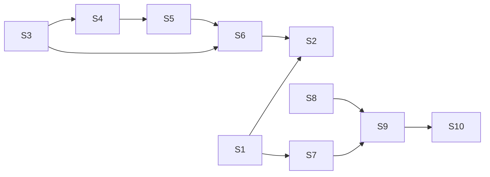

# jump-cannon: transform packages + run journal in graph-api — full solution (A1)

Phase 3 of Tree-of-Thoughts. Expands proposal **A1** (`jc-timeline-2026-09-25.proposals.a.md` §3, "Transform packages + run journal in graph-api") into an implementable design. This is a design document for an upstream feature: it names files and symbols that *will* exist; nothing below claims code is written. Every "today" claim cites the file it was read from. Unobserved claims are marked `[INFERENCE]`.

Where run state lives (the diversity invariant this solution must keep): **an in-memory, bounded run journal inside graph-api's per-source `AppState`**, plus a record-only append log on disk. Not graph-vcs commits, not the client, not the graph itself.

---

## 1. Analysis of A1

### 1.1 Core insight

jump-cannon already owns every piece of a transformation system except the two that connect them:

- `graph-combinators.nix` already contains `graph -> graph` rewrite rules (`hubRule`, `contractRule`, `reverseEdgesRule`, `composeOps`, `parallelMerge`; `crates/tvix-wasm/src/nix/graph-combinators.nix:162-259`). Nothing hosts them against a *live* graph.
- The tvix engine already binds typed variables into a Nix function at apply time and evaluates it natively on a blocking thread (`crates/importer/src/tvix.rs:354-371`, `:632-671`; precedent `POST /generate`, `crates/graph-api/src/server.rs:733-774`).
- `eval_seed` already injects host state into the expression as a `let` binding (`crates/tvix-wasm/src/lib.rs:416-419`: `let n = {n}; in (…)`), so injecting the live graph is the same idiom, not a new closure level.
- Every snapshot rebuild is already a discrete, atomic, revisioned event (`GraphSnapshot::build` mints a fresh `revision`, `crates/graph-api/src/state.rs:114-116`; `rebuild_snapshot` swaps it, `crates/graph-api/src/watcher.rs:476-535`) driven by an existing change driver (`WatchPlan::{Static,Filesystem,Poll,Push}`, `watcher.rs:188-207`).

A1's insight is therefore: **a transform is a tvix package with `role = "transform"` whose `expr` takes `{ graph, <variables> }`; a run is one snapshot rebuild; the timeline is the sequence of rebuilds.** No new scheduler, no new store, no new wire family.

### 1.2 Decisions A1 already made (kept)

| Decision | Kept as |
|---|---|
| Server-side eval, `spawn_blocking` | `TvixTransform::apply` (§4.4.2) |
| Input injected as JSON via a `let` binding | `tvix_wasm::eval_transform` (§4.4.1) |
| Journal is in-memory and bounded | `RunJournal` (§4.6) |
| Schedule derived from the existing `WatchPlan` | `RunSchedule` published by the existing drivers (§4.7) |
| Package shape stays format_version=3 / `engine = "tvix"`; only `[parser] role` is new | §4.3 |
| Same catalog + overlay files bind transforms | `ImporterSourceDefinition.transforms` (§4.4.5) |
| Node content: project Nix `metadata`, allow `[[schema.fields]]`, add `facts` + `provenance` to `NodeMeta` | §4.10 |
| In-place animation when node sets match, remount otherwise; reduced-motion swaps pulse for static highlight | §4.9 |

### 1.3 Gaps A1 left open (filled below)

1. **"Last K full snapshots for scrubbing"** — per-run full copies. Replaced by keyframe + `Vec<GraphOp>` deltas with a byte budget (§4.6).
2. **No terminal failure path** — what happens on cap overflow, throw, or overrun. Specified as a four-gate budget with recorded outcomes (§2.1, §4.5).
3. **No missed-tick / overlap semantics.** Specified against the existing `MissedTickBehavior::Skip` and debouncer (§2.6, §4.7).
4. **Which graph is the transform's input** — the fresh source import (view semantics), not the previous transform output (§4.1).
5. **Identity of derived nodes** under the `{source_kind}:{source_id}:{local}` contract that `validate_output` enforces per node (`crates/data-loader/src/lib.rs:595-600`) (§4.1).
6. **What "runs" are for sources without transforms** — every rebuild is a run, so Obsidian/Kubernetes/httpjson get the panel for free (§4.5).
7. **Boot-time failure** of a transform (§4.5).
8. **Removed nodes are absent from the live buffers**, so "dim removed nodes via `set_selected`" cannot work on the latest run. Solved by union frames for scrub and an arrival pulse for live (§4.9).

---

## 2. Judge feedback — addressed item by item

### 2.1 Terminal failure path (CK-009)

**Budget mechanism:** `TransformLimits { input_nodes, input_edges, output_nodes, output_edges, eval_ms }` on every transform binding, derived from the package's `[limits]` (`nodes`, `edges`, new `eval_ms`) clamped by the host caps (`JC_MAX_NODES`/`JC_MAX_EDGES`, read by `tvix_wasm::max_nodes()/max_edges()`, `crates/tvix-wasm/src/lib.rs:54-83`) and `JC_RUN_TIMEOUT_MS`. Enforced at **four gates**, all inside `TvixTransform::apply` (`crates/importer/src/tvix.rs`, native feature), which runs on the same `tokio::task::spawn_blocking` path `POST /generate` and `TvixImporter::import` already use:

| Gate | Where | Condition | Recorded outcome | Snapshot |
|---|---|---|---|---|
| G1 input | before rendering the graph JSON | `graph.nodes.len() > input_nodes` or edges > `input_edges` | `RunOutcome::Refused { reason: "input 1,204,331 nodes exceeds transform limit 1,000,000" }` | previous retained |
| G2 in-eval output | inside the Nix wrapper rendered by `eval_transform`: `let __r = …; __n = builtins.length __r.nodes; __e = builtins.length __r.links; in if __n > <output_nodes> then builtins.throw "…" else if __e > <output_edges> then builtins.throw "…" else builtins.deepSeq __r (builtins.toJSON __r)` | output list spine longer than the cap | `RunOutcome::Failed { error: "transform output: 4,000,001 links exceeds cap 4,000,000" }` | previous retained |
| G3 post-parse | `parse_graph_json` → `check_caps_against` (existing, `lib.rs:61-78`, `:326`) | same as G2 (belt-and-braces; also catches a wrapper bypass) | `Failed { error }` | previous retained |
| G4 wall clock | `tokio::time::timeout(eval_ms, spawn_blocking(eval))` | elapsed | `RunOutcome::TimedOut { ceiling_ms }` | previous retained |
| — throw | tvix returns `Err(msgs)` from `eval_to_json` (`lib.rs:280-283`) | any `throw`/`abort`/type error | `Failed { error: <tvix message> }` | previous retained |

G2 matters because `builtins.length` forces only the list spine, not each node's metadata, so a runaway output is rejected *before* `toJSON` materialises a multi-hundred-MB string — the cheap check the current `/generate` path lacks.

**Timeout is not cancellation.** tvix has no fuel or preemption (`lib.rs:25-31`), so on G4 the blocking thread keeps running. `TvixTransform` owns an `eval_slot: AtomicBool` (busy) and, on timeout, detaches one task that awaits the orphaned `JoinHandle`, discards its result, and clears the flag. While the flag is set every later `apply` on that transform returns `ImportError::TransformRefused { reason: "evaluation from run 42 (timed out after 120 s) is still running" }`, which the journal records as `RunOutcome::Skipped { reason: SkipReason::OrphanEval }`. **At most one orphan thread per transform, ever.** The UI shows "run 42 timed out after 120 s; its evaluation is still running on a worker thread — the next run starts when it exits."

**Every gate produces the same three visible effects**: (1) a `RunRecord` with the outcome and error text in the journal (`GET /runs`), (2) `progress.fail(stage, reason)` on the source's `ProgressLog` (Progress panel, footer), (3) the previous `GraphSnapshot` stays in the `ArcSwap` untouched — exactly the existing "reload failed; keeping last snapshot" posture (`watcher.rs:491-500`). Never a crash, never a hang (the driver loop awaits the timeout, not the thread), never a silently truncated graph (a graph that trips a cap is discarded whole).

**Boot** is the one place with no previous snapshot. A transform failure/timeout/refusal at boot is **fatal for the deployment default** (process exits with the error, exactly as a bad package manifest does) and a **failed build** for a runtime-switched alternate (existing `503 {"status":"failed"}` + `/retry`). A transform is configuration; a misconfigured deployment fails at rollout rather than silently serving a different topology.

**Known limit (stated, not hidden):** a non-terminating expression that allocates without bound cannot be stopped in-process. Kill criterion in Phase 2: if an orphan is observed to outlive `4 × eval_ms` in a deployment, transform evaluation moves to a `graph-api transform-eval` subprocess with the same JSON contract; the journal and UI are unchanged by that move.

### 2.2 Retention bound (CK-008)

The journal retains, per source, **at most `JC_RUNS_RETAIN` (default 256) fixed-size `RunRecord`s (~300 B each), at most `JC_RUNS_DELTA_BYTES` (default 64 MiB) of `RunDelta` op lists evicted oldest-first, and at most `JC_RUNS_KEYFRAMES` (default 2) full `Arc<graph_vcs::Snapshot>` keyframes written every `JC_RUNS_KEYFRAME_EVERY` (default 16) successful runs — and only while one keyframe's estimated size fits `JC_RUNS_KEYFRAME_BYTES` (default 256 MiB); the live graph is never copied because it is already the `Arc<GraphSnapshot>` in the `ArcSwap`.** Per-run full-graph copies do not exist. Deltas age out first (byte budget), then records (count). A record whose delta and keyframe coverage are gone is still listed with `scrubbable: false`.

On disk: `<overlay_dir>/runs/<source_id>/runs.jsonl` — one `RunRecord` JSON line per completed run, rotated to `runs.1.jsonl` at `JC_RUNS_LOG_LINES` (default 4096), one rotation kept. **Records only** — deltas and keyframes are never written (A1's deliberate no-durability-of-graph-data decision, kept). `overlay_dir` is the existing writable overlay location used by `catalog.local.json` / `variables.local.json` (`crates/graph-api/src/main.rs:155-156`); when it is absent or read-only the journal is memory-only and `GET /runs` reports `"log": null`. Full layout in §4.6.3.

### 2.3 Failed / timed-out / empty-graph UI states (CK-015)

Canvas and Runs panel per state; the previous canvas state is **always retained**:

| State | Canvas | Runs panel strip | Runs panel detail |
|---|---|---|---|
| Run `Failed` | unchanged (previous snapshot still served; revision probe sees no change, so no remount) | red marker at its time | "failed · <error text, first 4 lines, expandable>" + "Run now" |
| Run `TimedOut` | unchanged | red hollow marker | "timed out after 120 s · evaluation still running on a worker thread" while the orphan flag is set, then "… (finished, result discarded)" |
| Run `Refused` (G1) | unchanged | amber marker | "refused: input 1.2M nodes exceeds transform limit 1M — raise `[limits] nodes` or bind a smaller source" |
| Run `Skipped` | unchanged | grey tick (not a marker) | "skipped: run 41 still in flight" / "skipped: orphan evaluation" |
| Source `Unchanged` | unchanged | no marker; header shows "last checked 12 s ago · unchanged" | — |
| Run succeeded with an **empty output graph** (0 nodes) | the transform emitted an empty graph on purpose; it *is* published (`VaultGraph::validate` has no non-empty rule — its loops are vacuous at n=0, `crates/vault-data/src/graph.rs:70-94`; that `GraphSnapshot::build`'s index/metric stages accept n=0 is `[INFERENCE]` and is covered by a Phase 2 test). Canvas shows the existing empty state; the Runs detail says "0 nodes / 0 edges (−12,004 nodes)" in the delta counts | green marker | counts make the emptiness explicit |
| Scrub to a run whose frame aged out | unchanged (stays on whatever frame is mounted) | marker drawn hollow | "history only — frames for runs before #{oldest keyframe} were released (JC_RUNS_KEYFRAME_EVERY / JC_RUNS_DELTA_BYTES)" |
| Scrub frame fetch fails (network) | unchanged | — | `loading_store("runs-frame").fail(msg)` → `LoadingGate` shows the message over the detail area, never over the canvas |
| Graph too large for keyframes | live behaviour unchanged | scrub controls disabled | "scrub frames disabled: graph exceeds JC_RUNS_KEYFRAME_BYTES; deltas and arrival highlights still recorded" |

Empty *source* graph (importer produced 0 nodes) already works today; the journal records it like any run.

### 2.4 Knowledge-map update (CK-013)

Landed in the **same change** as each phase (§5), these notes under `charts/jump-cannon/knowledge/`:

- **New:** `Transform Runs.md` (doctype architecture, area data, audience user/developer/operator/agent) — the package role, run model, journal bounds, scheduling, endpoints, panel, failure states. Links: `[[Importer Runtime]]`, `[[Backend API]]`, `[[Frontend]]`, `[[Nodes Search and Documents]]`, `[[Use Jump Cannon]]`, `[[Troubleshooting]]`, `[[Helm Deployment]]`, `[[Observability]]`.
- `Importer Runtime.md` — tvix `role = "transform"`, `input`, reserved `graph` variable, `[[schema.fields]]` now accepted on tvix packages, catalog `transforms`, `--transform`, "an `Unchanged` source records no run"; link `[[Transform Runs]]`.
- `Backend API.md` — `/runs`, `/runs/{id}`, `/runs/{id}/delta`, `/runs/{id}/frame`, `/runs/{id}/frame/edges`, `POST /runs`; `NodeMeta` `facts`/`provenance`/`touched_runs`; `GET /importers` profile `transforms`.
- `Frontend.md` — Runs panel, arrival pulse, scrub/union frames, reduced motion, store ids `runs` / `runs-frame`.
- `Nodes Search and Documents.md` — Facts, Provenance, Runs sections in the Nodes panel; tvix metadata projection.
- `Import and Generate.md` — tvix packages carry node metadata and may declare fields; transform packages.
- `Helm Deployment.md` — `importers.sources.<id>.transforms[]` values; `JC_RUNS_*`, `JC_RUN_TIMEOUT_MS`.
- `Operations.md` — `runs.jsonl` location and rotation; env knobs.
- `Observability.md` — the `run` progress group.
- `Troubleshooting.md` — "run timed out / refused / skipped (orphan)", "scrub disabled".
- `Use Jump Cannon.md` — user paragraph for the Runs panel and richer node content.
- `Layouts Metrics and Filters.md:52` — add Runs to the "active workflows" list next to Timeline.
- `OMP Auto-Loop Topos.md` — one sentence: a topos may bind transforms to its source (example only; nothing in core references it).
- `AGENTS.md` — crate-map rows for `data-loader` (`GraphTransform`, `TransformedImporter`), `importer` (`role = "transform"`), `graph-api` (`/runs`, `runs.rs`); configuration table rows for the new env vars; "Backend state architecture" paragraph gains the run journal sentence.

### 2.5 Panel-kit loading (CK-006)

Runs panel hydration is store-shaped: `loading_store("runs", "loading runs…")` for the `GET /runs` poll (`begin` on first fetch, `succeed` on each response, `fail(msg)` on error), `loading_store("runs-frame", "loading run frame…")` for scrub-frame fetches (`begin_with("run #{id}: fetching frame")` → `update(Some(f), …)` as ids/edges/states arrive in three known-size steps (⅓ each — a *measured* fraction of requests completed, labelled as such) → `succeed`). Panel body is wrapped in `LoadingGate { store, … }`; the chrome (header, "Run now", strip) renders immediately. The workspace `GlobalLoadingBar` (`app/ui/src/main.rs:1686`) aggregates both. This mirrors `panels/history.rs:21,96` exactly. No hand-rolled `loaded` signals.

### 2.6 Scheduling semantics (D5)

Runs execute **inside the existing driver loops**; no new tokio task per transform.

- **Cadence origin.** `WatchPlan::Poll { interval_ms }` → `spawn_poll` tick (`watcher.rs:263-279`); `Filesystem` → the 400 ms `notify-debouncer-mini` window plus the optional periodic rescan (`filesystem_rescan_interval`, `watcher.rs:287-296`); `Push` → `spawn_push` trigger; `Static` → boot + `POST /runs` only. httpjson poll cadence stays `JUMP_CANNON_IMPORTER_POLL_INTERVAL_MS` (default 60 000).
- **Missed intervals: skip, never replay.** `polling_interval` already sets `MissedTickBehavior::Skip` (`watcher.rs:283`); so does `filesystem_rescan_interval` (`:294`). A tick that arrives while a run is executing in the same loop is simply the next `interval.tick()` after the awaited `periodic_reload` returns — there is no queue. Skipped ticks record nothing (nothing happened).
- **Filesystem bursts: coalesce.** The debouncer folds a save burst into one reload (existing).
- **Overlap: never.** A run holds the per-source **run slot** (`RunJournal::try_begin` → `RunGuard`, RAII). Drivers are sequential loops, so the only cross-driver overlap is `POST /runs` vs a driver tick. A tick finding the slot taken is recorded `Skipped { InFlight }` (poll/rescan) — the next tick re-checks anyway — **or** sets `pending_change` (filesystem/push, because a real source change must always land); when the in-flight run completes, the executor immediately runs one coalesced follow-up if `pending_change` is set. An overrunning run therefore cannot overlap itself; it delays the next tick, and the Runs panel shows the overrun ("running 3 m 12 s · next tick skipped").
- **Alternates.** `RescanGate` semantics unchanged (`watcher.rs:79-114`): idle alternates skip; `SkipInFlight` drops. The Runs panel's own poll marks the gate used, so a viewed source keeps rescanning.
- **Upcoming.** `RunSchedule { next_due_ms: AtomicU64, driver, interval_ms, last_checked_ms }` on `AppState`; `spawn_poll` stores `now + interval_ms` after each tick, `spawn_filesystem` stores the next rescan instant after each rescan/reset, `Push`/`Static` store 0. `GET /runs` derives `upcoming` from it and never invents a time.

### 2.7 Phase list (D7)

Five phases, each landing user-visible value on an existing seam, usable the day it merges, with acceptance and kill criteria (§5).

### 2.8 Reduced motion (CK-004)

`app/ui/src/render/mod.rs` gains `REDUCED_MOTION: GlobalSignal<bool>` read once at boot from `window.matchMedia("(prefers-reduced-motion: reduce)")` through `web_sys` (Rust, no JS). When set: the arrival **pulse** (size interpolation over 600 ms) becomes a **static** 4 s emphasis via `render::push_focus_set(None, &members)` (existing dim-others path, `render/mod.rs:499-504`) then clears; scrub playback (▶) is disabled — step ◀ ▶ only; union-frame fade-in/out becomes fixed alpha (added 1.0, removed 0.18, no interpolation); strip markers do not animate (`@media (prefers-reduced-motion: reduce)` in `app/ui/assets/app.css`, precedent at `:62-64`). Section §4.9.4.

### 2.9 Honest progress (CK-005)

- In-flight run marker: fraction only when `ProgressLog::latest()` reports one (`GraphSnapshot::build`'s metric stage reports `idx/total`, `state.rs:140-144`); the tvix eval stage has no fuel and reports **indeterminate** (`ProgressBar { fraction: None }`) with elapsed time. Never a synthetic percentage for eval.
- Countdown to the next run: `due_ms − (now_client − (server_ms_at_response − …))` — same server/client clock mapping the Progress poller already uses (`crates/graph-api/src/progress.rs:17-21`); displays "next run in 0:42" and, past due, "due · waiting for the driver" rather than a negative number.
- Scrub-frame store: fraction = requests completed / 3, labelled "fetching ids / edges / states".
- Runs list: `loading_store("runs")` indeterminate while fetching (no known size).

### 2.10 Nix-side composition (CK-010)

`graph-transform.nix` takes `{ graph }` explicitly (`{ graph }:` header) exactly like `graph-combinators.nix:12`, imports nothing itself (not `birds.nix`, not `graph.nix`), and inlines its own `Y` where needed (`graph-combinators.nix:26` precedent). Every builder is one `builtins.genList` + one `builtins.listToAttrs` (the `soupGen` pattern, `graph-combinators.nix:112-123`), never a `foldl'` over `addNode` (O(n²), confirmed by the judges). The transform package's `expr` composes at two import levels max: `graph.nix` (level 1, which imports `birds.nix`) and `graph-transform.nix { graph = g; }` (level 1, parameterised). §4.2.

### 2.11 No eval-time filesystem or network (CK-014)

`tvix-eval` is built `default-features = false` (`crates/tvix-wasm/Cargo.toml:26-32`, pinned rev `1dbdd85`): `readFile`/`readDir`/`getEnv` live in `eval/src/builtins/impure.rs` and are absent from the pure builtin set, while everything the wrapper uses — `fromJSON`, `length`, `throw`, `deepSeq`, `toJSON` — is in `eval/src/builtins/mod.rs` (`pure_builtins`). `import` is served only from the in-memory `GraphNixIO` VFS (`lib.rs:122-205`) containing the embedded library. The live graph enters as a `let graph = builtins.fromJSON "<escaped JSON>"; in …` binding rendered by the host — a string literal, not a file. All other external state enters as typed `[[parser.variables]]` bound at apply time (existing `resolve_variables` / `coerce`, `tvix.rs:313-413`). A transform therefore has exactly two inputs — the graph and its declared variables — and is a pure function of them.

### 2.12 Pure graph vocabulary (CK-002)

New core names: `GraphTransform`, `TransformedImporter`, `TransformDescriptor`, `TransformLimits`, `TvixTransform`, `TvixRole::{Generate,Transform}`, `RunJournal`, `RunRecord`, `RunTrigger::{Boot,Watch,Poll,Rescan,Push,Manual}`, `RunOutcome::{Succeeded,Failed,TimedOut,Refused,Skipped}`, `RunDelta`, `Keyframe`, `RunFrame`, `RunSchedule`, `Provenance`, `NodeFact`, endpoints `/runs*`, panel `Runs`, Nix `graph-transform.nix`. No `session`, `agent`, `tool call`, `goal`, `omp`, or local path appears in any type, endpoint, package field, or panel string. The shipped example transform is `collapse-by-facet.toml` (collapse nodes sharing a metadata value), meaningful for Kubernetes namespaces, Obsidian folders, generated cluster types, or any pest `kind` alike.

---

## 3. Implementation subproblems and dependencies

| # | Subproblem | Crate / file | Depends on |
|---|---|---|---|
| S1 | Nix `metadata` projection + `[[schema.fields]]` on tvix packages | `tvix-wasm/src/lib.rs` (`RawNode`/`GenNode`), `importer/src/tvix.rs` (`convert_generated_graph`, `validate_package_schema`) | — |
| S2 | `facts` + `provenance` + `touched_runs` on `NodeMeta`; Nodes panel sections | `graph-api/proto/graph.proto`, `server.rs::node_meta`, `app/ui/src/panels/nodes.rs::focused_node` | S1 (facts use declared fields); S6 (touched runs) |
| S3 | Run journal + executor over existing rebuilds | `graph-api/src/runs.rs` (new), `state.rs`, `watcher.rs::rebuild_snapshot`, `vault_loader.rs` | — |
| S4 | `/runs*` endpoints | `server.rs::api_routes` | S3 |
| S5 | Runs panel + arrival pulse + reduced motion | `app/ui/src/panels/runs.rs` (new), `api.rs`, `render/mod.rs`, `main.rs` | S4 |
| S6 | Deltas, keyframes, union frames, scrub | `runs.rs`, `server.rs`, `graph_canvas.rs::graph_data_from_frame`, `panels/runs.rs` | S3–S5 |
| S7 | `graph-transform.nix` + `eval_transform` | `tvix-wasm/src/nix/graph-transform.nix` (new), `tvix-wasm/src/lib.rs` | S1 |
| S8 | `GraphTransform` trait + `TransformedImporter` | `data-loader/src/lib.rs` (or `transform.rs`) | — |
| S9 | `TvixTransform` (role, limits, gates, timeout, orphan slot, derived-id namespacing) | `importer/src/tvix.rs` | S7, S8 |
| S10 | Binding: catalog `transforms`, `--transform`, `build_world_state` / `build_alternate` wiring | `graph-api/src/importer_catalog.rs`, `main.rs`, `lib.rs`, `source_host.rs` | S8, S9 |
| S11 | Knowledge map + AGENTS.md | `charts/jump-cannon/knowledge/*.md`, `AGENTS.md` | each phase |



---

## 4. Complete solution

### 4.1 Vocabulary and invariants

- **Transform**: a `format_version = 3`, `engine = "tvix"`, `role = "transform"` package whose `expr` is a Nix function `{ graph, <variables> } -> toGraphJSON-shaped attrset`.
- **Binding**: one transform + variable values + a `transform_id` (`[a-z0-9._-]{1,128}`, default = sanitized package id), attached to one source. A source may bind up to `MAX_TRANSFORMS_PER_SOURCE = 8`, applied in order.
- **Input**: the **fresh source import** (`ImportOutcome::Loaded` of the inner importer), then the output of the previous transform in the chain. A transform is a *view* recomputed from the source on every run — never a fold over its own previous output — so runs are idempotent and drift-free. (State-accumulating transforms are out of scope; that is A4/A5 territory.)
- **Run**: one attempt of the rebuild path (`rebuild_snapshot`), whether or not any transform is bound. Every source gets runs.
- **Identity**: an output node id that exists in the input is **kept verbatim** (with whatever metadata the transform returned — a "changed" node if metadata differs). Any other output id is a *local* id and is namespaced `{source_kind}:{transform_id}:{local}` with `meta.source_id = transform_id`, so `validate_output`'s per-node prefix check (`data-loader/src/lib.rs:595-600`) passes unchanged: the pipeline's `source_kind` stays the source's. `local` must satisfy `identity::validate_local_id` (non-empty, ≤ `MAX_LOCAL_ID_BYTES`; `:` and `/` are permitted, `identity.rs:79-92`); a violation fails the run naming the id. Collision safety comes from the prefix, not from the local part: `transform_id` is validated as a stable id and must differ from the source's `source_id` at bind time, so a derived id can never share a prefix with a source id.
- **Schema of a transformed pipeline**: `source.fields ∪ transform.fields` (dedup by key; same key with a different `field_type` is a bind-time error), `source.edge_types ∪ transform.edge_types`, `source_kind` = source's, `content` = source's. Kept nodes keep `content_readable`; derived nodes are metadata-only. `read_body` forwards to the inner importer.
- **Search documents**: kept nodes whose `VaultNode` JSON is byte-identical to the input reuse the source's `SearchDocument`; changed and derived nodes get documents built from the canonical projection (`id`, `title`, `tags`, `path`, `type` + every declared field present in `metadata`), the same projection `convert_generated_graph` produces (`tvix.rs:543-550`).

### 4.2 Nix side

**VFS layout** (`embed_nix_files!`, `tvix-wasm/src/lib.rs:104-116` gains one line):

```
/jc/src/birds.nix               existing
/jc/src/graph.nix               existing ({ }: — imports birds.nix)
/jc/src/graph-combinators.nix   existing ({ graph }:)
/jc/src/graph-transform.nix     NEW      ({ graph }:)  — array-style vocabulary over the attrset graph
/jc/src/seed.nix                existing
```

**`graph-transform.nix { graph }`** — every function is `args…: g: g'` (graph last) so chains fold with `compose`:

| Function | Type | Notes |
|---|---|---|
| `nodeList g` / `edgeList g` | `graph -> [node]` | `builtins.attrValues` |
| `fromNodeList nodes` / `fromEdgeList edges` | `[node] -> attrset` | one `listToAttrs` |
| `mapNodes f g` | `(node -> node) -> graph -> graph` | id must be preserved by `f`; `listToAttrs (map …)` |
| `filterNodes p g` | `(node -> bool) -> graph -> graph` | drops dangling edges in the same pass (`filter` over `edgeList` with `hasAttr`) |
| `mapEdges f g` / `filterEdges p g` | | |
| `foldNodes f acc g` | `(acc -> node -> acc) -> acc -> graph -> acc` | `builtins.foldl'` |
| `groupBy key g` | `(node -> string) -> graph -> { <k> = [node]; }` | one pass, `listToAttrs` of accumulated lists via `foldl'` on an attrset of lists |
| `collapse { key, merge ? _: ns: {…} } g` | `(node -> string) -> graph -> graph` | one node per group (`id = key`, `type = "group"`, `metadata = merge k members` — default `{ member_count; members = ids; }`), edges re-targeted to group ids and deduped by `"${src}->${tgt}"` |
| `withMetadata f g` | `(node -> attrs) -> graph -> graph` | `mapNodes (n: n // { metadata = n.metadata // f n; })` |
| `relabel f g` | `(node -> string) -> graph -> graph` | sets `type` |
| `compose fs` | `[graph -> graph] -> graph -> graph` | `g: builtins.foldl' (acc: f: f acc) g fs` |
| `toGraphJSON g` | re-exported from `graph` | so an `expr` needs only `graph.nix` + this file |

Laziness is Nix's: `filterNodes` returns a thunk until `toGraphJSON` forces it, and `deepSeq` forces everything at the end (`eval_to_json`, `lib.rs:268-271`).

**Injected graph shape** (`fromJSON` of `graph_to_nix_input`): the *internal* attrset form so every `graph.nix` op and combinator applies directly:

```nix
{ nodes = { "<full id>" = { id = "<full id>"; type = "<doctype or first tag or \"node\">";
             metadata = { title; tags = [ … ]; path; folder; doctype; source_id;
                          frontmatter = { … };            # NodeMeta.frontmatter verbatim
                          metrics = { degree; indegree; outdegree; pagerank; betweenness; kcore; community; wcc; }; # only when input = "graph+metrics"
                        }; }; … };
  edges = { "e0" = { id = "e0"; source; target; directed = true; metadata = { }; }; … }; }
```

Edge ids are `"e<i>"` in `graph.edges` order — the same convention `random`/`clustered`/`fromEdgeList` use (`graph.nix:128,190`). A `toGraphJSON` output link's `id` is ignored on the way back (`RawEdge` carries only `source`/`target`, `lib.rs:248-252`).

**Rendered expression** (importer renders bindings; tvix-wasm injects the graph):

```nix
let graph = builtins.fromJSON "<json, escaped>";        # eval_transform
    __r = ( <expr> ) { graph = graph; tag = "kind"; min_size = 2; };   # render_expression with `graph = graph;` first
    __n = builtins.length __r.nodes; __e = builtins.length __r.links;
in if __n > 1000000 then builtins.throw "transform output: ${toString __n} nodes exceeds cap 1000000"
   else if __e > 4000000 then builtins.throw "transform output: ${toString __e} links exceeds cap 4000000"
   else builtins.deepSeq __r (builtins.toJSON __r)
```

`graph` is a reserved variable name for `role = "transform"` (validation rejects a declared variable named `graph`, and rejects `role = "transform"` packages whose `expr` does not mention `graph` — cheap textual check, same spirit as the non-empty-expr check at `tvix.rs:248-250`).

### 4.3 Package manifest shape

```toml
# charts/jump-cannon/packages/collapse-by-facet.toml
format_version = 3

[metadata]
id = "graph.collapse-by-facet"
name = "Collapse by facet"
version = "1.0.0"
description = "Collapse every node sharing one metadata value into one group node carrying member_count; edges are re-targeted to the groups."

[limits]
nodes = 1000000        # input AND output cap for this transform (≤ HARD_LIMITS.nodes, ≤ JC_MAX_NODES)
edges = 500000
eval_ms = 60000        # NEW Limits field, default 120000, ceiling 3600000; only tvix enforces it

[[schema.fields]]      # NOW accepted on tvix packages (was rejected: tvix.rs:293-307)
key = "member_count"
field_type = "integer"
required = false
searchable = false
facetable = false

[parser]
engine = "tvix"
role = "transform"     # NEW; default "generate" keeps every existing package valid
input = "graph"        # NEW; "graph" | "graph+metrics"; default "graph"
expr = '''
{ graph, key, min_size }:
let g = import /jc/src/graph.nix { };
    t = import /jc/src/graph-transform.nix { graph = g; };
    keyOf = n: n.metadata.frontmatter.${key} or n.type;
in t.toGraphJSON (t.compose [
     (t.collapse { key = keyOf; })
     (t.filterNodes (n: (n.metadata.member_count or 1) >= min_size))
   ] graph)
'''

[[parser.variables]]
name = "key"
type = "string"
default = "type"
description = "Metadata key whose value groups nodes; falls back to the node type."

[[parser.variables]]
name = "min_size"
type = "integer"
default = "1"
min = 1
description = "Drop groups smaller than this."
```

Validation deltas in `importer/src/tvix.rs`: `TvixParserToml` gains `role: String (default "generate")` and `input: String (default "graph")`; `build_config` maps them to `TvixRole`/`TvixInput`; `validate_config` adds the reserved-`graph` rules; `validate_package_schema` is replaced by the pest-style `CORE_KEYS` collision check (`pest.rs:216-224`) so `[[schema.fields]]` and `[[schema.edge_types]]` are accepted for both roles; `Limits` gains `eval_ms` with `HARD_LIMITS.eval_ms = 3_600_000` and default `120_000`.

### 4.4 Rust types

#### 4.4.1 `crates/tvix-wasm/src/lib.rs`

```rust
/// A node with its Nix `metadata` retained (was discarded: `RawNode` ignored extra fields, lib.rs:233-246).
pub struct GenNode { pub id: String, pub kind: Option<String>, pub metadata: BTreeMap<String, serde_json::Value> }
// RawNode gains `#[serde(flatten)] extra: BTreeMap<String, serde_json::Value>`; GenEdge unchanged.

pub struct OutputCaps { pub max_nodes: usize, pub max_edges: usize }   // caller passes min(package, env)

/// Evaluate a transform expression against an injected graph. `input_json` is the attrset-form graph
/// (§4.2); it is embedded as a Nix string literal via `nix_string_literal` and bound as `graph`.
/// The wrapper enforces `caps` in-eval (G2) before `toJSON`; `parse_graph_json` enforces them again (G3).
pub fn eval_transform(rendered_expr: &str, input_json: &str, caps: OutputCaps) -> Result<GeneratedGraph, String>;

/// Escape a Rust string as a Nix double-quoted literal (`"`, `\`, `${`, control chars).
pub fn nix_string_literal(s: &str) -> String;
```

`to_graph_json` re-emits `metadata` alongside `id`/`type` so `/generate` round-trips it too.

#### 4.4.2 `crates/importer/src/tvix.rs` (native feature)

```rust
pub enum TvixRole { Generate, Transform }
pub enum TvixInput { Graph, GraphWithMetrics }
pub struct TvixEngineConfig { pub expr: String, pub variables: Vec<TvixVariable>, pub role: TvixRole, pub input: TvixInput }

pub struct TvixTransform {
    id: String, name: String, version: String,
    transform_id: String,                 // namespace source_id for derived nodes
    bindings: String,                     // rendered `{ graph = graph; k = v; … }` (wasm-clean renderer)
    expr: String,                         // package expr
    input: TvixInput,
    fields: Vec<DiscoveryField>, edge_types: Vec<EdgeTypeSchema>,
    limits: TransformLimits,
    eval_slot: Arc<AtomicBool>,           // orphan guard (§2.1)
}

pub fn build_tvix_transform(package: ValidatedPackage, variables: BTreeMap<String,String>, transform_id: String) -> Result<TvixTransform, ImportError>;

/// VaultGraph → attrset-form JSON (§4.2). O(n+e); runs inside `apply` on the blocking thread.
pub fn graph_to_nix_input(graph: &VaultGraph, with_metrics: bool) -> String;

/// GeneratedGraph → LoadResult under the identity rule of §4.1. `input` is borrowed for kept-node
/// document reuse and the id set; `namespace` is `Namespace::new(source_kind, transform_id)`.
pub fn convert_transformed_graph(generated: &GeneratedGraph, input: &LoadResult, namespace: &Namespace, schema: &ImporterSchema) -> Result<LoadResult, PipelineError>;

impl GraphTransform for TvixTransform {
    fn descriptor(&self) -> TransformDescriptor;
    fn apply<'a>(&'a self, input: LoadResult, progress: &'a dyn ImportProgress) -> ImportFuture<'a, Result<LoadResult, ImportError>> {
        // G1 input gate → TransformRefused
        // orphan gate → TransformRefused
        // stage "Evaluating <name>" (indeterminate); optional metrics pass when input = graph+metrics
        // timeout(eval_ms, spawn_blocking(|| eval_transform(expr, json, caps)))  → G2/G3/throw → TransformEval; Elapsed → TransformTimedOut (+ orphan detach)
        // stage "Projecting <name>" → convert_transformed_graph → schema.validate_result
    }
}
```

`convert_generated_graph` (generate role) changes in one place: `frontmatter` = `metadata` minus the promoted keys (`title`, `path`, `folder`, `doctype`, `tags`); `title` = `metadata.title` or id; `tags` = `metadata.tags` (list of strings) or `[type]`; `doctype` = `metadata.doctype` or `"generated"`; search documents add every declared field found in `metadata` (typed by `validate_field_value`).

#### 4.4.3 `crates/data-loader/src/lib.rs`

```rust
pub struct TransformLimits { pub input_nodes: usize, pub input_edges: usize, pub output_nodes: usize, pub output_edges: usize, pub eval_ms: u64 }
pub struct TransformDescriptor { pub id: String, pub name: String, pub version: String, pub transform_id: String,
                                 pub fields: Vec<DiscoveryField>, pub edge_types: Vec<EdgeTypeSchema>, pub limits: TransformLimits }

pub trait GraphTransform: Send + Sync {
    fn descriptor(&self) -> TransformDescriptor;
    fn apply<'a>(&'a self, input: LoadResult, progress: &'a dyn ImportProgress) -> ImportFuture<'a, Result<LoadResult, ImportError>>;
}

/// An importer with a transform chain applied after the inner import. `descriptor()` returns the inner
/// descriptor with the merged schema (§4.1); `watch` is the inner plan; `read_body` forwards.
pub struct TransformedImporter { inner: Box<dyn Importer>, transforms: Vec<Box<dyn GraphTransform>>, schema: ImporterSchema }
impl TransformedImporter { pub fn new(inner, transforms) -> Result<Self, ImportError>; pub fn transform_ids(&self) -> Vec<String>; }
impl Importer for TransformedImporter { /* Unchanged passes through; Loaded folds `apply` in order */ }

pub enum ImportError { /* existing … */
    TransformRefused { transform: String, message: String },
    TransformTimedOut { transform: String, ceiling_ms: u64 },
    TransformEval    { transform: String, message: String },
}
```

`HostedImporter` wraps the `TransformedImporter` exactly as it wraps any importer, so capability preflight, `watch_is_authorized`, and `ImporterDescriptor::validate` are untouched.

#### 4.4.4 `crates/graph-api/src/runs.rs` (new module)

```rust
pub type RunId = u64;
pub enum RunTrigger { Boot, Watch, Poll, Rescan, Push, Manual }
pub enum SkipReason { InFlight, OrphanEval }
pub enum RunOutcome { Succeeded, Failed { error: String }, TimedOut { ceiling_ms: u64 }, Refused { reason: String }, Skipped { reason: SkipReason } }
pub struct RunStage { pub label: String, pub started_ms: u64, pub finished_ms: u64, pub ok: bool }
pub struct RunCounts { pub nodes_before: u32, pub nodes_after: u32, pub edges_before: u32, pub edges_after: u32,
                       pub nodes_added: u32, pub nodes_removed: u32, pub nodes_changed: Option<u32>,   // None = fine diff not computed (§4.6.2)
                       pub edges_added: u32, pub edges_removed: u32 }
pub struct RunRecord { pub id: RunId, pub trigger: RunTrigger, pub forced: bool, pub transform_ids: Vec<String>,
                       pub started_ms: u64, pub finished_ms: Option<u64>,
                       pub revision_before: u64, pub revision_after: Option<u64>,
                       pub counts: Option<RunCounts>, pub outcome: RunOutcome, pub stages: Vec<RunStage> }

pub struct RunDelta { pub run_id: RunId, pub ops: Vec<graph_vcs::GraphOp>,     // forward ops before→after (data type only; no VcsStore)
                      pub touched: HashSet<String>,                              // ids added ∪ removed ∪ changed (per-node history, §4.10)
                      pub added_idx: Vec<u32>, pub changed_idx: Vec<u32>,        // against revision_after's idx_to_id
                      pub approx_bytes: usize }
pub struct Keyframe { pub run_id: RunId, pub graph: Arc<graph_vcs::Snapshot>, pub approx_bytes: usize }
pub struct RunFrame { pub run_id: RunId, pub revision_after: u64,
                      pub ids: Vec<String>, pub node_state: Vec<u8>,            // 0 unchanged · 1 added · 2 removed · 3 changed
                      pub edges: Vec<u32>, pub edge_state: Vec<u8> }            // union of before ∪ after

pub struct JournalBudget { pub max_records: usize, pub max_delta_bytes: usize, pub keyframe_every: u32,
                           pub max_keyframes: usize, pub keyframe_bytes: usize, pub diff_max_nodes: usize, pub big_run_fraction: f32 }
impl JournalBudget { pub fn from_env() -> Self; }   // JC_RUNS_* (§4.11)

pub struct RunSchedule { pub driver: RunDriverKind, pub interval_ms: Option<u64>, next_due_ms: AtomicU64, last_checked_ms: AtomicU64 }
pub enum RunDriverKind { Static, Filesystem, Poll, Push }

pub struct InFlightRun { pub id: RunId, pub trigger: RunTrigger, pub started_ms: u64 }
pub struct RunGuard<'j> { … }   // RAII run slot; `discard()` for Unchanged (no record); Drop releases the slot

pub struct RunJournal {
    budget: JournalBudget, transform_ids: Vec<String>, log: Option<RunLog>,
    inner: Mutex<JournalInner>,           // records: VecDeque<RunRecord>, deltas: VecDeque<Arc<RunDelta>>, keyframes: VecDeque<Keyframe>,
                                          // next_run_id, in_flight: Option<InFlightRun>, pending_change: bool, frame_cache: [Option<Arc<RunFrame>>; 2]
    pub schedule: RunSchedule,
}
impl RunJournal {
    pub fn try_begin(&self, trigger: RunTrigger) -> Result<RunGuard<'_>, SkipReason>;
    pub fn record_skip(&self, trigger: RunTrigger, reason: SkipReason, live_revision: u64);
    pub fn note_checked(&self);                                          // Unchanged tick
    pub fn complete(&self, guard: RunGuard<'_>, outcome: RunOutcome, before: &GraphSnapshot, after: Option<&GraphSnapshot>, stages: Vec<RunStage>);
    pub fn list(&self, limit: usize, before: Option<RunId>) -> RunsView;   // newest first, scrubbable computed
    pub fn record(&self, id: RunId) -> Option<RunRecord>;
    pub fn delta(&self, id: RunId) -> Option<Arc<RunDelta>>;
    pub fn frame(&self, id: RunId, live: &GraphSnapshot) -> Result<Arc<RunFrame>, FrameUnavailable>;   // keyframe.apply(ops…), cached ×2
    pub fn touched_runs(&self, node_id: &str) -> (Vec<RunId>, bool /* history_bounded */);
    pub fn upcoming(&self, gated: bool) -> Vec<Upcoming>;
}
pub struct RunLog { path: PathBuf, max_lines: usize }   // append RunRecord JSON lines; rotate to runs.1.jsonl; `load_records()` at boot
```

`AppStateInner` gains `pub runs: Arc<RunJournal>`; `build_world_state` constructs it from `TransformedImporter::transform_ids()` (empty for plain sources) and the descriptor's `WatchPlan`.

#### 4.4.5 `crates/graph-api/src/importer_catalog.rs`

```rust
pub struct ImporterTransformBinding { pub package: String, #[serde(default)] pub variables: BTreeMap<String,String>, pub transform_id: Option<String> }
// ImporterSourceDefinition gains: #[serde(default, skip_serializing_if = "Vec::is_empty")] pub transforms: Vec<ImporterTransformBinding>,
pub const MAX_TRANSFORMS_PER_SOURCE: usize = 8;
```

`validate_source` applies the existing filename bound (`MAX_PACKAGE_FILENAME_BYTES = 256`, no separators) and `validate_stable_id` to `transform_id`. `catalog.local.json` carries the same field. The sanitized `ImporterCatalogItem` exposes `transforms: [{ package, transformId, variableNames }]` (names only — values may be operator configuration).

CLI parity (`main.rs`): `--transform <file.toml>[?k=v&…]` (env `JUMP_CANNON_TRANSFORMS`, `;`-separated), repeatable, applied to the deployment default; mirrors `--importer-manifest` / `--importer-var`. `build_alternate` (`source_host.rs:1814-1959`) wraps each arm's importer in `TransformedImporter` when the definition has transforms — one helper `wrap_transforms(importer, &definition.transforms, packages_dir)` called in all three arms.

#### 4.4.6 `crates/graph-api/proto/graph.proto`

```proto
message NodeFact   { string key = 1; string value_json = 2; string field_type = 3; }     // declared order
message Provenance { string source_id = 1; optional string transform_id = 2;
                     optional uint64 first_seen_run = 3; optional uint64 last_changed_run = 4;
                     string change = 5;            // "unchanged" | "added" | "changed" relative to the latest run
                     bool history_bounded = 6; }   // true when the retained deltas do not reach the node's first appearance
message NodeMeta { /* existing 1-28 … */
  repeated NodeFact facts = 29; Provenance provenance = 30; repeated uint64 touched_runs = 31; }
```

Regenerated into `app/ui/src/proto/` via `just app-proto` (checked-in prost types, AGENTS.md).

### 4.5 Run executor (the rebuild path) and failure matrix

`watcher.rs::rebuild_snapshot(state)` becomes `run_rebuild(state, trigger: RunTrigger, force: bool) -> bool` (callers: `reload`/`reload_with_paths` pass `Watch`/`Rescan`/`Poll`/`Push`; boot passes `Boot`; `POST /runs` passes `Manual`):

1. `let guard = match state.inner.runs.try_begin(trigger) { Ok(g) => g, Err(reason) => { runs.record_skip(...); if trigger.is_change() { set pending_change }; return false } }`.
2. `progress.start("run", "Run #{id} ({trigger})")` — a task row in the new `run` group so the Progress panel folds stages under the run (`main.rs::fold_progress`).
3. `load_with_progress(&state.inner.importer, …)` (unchanged API; the importer is the `TransformedImporter`). On `Unchanged` → `runs.note_checked(); guard.discard(); return false` (no record — nothing happened). On `Err(e)` → classify: `TransformRefused` → `Refused`, `TransformTimedOut` → `TimedOut`, `TransformEval`/anything else → `Failed { error }`; `runs.complete(guard, outcome, &live, None, stages)`; keep snapshot; `return false`.
4. `GraphSnapshot::build` on `spawn_blocking` (existing); failure → `Failed`.
5. `state.inner.snapshot.store(new)`; `runs.complete(guard, Succeeded, &old, Some(&new), stages)` — the diff/keyframe work runs on `spawn_blocking` *after* the swap so publication latency is unchanged; the record is visible with `counts: None` for the ≤ seconds the diff takes, then updated in place.
6. `push_graph_to_worker` (existing). If `pending_change` was set during the run, loop once more with `RunTrigger::Watch` (coalesced follow-up).

`POST /runs { force }` → spawns one task calling `run_rebuild(state, Manual, force)`; `force` routes the inner `ImportPipeline` through `run()` (the documented force-refresh escape hatch that bypasses the unchanged gate, `data-loader/src/lib.rs:1454-1460`) — for non-pipeline importers `force` is accepted and has no extra effect (they always reload).

### 4.6 Journal storage, retention, and on-disk layout

#### 4.6.1 Rings and eviction (one sentence, restated from §2.2)

Records ≤ `max_records` (256); deltas ≤ `max_delta_bytes` (64 MiB) evicted oldest-first (and never more than `max_records`); keyframes ≤ `max_keyframes` (2), taken at run 0 and every `keyframe_every` (16) successful runs, and additionally *instead of* a delta when a run touches more than `big_run_fraction` (0.25) of the nodes (the ops list would cost about as much as a keyframe); no keyframe is taken when the graph's estimated bytes exceed `keyframe_bytes` (256 MiB) — then `scrub: "deltas_only"` in `GET /runs` and the panel disables scrub. The live snapshot is never duplicated.

`approx_bytes` estimators are explicitly approximate: per op, id + title + path + tags + `frontmatter` JSON length + 64; per keyframe, the sum over nodes + 32 per edge. They bound memory to within a small constant factor, which is what the budget is for.

#### 4.6.2 Delta computation

`runs::diff_graphs(before: &VaultGraph, after: &VaultGraph) -> RunDelta` walks `after.nodes` (IndexMap) against `before.nodes`: absent → `UpsertNode` (added); present and `serde_json::to_value(node)` differs → `UpsertNode` (changed); `before` ids absent in `after` → `DeleteNode`; edges via `HashSet<EdgeId>` symmetric difference. This is `graph_vcs::diff_snapshots`' rule (`crates/graph-vcs/src/merge.rs:203-234`) applied to `VaultGraph` directly to avoid building two `Snapshot`s per run; ops are `graph_vcs::GraphOp` so `Snapshot::apply` (`merge.rs:40-59`) reconstructs frames. Above `diff_max_nodes` (500 k) the fine compare is skipped: `nodes_changed = None`, `touched` holds added ∪ removed only, and the record says "changed nodes not computed above JC_RUNS_DIFF_MAX_NODES".

#### 4.6.3 On-disk layout

```
<overlay_dir>/runs/<source_id>/runs.jsonl     one RunRecord per line, newest last
<overlay_dir>/runs/<source_id>/runs.1.jsonl   previous rotation (≤ JC_RUNS_LOG_LINES lines), one kept
```

Written synchronously at `complete` (one small line; failure to write logs a warning and disables the log for the process). At boot `RunLog::load_records()` seeds `records` (up to `max_records`, `scrubbable: false`, `revision_*` from the previous process are kept as opaque numbers and labelled "previous process" in the panel), so the strip shows history across restarts. Alternates evicted on idle TTL (`source_host.rs:431`) drop their journal with their `AppState`; their records reload on the next build.

### 4.7 Scheduling — where each field comes from

| Driver | `next_due_ms` written by | `upcoming[]` | Panel text |
|---|---|---|---|
| `Poll { interval_ms }` | `spawn_poll` after every `tick()`: `now + interval_ms` | one entry `{ due_ms, driver: "poll", gated }` | "next run in 0:42" |
| `Filesystem` with rescan > 0 | `spawn_filesystem` after each rescan tick and after `reset_filesystem_rescan` | `{ due_ms, driver: "rescan" }` | "rescan in 0:58 · also runs on file change" |
| `Filesystem` rescan = 0 | 0 | `[]` | "runs on file change" |
| `Push` | 0 | `[]` | "runs on push" |
| `Static` | 0 | `[]` | "manual only — Run now" |

`gated: true` for alternates (a `RescanGate` may skip the tick if the source is idle); the panel appends "while this source is being viewed". `last_checked_ms` updates on every `Unchanged` tick.

### 4.8 Endpoints

All read routes take `SourceSelection` (per-viewer source, existing extractor); the write route takes `DefaultSource`.

| Route | Body / response | Why this endpoint |
|---|---|---|
| `GET /runs?limit=64&before=<id>` | JSON `{ server_ms, source: {id,name}, transforms: [ids], live_revision, scrub: "frames"\|"deltas_only", log: "<path>"\|null, in_flight: { id, trigger, started_ms, stage, detail, fraction }\|null, last_checked_ms, upcoming: [{ due_ms, driver, gated }], runs: [RunRecord + scrubbable] }` | One poll answers the whole panel: strip, detail, countdown, in-flight bar. Polled every 2 s alongside the existing revision probe cadence (`main.rs:1197`). |
| `GET /runs/:id` | one record with stages | Detail without re-listing. |
| `GET /runs/:id/delta` | binary LE `[u32 n_added][u32 n_changed][u32×n_added][u32×n_changed]`, header `x-graph-revision: <revision_after>`; 404 aged out; 409 when `revision_after != live` (use the frame instead) | The arrival pulse needs dense indices against the mounted buffers — the same shape `/search/matches` uses (`server.rs:2027-2064`). |
| `GET /runs/:id/frame` | JSON `{ run_id, revision_after, n_nodes, n_edges, ids: […], node_state: [u8…] }`; 404 not reconstructable | Scrub needs the union topology's ids (mirrors `/graph/ids`). |
| `GET /runs/:id/frame/edges` | binary LE `[u32×2m edges][u8×m edge_state]` | Bulk numeric stays binary (AGENTS.md wire rule; mirrors `/graph/edges`). |
| `POST /runs` `{ "force": false }` | 202 `{ run_id }` · 409 `{ in_flight: <id> }` · 400 non-default source | Manual trigger; the run slot makes overlap impossible. |
| `GET /node/*id` | existing protobuf + `facts`, `provenance`, `touched_runs` | No new endpoint: the node the user clicked already has one. |
| `GET /importers` | profiles gain `transforms` | Operators see what is bound; no values leak. |

Progress: the `run` group on `GET /progress` (existing route) carries the per-run task row and stages.

### 4.9 UI integration (real symbols)

#### 4.9.1 Wiring

- `main.rs`: `Panel::Runs` (+ title "Runs", catalog entry, default layout: docked next to Timeline); `reset_graph_session` (`main.rs:912-928`) calls `panels::runs::reset_for_graph_session()`; the revision-probe loop (`main.rs:1191-1212`) calls `panels::runs::on_live_revision(rev)` after `reload_graph` resolves.
- `api.rs`: `pub struct RunRecord`, `RunCounts`, `RunOutcome`, `Upcoming`, `InFlight`, `RunsResponse`; `pub async fn runs(limit: u32, before: Option<u64>) -> ApiResult<RunsResponse>`; `run_delta(id) -> ApiResult<Revisioned<RunDeltaBuf>>` (reuses `get_revisioned_bytes`, `api.rs:594-598`); `run_frame(id) -> ApiResult<RunFrame>`; `run_frame_edges(id) -> ApiResult<Vec<u8>>`; `post_run(force) -> ApiResult<PostRunResp>`; `node_meta` unchanged (proto grows).
- `panels/runs.rs` (new, modelled on `panels/timeline.rs` for module-local `GlobalSignal` state): `static RUNS: GlobalSignal<Option<api::RunsResponse>>`, `static SELECTED: GlobalSignal<Option<u64>>`, `static SCRUB: GlobalSignal<Scrub>` (`Live | At(run_id) | Playing { at, step_ms }`), `static FRAME: GlobalSignal<Option<Arc<MountedFrame>>>`; `pub(crate) fn panel(ctx: Ctx) -> Element`; `fn strip() -> Element`; `fn detail(rec: &api::RunRecord) -> Element`; `pub(crate) fn scrub_to(ctx, run_id)`; `pub(crate) fn on_live_revision(rev: u64)`; `pub(crate) fn reset_for_graph_session()`; `fn ensure_poller()` (one `spawn_forever` poller armed like `timeline::ensure_ticker`, `timeline.rs:373-383`).
- `graph_canvas.rs`: `pub(crate) fn graph_data_from_frame(frame: &api::RunFrame, edges: &[u32], live: Option<&GraphData>) -> GraphData` — mirrors `graph_data_from_snapshot` (`graph_canvas.rs:174-234`): `graph_revision: None` (browser-mounted), colours from `node_state` (added = accent, removed = base at 0.18 α, changed = accent-2, unchanged = community colour when the id exists in `live`), positions copied from `render::with_host(|h| h.pipes.positions_cpu())` for ids present in `live.id_to_idx`, sphere-shell for the rest.
- `render/mod.rs`: `pub static REDUCED_MOTION: GlobalSignal<bool>`; `pub fn pulse(members: HashSet<u32>, duration_ms: u32)` — stores `{ start, members }` in `CTL`; the existing rAF loop scales `sizes_base` for members by `1 + 0.6·(1 − t)` and writes via `pipes.update_sizes` (`pipelines.rs:1270-1285`) until `t = 1`, then restores `sizes_base`; reduced motion → `push_focus_set(None, &members)` for 4 s then `push_focus_set(None, &HashSet::new())`.

#### 4.9.2 Runs panel surface (one hierarchy)

```
[Runs]  <source name> · collapse-by-facet → …        [Run now]
 ───●───●───○───●───●───◐──────┃ now ┃ ─ ─ ─ ─ ◇ next in 0:42 (poll, 60 s)
 #38  #39  #40  #41  #42  #43 (running · Evaluating collapse-by-facet · 0:07)
 ┌ Run #42 · poll · 12:04:31 · 1.8 s ─────────────────────────┐
 │ +12 nodes · −3 nodes · ~41 changed · +20 / −6 edges         │
 │ stages: import 0.4 s · transform 0.9 s · metrics 0.3 s      │
 │ [◀] [▶ play] [Live]                                         │
 └─────────────────────────────────────────────────────────────┘
 last checked 12 s ago · unchanged                 log: runs.jsonl
```

Markers: filled = succeeded, red = failed, red hollow = timed out, amber = refused, hollow = history only (frame aged out), grey tick = skipped, `◐` = in flight (indeterminate `ProgressBar` in the detail row; determinate only when the stage reports a fraction). ARIA: strip is `role="listbox"` with `aria-activedescendant`; markers are `role="option"`; ◀ ▶ are buttons with labels; the countdown is `aria-live="polite"` updated at 1 Hz.

#### 4.9.3 Live: arrival pulse (no remount beyond the one the app already does)

When the probe sees a new revision, `reload_graph` remounts as today. `on_live_revision(rev)` then fetches `/runs?limit=1`; if `runs[0].revision_after == rev` and its delta is retained, it fetches `/runs/:id/delta` (409 → skip: the graph moved on) and calls `render::pulse(added ∪ changed, 600)`. Removed nodes are not in the buffers; the panel reports the count. Selection and camera survive (`reload_graph` already replaces the graph in place, `main.rs:1188-1190`).

#### 4.9.4 Scrub: union frames

`scrub_to(k)`: `loading_store("runs-frame").begin_with(…)` → fetch `/runs/:k/frame` + `/frame/edges` → `graph_data_from_frame` → `render::mount_canvas(scene)` with `render::set_sim_running(false)` so the layout holds; the app's `graph_session` becomes a client-origin session (`GraphOrigin::ClientGenerated { evaluator: "run frame" }` reuses the existing enum) so panels that require a server graph (`focused_node`, `nodes.rs:745`) show their existing "No hosted content" state rather than fetching against a foreign revision. Fade: for 600 ms after mount the rAF loop interpolates colour α for added (0→1) and removed (1→0.18) via `pipes.update_colors` (`pipelines.rs:1231-1245`); reduced motion writes the final alphas once. ▶ steps `At(k) → At(k+1)` every `step_ms` (default 1500) until the newest scrubbable run; disabled under reduced motion. **Live** remounts the live graph through `reload_graph` and re-enables the sim.

#### 4.9.5 Timeline panel

Unchanged: it scrubs layout-position frames (`timeline.rs:1-27`); Runs scrubs graph states. The two are different axes and stay separate panels (one hierarchy per surface). `timeline::reset_for_graph_session` already runs on every mount, so a run-frame mount clears the position ring as it should.

### 4.10 Node content

1. **Projection** (§4.4.2): tvix nodes carry their Nix `metadata` into `frontmatter`, so the Inspector's chip walker and leftover grid (`inspector.rs:505-587`) light up for generated and transformed graphs with zero new UI.
2. **Facts** (`server.rs::node_meta`): for each `snap.schema.fields` entry in declared order, resolve the value — canonical keys from `NodeMeta` (`id`, `title`, `tags`, `path`, `type` → `doctype` or first tag), anything else from `meta.frontmatter[key]` — and emit `NodeFact { key, value_json, field_type }` when present. Pure function of snapshot + node; no new state.
3. **Provenance**: `source_id` = `meta.source_id`; `transform_id` = `Some(meta.source_id)` when it names a bound transform (the journal knows the ids); `touched_runs` = `runs.touched_runs(id)` over retained deltas (≤ 256 hash lookups); `first_seen_run` = the oldest touched run *if* it is an "added" op there, else `None` with `history_bounded: true`; `last_changed_run` = newest touched; `change` relative to the latest run.
4. **Nodes panel** (`nodes.rs::focused_node`, `:789-814`): between `header.nodes-focus-head` and `div.nodes-focus-body`, three sections — `section.nodes-facts` (definition grid, typed rendering: numbers right-aligned, keyword lists as chips reusing `badges::frontmatter_chips`, text in a bounded scroller), `section.nodes-provenance` ("source · transform · first seen run #12 · last changed run #41 · added/changed/unchanged", with "history bounded" when true), `section.nodes-runs` ("touched in runs #12 #15 #41" — each a button calling `panels::runs::scrub_to`). Hidden when empty. The Inspector keeps metrics/badges/frontmatter/neighbours as the raw view; the Nodes panel's Facts section is the schema-declared subset — the two lists differ by design, as `GRID_SKIP_KEYS` vs the chip walker already do (`inspector.rs:507-510`).

### 4.11 Configuration knobs

| Var | Read by | Default | Meaning |
|---|---|---|---|
| `JC_RUNS_RETAIN` | graph-api | 256 | records per source |
| `JC_RUNS_DELTA_BYTES` | graph-api | 64 MiB | delta byte budget per source |
| `JC_RUNS_KEYFRAME_EVERY` | graph-api | 16 | successful runs between keyframes |
| `JC_RUNS_KEYFRAMES` | graph-api | 2 | keyframes retained |
| `JC_RUNS_KEYFRAME_BYTES` | graph-api | 256 MiB | above this, no keyframes (`deltas_only`) |
| `JC_RUNS_DIFF_MAX_NODES` | graph-api | 500 000 | above this, no fine (changed) diff |
| `JC_RUNS_LOG_LINES` | graph-api | 4096 | `runs.jsonl` rotation |
| `JC_RUN_TIMEOUT_MS` | importer (tvix transforms) | 120 000 | host ceiling; packages may lower via `[limits] eval_ms` |
| `JC_MAX_NODES` / `JC_MAX_EDGES` | tvix-wasm (existing) | 1 M / 4 M | output caps; transform packages may lower via `[limits]` |
| `JUMP_CANNON_TRANSFORMS` / `--transform` | graph-api | unset | default-source transform bindings |

---

## 5. Phased delivery

Each phase merges independently, on an existing seam, and is usable that day.

### Phase 0 — Richer nodes for every source (S1, S2 without runs)
- **Lands:** metadata projection in `convert_generated_graph`; `[[schema.fields]]` accepted on tvix packages; `NodeFact` + `facts` on `NodeMeta`; Facts section in `focused_node`.
- **Seam:** `/node/*id` and the Nodes panel.
- **Acceptance:** clicking a `generate-clusters` node shows `type: cluster-3` as a fact and the Inspector chips; clicking an `omp-auto-loop` (pest) node shows its declared fields typed; Obsidian nodes unchanged; `cargo test -p importer` covers projection of a metadata-bearing expression; `just test browser-rust` green.
- **Kill:** if for Obsidian ≥ 90 % of Facts rows duplicate the Inspector frontmatter grid, merge Facts into the Inspector's grid header instead of a second section.

### Phase 1 — Run journal over existing rebuilds (S3, S4, S5 without scrub)
- **Lands:** `runs.rs` (records, counts, deltas, `touched`, `runs.jsonl`), `run_rebuild` executor with the run slot + `pending_change`, `RunSchedule`, `GET /runs`, `GET /runs/:id`, `GET /runs/:id/delta`, `POST /runs`, Runs panel (strip, detail, countdown, in-flight bar, "Run now"), arrival pulse + reduced-motion variant, `run` progress group, Provenance/Runs sections in the Nodes panel.
- **Seam:** `rebuild_snapshot`, the revision probe, `/progress`.
- **Acceptance:** saving an Obsidian note produces a run within 2 s with `~1 changed` and a pulse on that node; a Kubernetes poll shows `+N/−M` pods; `POST /runs` during a run answers 409; a 1 000-run soak in a `runs.rs` unit test (a synthetic 10 k-node graph mutated between `complete` calls) holds `records ≤ 256` and `delta bytes ≤ 64 MiB`; a filesystem change arriving during a manual run is applied by exactly one coalesced follow-up run; `runs.jsonl` reloads after restart; `prefers-reduced-motion` yields a static highlight (browser test toggles the media emulation).
- **Kill:** if `diff_graphs` p95 on the largest deployed source exceeds 2 s, lower `JC_RUNS_DIFF_MAX_NODES` default to 100 000 (counts-only above).

### Phase 2 — Transform packages (S7, S8, S9, S10)
- **Lands:** `graph-transform.nix`; `eval_transform` + `nix_string_literal` + `OutputCaps`; `GraphTransform`/`TransformedImporter`; `TvixTransform` with the four gates, timeout, orphan slot, derived-id namespacing, schema merge; catalog `transforms` + `--transform`; `collapse-by-facet.toml`; outcomes `Failed/TimedOut/Refused/Skipped` rendered in the panel; `tvix-wasm` test `all_transform_demos_evaluate` (a `TRANSFORM_DEMOS` catalog, mirroring `all_demos_evaluate`).
- **Seam:** the importer chain; the Runs panel from Phase 1.
- **Acceptance:** binding `collapse-by-facet` to `generate-clusters` (key = `type`) yields 8 group nodes with `member_count` facts and searchable ids `tvix:collapse:cluster-3`; a package whose expr `throw`s records `Failed` with the tvix message and the canvas keeps the previous graph; `eval_ms = 1000` on a deliberately slow expression records `TimedOut`, the next tick records `Skipped { OrphanEval }`, and the orphan flag clears when the thread ends; a source above `[limits] nodes` records `Refused`; boot with a broken transform exits non-zero with the error; `--transform` works against `--source=pest --importer-manifest omp-auto-loop.toml` locally with nothing loop-specific in the package.
- **Kill:** an orphan observed to outlive `4 × eval_ms` in a deployment → move eval to a `graph-api transform-eval` subprocess (same JSON contract; journal/UI untouched).

### Phase 3 — Scrub with union frames (S6)
- **Lands:** keyframes (+ `keyframe_bytes` gate, big-run rule), `frame()` reconstruction with a 2-entry cache, `GET /runs/:id/frame` + `/frame/edges`, `graph_data_from_frame`, ◀ ▶ ▶play, sim hold, fade / reduced-motion fixed alpha, "history only" and "deltas only" states.
- **Seam:** `render::mount_canvas` + the Runs panel.
- **Acceptance:** 20 runs of a poll source; scrubbing shows removed nodes at 0.18 α and added nodes bright; run #1 (before the oldest keyframe after 40 runs) is "history only"; a 1 M-node source reports `deltas_only` and the scrub controls are disabled with the explanation; frame reconstruction at 200 k nodes < 3 s p95.
- **Kill:** if reconstruction p95 > 3 s at 200 k nodes, default `JC_RUNS_KEYFRAME_EVERY` to 8.

### Phase 4 — Operator surface + map (S10 tail, S11)
- **Lands:** `GET /importers` `transforms`; Importers panel shows the bound chain on a row; Helm values `importers.sources.<id>.transforms[]`; every knowledge note in §2.4; AGENTS.md rows.
- **Acceptance:** `nix flake check` (chart + app-web) green; knowledge links validated per `[[Testing]]`; the Importers panel row for a transformed source lists its chain.
- **Kill:** none (documentation and read-only surfaces).

---

## 6. Self-verification

**Q1. Can any path leave the canvas blank or serve a truncated graph?**
Traced: G1–G4 and throw all return `Err` before `snapshot.store`; `GraphSnapshot::build` failure returns before the store (existing); a frame 404 leaves the mounted scene untouched and surfaces through `loading_store("runs-frame").fail`. A successful *empty* output is published on purpose and labelled. Boot failure is fatal/failed-build, never a silent alternative topology. **One gap found:** a Filesystem change arriving during a manual run was `Skipped` in the first draft and therefore lost. **Fixed** with `pending_change` + the coalesced follow-up (§2.6, §4.5 step 6).

**Q2. Is memory bounded at 1 M nodes over 10 k runs?**
Records 256 × ~300 B; deltas ≤ 64 MiB; the first draft's "2 keyframes" at 1 M nodes ≈ 2 × ~500 MB — **not acceptable**. **Fixed** with `JC_RUNS_KEYFRAME_BYTES` (256 MiB): above it no keyframes are taken, `GET /runs` reports `deltas_only`, the panel says so, and the live features (records, arrival pulse, provenance) still work. The frame cache holds two `Arc<RunFrame>` (ids + u32 edges + u8 states), bounded by the same gate.

**Q3. Can a transform forge or collide with a source node id?**
Output id ∈ input → kept (an update at most). Output id ∉ input → local id under `{source_kind}:{transform_id}:`. `validate_local_id` permits `:` (`identity.rs:79-81`), so a forged `pest:loop:x` that is not in the input simply becomes `pest:collapse:pest:loop:x` — a distinct id in the transform's namespace, never the source's. `transform_id` is validated as a stable id distinct from the source's `source_id` at bind time (a binding whose `transform_id` equals the source's `source_id` is rejected). The existing per-node prefix check in `validate_output` then holds for every node. ✔ — **the first draft claimed `validate_local_id` rejects `:`; it does not. Corrected** here and in §4.1.

**Q4. Does the `Unchanged` gate ever hide a change the user made?**
Transform variables change through `PUT /importers/:id/variables`-style overlay edits, which drop and rebuild the alternate (existing behaviour) — the rebuild is a `Boot` run for that alternate. For the default source a variable change needs a restart today (existing). `POST /runs { force: true }` bypasses the gate for an explicit re-run. Stated in `Importer Runtime.md`. ✔ — but the first draft did not say what `force` means for non-pipeline importers; **fixed** (§4.5: accepted, no extra effect, they always reload).

**Q5. Is "upcoming" ever fabricated, and is the countdown honest across clocks?**
`next_due_ms` is written only by the driver that owns the timer, from the same `tokio::time::Interval` that will fire; `Push`/`Static` publish nothing. The client maps `server_ms` to its own clock as the progress poller does; past-due shows "due · waiting for the driver", never negative. Gated alternates carry `gated: true` and the caveat text. ✔ — **one addition:** `last_checked_ms` was missing from the first draft, so an `Unchanged` source looked dead; added to `RunSchedule` and the header line.

**Q6 (extra). Does the run slot starve the existing watcher for alternates?**
`RescanGate` already serialises alternates; the run slot is taken *inside* the gate's `Run` decision, so the two never disagree. For the default source (no gate) the slot is the only serialiser and `POST /runs` is the only concurrent caller. ✔

---

## 7. What changed from A1 and why

| A1 said | This solution | Why |
|---|---|---|
| Journal keeps "the last K (default 8) full snapshots for scrubbing" | Keyframe every 16 runs (≤ 2, byte-gated) + `Vec<GraphOp>` deltas (byte-budgeted); live never copied | Judges: per-run full copies unacceptable; needed a stated bound |
| Runs = transform applications | Every rebuild is a run (`transform_ids` may be empty) | A3's insight folded in: Obsidian/Kubernetes/httpjson get the panel with no transform; provenance works for every source |
| "Dim removed nodes via `set_selected`" on the live canvas | Live = arrival pulse on added ∪ changed (removed reported as a count); scrub = **union frame** with `node_state` | Removed nodes are not in the live buffers, so the original animation was impossible for the latest run |
| `/runs/:id/diff` | `/runs/:id/delta` (indices vs `revision_after`, 409 when stale) + `/runs/:id/frame*` (union topology) | Two different consumers (pulse vs scrub) with different revision requirements |
| Input "the current snapshot" | Input = the fresh source import (view semantics), optional `graph+metrics` | Idempotent, drift-free runs; stated explicitly; metrics available on request without a stale-snapshot mix |
| Unspecified failure handling | Four gates + throw + orphan slot + boot rule (§2.1) | CK-009 |
| `data_loader::Transform::apply(&VaultGraph)` | `GraphTransform::apply(LoadResult)` + `TransformedImporter` | The output needs `SearchDocument`s and a merged schema; wrapping as an `Importer` leaves `HostedImporter`, watcher, and `load_with_progress` untouched |
| Derived-node identity unspecified | `{source_kind}:{transform_id}:{local}`; kept ids verbatim | `validate_output` enforces the prefix per node; this passes without touching the identity contract |
| "No durability" | Records-only `runs.jsonl`; deltas/keyframes still memory-only | Judges asked for an on-disk layout; the history strip survives restarts without storing graph data |
| Manual run via `POST /runs` | Same, plus `force`, 409 on overlap, `pending_change` coalescing | D5 |
| Timeline panel gains a run track | Separate Runs panel; Timeline unchanged | One hierarchy per surface; the two scrub different axes |
| Node content phase last | Node content is Phase 0 | Approach-independent, smallest, immediately useful (the judges' own hint) |

Everything else — server-side eval on `spawn_blocking`, the `let`-binding injection, `{ graph }`-parameterised Nix library, the format_version=3 package with a single new `role` field, catalog/overlay binding, schedule derived from `WatchPlan`, in-memory bounded journal in graph-api — is A1 as proposed.
