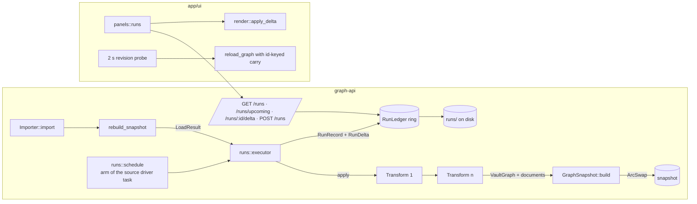

# Transform Packages + Run Ledger in graph-api — Full Solution (B1)

**Date:** 2026-09-25
**Status:** Design (Tree-of-Thoughts phase 3). Nothing here is implemented; every file and symbol named below is either an existing seam (cited with a path) or a proposed addition (marked *new*).
**Starting point:** `.specs/research/jc-timeline-2026-09-25.proposals.b.md` § "Approach 1 — Transform packages + run ledger in graph-api" (lines 62–77).
**Where run state lives (the diversity axis):** in graph-api's process — a bounded `RunLedger` beside the `ArcSwap<GraphSnapshot>` in `AppState`, persisted under `JUMP_CANNON_IMPORTER_PACKAGES_DIR`. Not in graph-vcs, not in the browser, not in the graph.

---

## 1. Reading of the proposal

### 1.1 Core insight

A graph transformation is *the same artifact* as a graph generator — a `format_version = 3` tvix package (`{ expr, [[parser.variables]] }`) — with one extra declared input: the current graph. Everything else the feature needs (runs, schedule, history, animation, richer node content) is bookkeeping *around* applying that package repeatedly, and that bookkeeping belongs in the process that already owns the snapshot lifecycle: graph-api's watcher/`rebuild_snapshot` path (`crates/graph-api/src/watcher.rs:476-535`). An import is simply run zero of a new epoch, so every source — Obsidian, Kubernetes, OKF, pest, httpjson, tvix generators — gets "what changed and when" without a per-source code path.

### 1.2 Decisions inherited from B1 (kept)

| Decision | Kept because |
|---|---|
| Whole-graph output from Nix; Rust computes the delta | Nix stays a pure `graph -> graph` function; the delta is derived, never authored, so it cannot lie. |
| Ledger in graph-api, not graph-vcs | The standalone binary has no VCS store; the ledger is a ring + append-only file, not a merge model. |
| Schedule in the *catalog*, not the package | A package is mechanism; cadence is deployment configuration (mirrors `pollIntervalMs` on `ImporterHttpJsonSource`, `importer_catalog.rs:99-101`). |
| `input = "graph"` on `[parser]`, default `"none"` | Preserves every `generate-*.toml` byte-for-byte. |
| New wasm-clean `graph-transform` crate with `Transform` trait + `TvixTransform` + Rust built-ins | Built-ins are the escape hatch for graphs too large to push through tvix. |
| Runs panel + `render::apply_delta` + position carry-over keyed by id | Success criterion "scrubbing changes only the delta on screen". |
| Node content: metadata reaches `frontmatter`; `/node/:id` gains properties, provenance, edges, history | Root cause named by the judges (`convert_generated_graph`, `tvix.rs:507-566`). |

### 1.3 Gaps B1 left open (each closed below)

1. What happens when a run blows a cap, throws, or hangs (§5).
2. How large the ledger may grow and what survives restart (§7).
3. Exactly how a schedule fires, misses, and overlaps (§6).
4. How the graph enters Nix without O(n²) attrset building or a JSON round trip (§3.2).
5. What the UI shows for failed / timed-out / empty runs (§9.4).
6. Which knowledge notes change (§11) and in which order the work ships (§12).

### 1.4 Judge-feedback matrix

| # | Requirement | Section |
|---|---|---|
| 1 | Terminal failure path, budget mechanism, `spawn_blocking` reuse | §5 |
| 2 | Retention bound in the sentence that introduces the store | §7.1 |
| 3 | Failed / timed-out / empty-graph UI states | §9.4 |
| 4 | Knowledge-map update | §11 |
| 5 | panel-kit store-shaped loading | §9.6 |
| 6 | Scheduling semantics, tick-machinery reuse | §6 |
| 7 | Phased delivery with acceptance + kill criteria | §12 |
| 8 | `prefers-reduced-motion` variant | §9.5 |
| 9 | Honest progress | §9.7 |
| 10 | Nix-side `{ graph }` composition | §3.3 |
| 11 | No eval-time filesystem/network; typed variable binding | §3.4 |
| 12 | Pure graph vocabulary | §10 |

---

## 2. Architecture



Data path for one scheduled Nix run:

1. The source's driver task (existing `spawn_poll` / `spawn_filesystem` loop, §6.2) sees a transform due.
2. `runs::executor::run_one` takes the live `Arc<GraphSnapshot>` as input, checks the input budget, and calls `TvixTransform::apply` on `tokio::task::spawn_blocking` under a fuel + wall-clock budget (§5).
3. The `GeneratedGraph` (now carrying metadata) is projected by `convert_generated_graph` into a `LoadResult`, diffed against the input by `graph_transform::delta::presence_delta`, and built into a new `GraphSnapshot` via the existing `GraphSnapshot::build` (`state.rs:85`).
4. `AppState.snapshot.store(...)`, `push_graph_to_worker`, the record + delta appended to the ledger and flushed to disk.
5. The UI's 2 s probe (`main.rs:1191-1212`) sees the revision advance; `reload_graph` fetches the new buffers, carries positions by id, and animates the delta.

---

## 3. Package, Nix layout, and input binding

### 3.1 Manifest shape

A transform is a tvix package with `input = "graph"`:

```toml
# charts/jump-cannon/packages/transform-relabel-hubs.toml   (new, example)
format_version = 3

[metadata]
id = "transform.relabel-hubs"
name = "Relabel hubs"
version = "1.0.0"
description = "Retypes every node whose total degree is at least `threshold` to `hub`."

[limits]
nodes = 250000
edges = 1000000

[parser]
engine = "tvix"
input = "graph"                     # NEW; default "none" keeps generate-*.toml unchanged
expr = '''
{ graph, threshold }:
let
  g = import /jc/src/graph.nix { };
  t = import /jc/src/graph-transforms.nix { graph = g; };
  deg = t.degrees graph;                                   # one O(E) pass
in
g.toGraphJSON (t.mapNodes
  (n: if (deg.${n.id} or 0) >= threshold then n // { type = "hub"; } else n)
  graph)
'''

[[parser.variables]]
name = "threshold"
type = "integer"
default = "12"
min = 1
description = "Minimum total degree for a node to be retyped `hub`."

# NEW for the tvix engine: declared discovery fields are read from node
# metadata by name and typed; undeclared metadata still lands in frontmatter.
[[schema.fields]]
name = "weight"
type = "number"
facetable = false
searchable = false
```

Validation changes in `crates/importer/src/tvix.rs`:

- `TvixParserToml` gains `#[serde(default)] input: String` (`"none"` | `"graph"`); `TvixEngineConfig` gains `input: TvixInput` (*new* enum `{ None, Graph }`). A `graph` variable name in `[[parser.variables]]` is rejected when `input = "graph"` (it is host-bound).
- `validate_package_schema` (`tvix.rs:293-307`) no longer rejects `[[schema.fields]]`; it rejects only fields named `id`/`title`/`tags`/`path`/`type` (fixed by `tvix_schema()`, `tvix.rs:476-499`). `[[schema.edge_types]]` stays rejected: `VaultEdge` carries no attributes (`vault-data/src/graph.rs:10`, `graph-vcs/src/merge.rs:11-14`), so edge metadata has nowhere to live without a shared-type change that is outside this feature (see the `[[schema.edge_types]]` row in §14). The package schema is merged into the fixed schema, exactly as the json engine merges its declared fields.
- `ValidatedPackage::tvix_input()` (*new*) exposes the input kind so the catalog can reject binding an `input = "graph"` package as a *source* (`ImporterSourceDefinition::runnable`, `importer_catalog.rs:203-211`) and an `input = "none"` package as a *transform*.

### 3.2 How the graph enters Nix — `env`-bound lazy value (the `eval_seed` idiom, done natively)

B1 proposed `graph = import /jc/input/graph.nix` served by `GraphNixIO` as a `builtins.fromJSON` literal. This design replaces that with a native binding, for three reasons confirmed against the pinned tvix rev: (a) `builtins.readFile` is an *impure* builtin and unavailable under `default-features = false` (`tvix/eval/src/builtins/impure.rs:70`), so the only file route is `import` of a Nix literal, which means either a JSON-in-`''`-string escape layer or a giant Nix literal to parse; (b) `EvaluationBuilder::env` (`tvix/eval/src/lib.rs:261`) binds names into the top-level scope — the compiler declares them as root-scope locals (`compiler/mod.rs:1658-1674`) — which is precisely what `eval_seed`'s `let n = …; in (…)` does textually (`tvix-wasm/src/lib.rs:418`), only without rendering; (c) `Thunk::new_suspended_native` (`value/thunk.rs:153`) gives the laziness B1 wanted from the VFS import: `graph.nodes` and `graph.edges` are separate suspended thunks, so an expression that only touches nodes never materialises edges.

*New* in `crates/tvix-wasm/src/input.rs`:

```rust
/// The graph as the transform expression sees it. Arrays, not maps: built
/// once per run from the live snapshot, converted lazily into Nix values.
pub struct InputGraph {
    pub nodes: Vec<InputNode>,          // id, kind (Nix `type`), metadata (BTreeMap<String, serde_json::Value>)
    pub edges: Vec<InputEdge>,          // id ("e{i}"), source, target, directed = true, metadata = {}
}
pub struct InputNode { pub id: String, pub kind: String, pub metadata: BTreeMap<String, serde_json::Value> }
pub struct InputEdge { pub id: String, pub source: String, pub target: String }

/// Builds `{ nodes = <thunk>; edges = <thunk>; }` where each thunk, when
/// forced, builds ONE `NixAttrs` via `NixAttrs::from_iter` (O(n)) — the
/// `soupGen`/`listToAttrs` pattern, never repeated `//` merges.
pub(crate) fn input_value(input: Rc<InputGraph>) -> tvix_eval::Value;
```

The rendered call for an `input = "graph"` package becomes `( <expr> ) { inherit graph; <bindings> }` (`render_expression`, `tvix.rs:358-371`, gains the `inherit graph;` prefix when `input == Graph`), evaluated by *new* `tvix_wasm::eval_graph_with_input(expr, input: Rc<InputGraph>, budget: &EvalBudget) -> Result<GeneratedGraph, EvalFailure>`, which is `eval_to_json` with `.env(Some(&{ "graph" => input_value(input) }))` and the budget observer of §5.2. `eval_graph` (no input) becomes `eval_graph_with_input` with an empty env — one evaluation path.

The attrset shape is exactly `graph.nix`'s documented representation (`graph.nix:4-6`): `{ nodes = { <id> = { id; type; metadata; }; }; edges = { <id> = { id; source; target; directed; metadata; }; }; }`, so every existing `graph.nix` query (`neighbors`, `edgesFrom`, `merge`, `toGraphJSON`) works on the input unchanged. Node ids inside Nix are the *local* ids (namespace stripped by the host: `tvix:{source_id}:` prefix for tvix-produced nodes; for other sources the full canonical id is the local id and the transform's output is re-namespaced under the transform's `source_id` only for nodes it *creates*, see §4.3).

### 3.3 Nix-side module layout (item 10)

*New* `crates/tvix-wasm/src/nix/graph-transforms.nix`, embedded at `/jc/src/graph-transforms.nix` via `embed_nix_files!` (`lib.rs:104-116`):

```nix
# graph-transforms.nix — bulk transformations over the graph.nix representation.
#
# Takes the graph.nix library as the `graph` PARAMETER (the same
# tvix closure-across-3+-imports workaround graph-combinators.nix uses,
# graph-combinators.nix:3-12) and imports nothing itself. From a package
# expression the import depth is: expr → graph-transforms.nix (1) and
# expr → graph.nix (1) → birds.nix (2). Importing graph.nix from here would
# put birds.nix at depth 3 through the user expression, where captured
# closures lose their context.
{ graph }:
let
  inherit (graph) toNodeList toEdgeList toGraphJSON emptyGraph;
  # Every builder produces its attrset in ONE listToAttrs (O(n)); no
  # foldl' over addNode (O(n²), see soupGen, graph-combinators.nix:112-116).
  nodesFromList = ns: builtins.listToAttrs (builtins.map (n: { name = n.id; value = n; }) ns);
  edgesFromList = es: builtins.listToAttrs (builtins.map (e: { name = e.id; value = e; }) es);

  mapNodes     = f: g: g // { nodes = nodesFromList (builtins.map f (toNodeList g)); };
  filterNodes  = p: g: let keep = nodesFromList (builtins.filter p (toNodeList g));
                       in { nodes = keep; edges = edgesFromList (builtins.filter
                            (e: keep ? ${e.source} && keep ? ${e.target}) (toEdgeList g)); };
  foldNodes    = f: z: g: builtins.foldl' f z (toNodeList g);
  mapEdges     = f: g: g // { edges = edgesFromList (builtins.map f (toEdgeList g)); };
  filterEdges  = p: g: g // { edges = edgesFromList (builtins.filter p (toEdgeList g)); };
  relabel      = f: g: mapNodes (n: n // { type = f n; }) g;
  # degrees : graph -> { <id> = int }   one O(E) pass (in + out)
  degrees      = g: builtins.foldl' (acc: e:
                   acc // { ${e.source} = (acc.${e.source} or 0) + 1;
                            ${e.target} = (acc.${e.target} or 0) + 1; }) { } (toEdgeList g);
  # partitionBy : (node -> string) -> graph -> { <key> = [node] }
  partitionBy  = k: g: builtins.groupBy k (toNodeList g);
  # delta : graph -> graph -> { added = [id]; removed = [id]; changed = [id]; }
  delta        = g1: g2: let a = g1.nodes; b = g2.nodes; in {
                   added   = builtins.filter (id: !(a ? ${id})) (builtins.attrNames b);
                   removed = builtins.filter (id: !(b ? ${id})) (builtins.attrNames a);
                   changed = builtins.filter (id: (a ? ${id}) && a.${id} != b.${id}) (builtins.attrNames b);
                 };
in { inherit mapNodes filterNodes foldNodes mapEdges filterEdges relabel degrees partitionBy delta; }
```

`degrees` uses `//` per edge on a flat integer map; at 1M edges that is 1M small merges — acceptable for the Nix tier (the Rust built-ins own the 1M+ case). `builtins.groupBy` exists at the pinned rev (`tvix/eval/src/builtins/mod.rs:568`), and every function in this file is covered by an `all_demos_evaluate`-style test (`lib.rs:508-514` pattern) so the picker and the docs can never reference a broken combinator. `graph.nix` itself gains nothing: `toGraphJSON` already emits node and edge metadata (`graph.nix:143-149`); the only new test asserts that it still does.

### 3.4 No eval-time filesystem or network; host-bound variables (item 11)

The evaluator is built exactly as today: `Evaluation::builder(io).enable_import().build()` (`lib.rs:274-276`) against `GraphNixIO`, which serves only the embedded library; `default-features = false` drops `readFile`/`readDir`/`pathExists`/`getEnv`/`fetch*`. The transform sees precisely two things: the `graph` value and its declared variables.

Per-run external state that a transform legitimately needs (a timestamp to stamp nodes, the run index to make ids unique) is bound as a **declared, typed variable** whose catalog value is a host reference:

| Catalog value | Bound as | Type required |
|---|---|---|
| `"$run.index"` | the run's `run_id` | `integer` |
| `"$run.started_at_ms"` | run start, Unix ms | `integer` |
| `"$run.input_revision"` | `GraphSnapshot.revision` of the input | `integer` |
| `"$run.trigger"` | `"after_import"` / `"every"` / `"daily"` / `"manual"` | `string` |

Substitution happens in `runs::executor::bind_variables` (*new*) **before** `resolve_variables` (`tvix.rs:313-352`), so type and bounds validation applies to the substituted literal like any other value. The resolved map is stored on the `RunRecord`, which is what makes a run replayable: re-binding the stored map reproduces the output (S2). Any `$run.` reference to an unknown key is a catalog validation error at boot, not a runtime surprise.

---

## 4. Rust types

### 4.1 `crates/graph-transform` (*new*, wasm-clean like `importer --no-default-features`)

```rust
// src/lib.rs
pub trait Transform: Send + Sync {
    fn id(&self) -> &str;
    fn descriptor(&self) -> TransformDescriptor;
    fn apply(&self, input: &VaultGraph, ctx: &RunCtx) -> Result<TransformOutput, TransformError>;
}

pub struct TransformDescriptor { pub id: String, pub name: String, pub version: String, pub package_id: Option<String>, pub schema: ImporterSchema }

pub struct RunCtx<'a> {
    pub run_id: u64,
    pub started_at_ms: i64,
    pub input_revision: u64,
    pub trigger: Trigger,
    pub budget: RunBudget,
    pub progress: &'a dyn data_loader::ImportProgress,   // stage/advance/finish/fail — the existing contract
}

pub struct TransformOutput {
    pub graph: VaultGraph,
    pub documents: Vec<SearchDocument>,   // one per node, validated by ImporterSchema::validate_output
    pub input_size: GraphSize,
    pub output_size: GraphSize,
}
#[derive(Clone, Copy)] pub struct GraphSize { pub nodes: u32, pub edges: u32 }

#[derive(Clone, Copy)]
pub struct RunBudget {
    pub max_input_nodes: u32,   // JC_RUN_MAX_INPUT_NODES, default 250_000 (Nix transforms only)
    pub max_input_edges: u32,   // JC_RUN_MAX_INPUT_EDGES, default 1_000_000
    pub max_output_nodes: u32,  // min(JC_MAX_NODES, package [limits].nodes)
    pub max_output_edges: u32,  // min(JC_MAX_EDGES, package [limits].edges)
    pub max_ops: u64,           // JC_RUN_MAX_OPS, default 2_000_000_000 VM ops
    pub wall_ms: u32,           // min(JC_RUN_WALL_MS default 60_000, catalog wallMs)
    pub allow_empty: bool,
}

pub enum TransformError {
    InputTooLarge { nodes: u32, edges: u32, budget: RunBudget },
    Eval(String),
    Budget { ops: u64, elapsed_ms: u32, kind: BudgetKind },   // BudgetKind::{Ops, Wall}
    OutputTooLarge { nodes: u32, edges: u32 },
    EmptyOutput,
    Projection(String),
    Internal(String),
}

// src/tvix.rs  (feature "native" = tvix evaluation; the trait + types build on wasm32)
pub struct TvixTransform { id, name, version, package_id, expr: String, input: TvixInput, namespace: Namespace, schema: ImporterSchema }
pub fn build_tvix_transform(package: ValidatedPackage, variables: BTreeMap<String,String>, transform_id: String) -> Result<TvixTransform, ImportError>;

// src/builtin.rs  — Rust transforms for graphs beyond the Nix tier
pub enum Builtin { LabelCommunities { field: String }, PruneDegree { max_degree: u32 }, ContractChains }
impl Transform for Builtin { … }   // pure over VaultGraph + NodeMetrics; no eval, no input cap

// src/delta.rs
pub struct RunDelta {
    pub nodes_added:   Vec<NodeRef>,        // NodeRef { id: String, kind: String }
    pub nodes_removed: Vec<NodeRef>,
    pub nodes_changed: Vec<String>,         // fingerprint differs (title, tags, frontmatter)
    pub edges_added:   Vec<(String, String)>,
    pub edges_removed: Vec<(String, String)>,
}
#[derive(Default, Clone, Copy)] pub struct DeltaStats { pub nodes_added: u32, pub nodes_removed: u32, pub nodes_changed: u32, pub edges_added: u32, pub edges_removed: u32 }
impl RunDelta { pub fn stats(&self) -> DeltaStats; pub fn invert(&self) -> RunDelta; pub fn approx_bytes(&self) -> usize; }
pub fn presence_delta(prev: &VaultGraph, next: &VaultGraph) -> RunDelta;   // O(n + e), no VaultNode clones
pub fn graph_hash(g: &VaultGraph) -> u64;   // order-independent XOR-fold of per-id / per-edge FNV-1a
```

`presence_delta` replaces B1's `graph_vcs::diff_snapshots` for the ledger: `diff_snapshots` needs both sides as `graph_vcs::Snapshot` (BTreeMap clones of every `VaultNode`) and serialises each node to JSON to detect change (`merge.rs:203-214`) — prohibitive at 10⁵–10⁶ nodes per run. The vocabulary stays aligned: a `RunDelta` is losslessly expressible as `Vec<GraphOp>` (`graph-vcs/src/model.rs:60-69`) via `RunDelta::to_ops(&next_graph)` for any future VCS commit path, so the two crates share meaning without sharing cost.

### 4.2 `crates/tvix-wasm` changes

- `RawNode` / `RawEdge` (`lib.rs:242-252`) gain `#[serde(flatten)] extra: BTreeMap<String, serde_json::Value>`; `GenNode` gains `metadata: BTreeMap<String, Value>`; `GenEdge` gains `id: Option<String>`, `directed: Option<bool>`. `to_graph_json` round-trips them. The `GeneratedGraph` shape is what both `POST /generate` and the transform path parse, so the browser Generate panel gets metadata for free.
- *New* `budget.rs`: `EvalBudget { max_ops, wall }` and `DeadlineObserver` (§5.2).
- *New* `input.rs` (§3.2).
- `eval_graph_with_input`; `eval_graph` delegates to it with an empty input.

### 4.3 Projection (`crates/importer/src/tvix.rs::convert_generated_graph`, extended)

```rust
pub fn convert_generated_graph(
    generated: &GeneratedGraph,
    namespace: &Namespace,      // the TRANSFORM's namespace, used only for ids that are not already canonical
    source_id: &str,
    schema: &ImporterSchema,    // fixed fields + package-declared fields
) -> Result<LoadResult, PipelineError>
```

- `title` ← `metadata.title` (string) else the local id; `tags` ← `[type] ++ metadata.tags` (list of strings); `frontmatter` ← every remaining metadata key (this is the fix for "frontmatter empty, content_readable false"); `doctype` ← `metadata.doctype` else `"generated"`; `path` ← `metadata.path` else the local id; `content_readable` stays false (no body source exists for a generated node — honest).
- Declared `[[schema.fields]]` are read from `metadata` by name and typed by `DiscoveryFieldType`; a value of the wrong type is a projection error (`Failed(Projection)`), never coerced silently.
- Id policy for `input = "graph"`: an output id that equals an input id keeps it (the node is *kept* or *changed*); any other id is namespaced `tvix:{transform source_id}:{local}` (the node is *created*). This is what makes "transform an Obsidian graph" produce stable ids for untouched notes so the canvas can carry their positions.

### 4.4 graph-api: catalog and state

`importer_catalog.rs` — `ImporterSourceDefinition` gains:

```rust
#[serde(default, skip_serializing_if = "Vec::is_empty")]
pub transforms: Vec<TransformBinding>,          // ordered; ≤ MAX_TRANSFORMS_PER_SOURCE = 16

#[derive(Debug, Clone, PartialEq, Eq, Serialize, Deserialize)]
#[serde(rename_all = "camelCase", deny_unknown_fields)]
pub struct TransformBinding {
    pub id: String,                              // DNS label, unique within the source
    pub package: String,                         // filename under the packages dir; must be input = "graph"
    #[serde(default)] pub variables: BTreeMap<String, String>,   // may use "$run.*" (§3.4)
    pub trigger: Trigger,
    #[serde(default, skip_serializing_if = "Option::is_none")] pub wall_ms: Option<u32>,   // ≤ JC_RUN_WALL_MS
    #[serde(default)] pub allow_empty: bool,
}

#[derive(Debug, Clone, PartialEq, Eq, Serialize, Deserialize)]
#[serde(tag = "kind", rename_all = "camelCase")]
pub enum Trigger {
    AfterImport,                                 // every successful import rebuild, in list order
    Every { interval_ms: u64 },                  // 60_000 ≤ interval_ms ≤ 24 h
    Daily { at_utc: String },                    // "HH:MM"; grace_ms default 3_600_000
    Manual,
}
```

`validate_source` (`importer_catalog.rs:700-901`) validates ids, bounds, package existence (deferred to boot package load), and rejects `$run.<unknown>`. Helm: `importers.sources.<id>.transforms` renders into the same catalog JSON (`charts/jump-cannon/values.yaml`), bounded by `MAX_IMPORTER_CATALOG_BYTES` (64 KiB, `importer_catalog.rs:22`).

`state.rs` — `AppStateInner` gains `pub runs: Arc<runs::RunHost>` (*new*): the ledger, the bound `Vec<Box<dyn Transform>>`, the schedule state, and the on-disk store handle for the **default source** (transforms/runs are default-source-only in this feature, matching `/generate`, `/compute/*`, `/vault/page` — `DefaultSource` extractor; alternates answer 400 as those routes do).

### 4.5 graph-api `runs` module (*new* `crates/graph-api/src/runs/{mod,ledger,executor,schedule,store,routes}.rs`)

```rust
pub type RunId = u64;   // monotonic per source; persisted; never reused

#[derive(Clone, Serialize, Deserialize)]
pub struct RunRecord {
    pub run_id: RunId,
    pub transform_id: String,                    // "import" for run zero of an epoch
    pub package_id: Option<String>,
    pub package_version: Option<String>,
    pub variables: BTreeMap<String, String>,     // resolved (after $run.* binding)
    pub trigger: Trigger,
    pub scheduled_at_ms: Option<i64>,            // when the schedule said it was due
    pub started_at_ms: i64,
    pub finished_at_ms: Option<i64>,
    pub status: RunStatus,
    pub input_revision: Option<u64>,
    pub output_revision: Option<u64>,            // Some only on Succeeded
    pub input_hash: u64,                         // graph_hash of the input
    pub output_hash: Option<u64>,
    pub input_size: GraphSize,
    pub output_size: Option<GraphSize>,
    pub delta: DeltaStats,                       // counts survive delta eviction
    pub delta_retained: bool,
    pub keyframe: bool,                          // a Keyframe was written after this run
    pub budget: RunBudget,
    pub error: Option<String>,                   // ≤ 4 KiB, truncated with "…"
}

#[derive(Clone, Serialize, Deserialize)]
#[serde(tag = "kind", rename_all = "snake_case")]
pub enum RunStatus {
    Queued,
    Running,
    Succeeded,
    Failed { reason: FailureReason },            // Eval | OutputTooLarge | EmptyOutput | Projection | Snapshot | Internal
    TimedOut { ops: u64, elapsed_ms: u32, kind: BudgetKind },
    Rejected { reason: RejectReason },           // InputTooLarge | VariablesInvalid
    Skipped { reason: SkipReason },              // MissedWindow | Suspended
}

pub struct Keyframe { pub run_id: RunId, pub graph_hash: u64, pub node_ids: Vec<String>, pub node_kinds: Vec<String>, pub edges: Vec<(u32, u32)> }

pub struct RunLedger {
    records: VecDeque<RunRecord>,                // ≤ retain_runs
    deltas:  BTreeMap<RunId, Arc<RunDelta>>,     // ≤ retain_deltas AND ≤ delta_bytes
    delta_bytes: usize,
    keyframes: BTreeMap<RunId, Arc<Keyframe>>,   // ≤ 4
    touched: HashMap<String, SmallVec<[(RunId, TouchKind); 4]>>,   // node id → runs in the retained-delta window; entries pruned when their delta is evicted, so this index is bounded by the delta bound
    next_run_id: RunId,
    seq: u64,                                    // monotonic change counter for GET /runs?since=
}
```

Per-transform schedule state (`schedule.rs`):

```rust
pub struct TransformState {
    pub binding: TransformBinding,
    pub transform: Box<dyn Transform>,
    pub last_finished_at_ms: Option<i64>,        // from the ledger on boot
    pub next_due_at_ms: Option<i64>,             // None for AfterImport / Manual / Suspended
    pub consecutive_budget_failures: u8,
    pub phase: TransformPhase,                   // Idle | Queued { requested_at_ms } | Running { run_id } | Suspended { since_run: RunId }
}
```

---

## 5. Run execution and the terminal failure path (item 1)

### 5.1 Execution path — the `spawn_blocking` precedent is reused

`runs::executor::run_one(state: &AppState, ts: &mut TransformState, trigger: Trigger)` runs on the source's driver task and, for a `TvixTransform`, does exactly what `POST /generate` (`server.rs:733-774`) and `TvixImporter::import` (`tvix.rs:632-671`) do: the expression string, the `Rc<InputGraph>` (built on the async side from the live snapshot, O(n)), and the budget cross into `tokio::task::spawn_blocking`; only the `Result<GeneratedGraph, EvalFailure>` crosses back. The blocking closure wraps the evaluation in `std::panic::catch_unwind(AssertUnwindSafe(..))` so the budget unwind of §5.2 is turned into a typed error on the blocking thread, not a `JoinError`. Built-in Rust transforms run on the same `spawn_blocking` path without the observer.

Every outcome is a `RunRecord` with a terminal status, appended to the ledger and flushed to disk *before* the executor returns; the previous `GraphSnapshot` is untouched unless the status is `Succeeded`. The progress log (`/progress`, group `runs`) gets one task row `Run #N · <transform name>` with stages `Evaluating` (indeterminate — tvix has no progress hook), `Projecting graph`, `Building snapshot` (the determinate fractions `GraphSnapshot::build` already emits, `state.rs:140-144`), finished or failed with the same reason string the record carries.

### 5.2 Budget mechanism — fuel + wall clock, enforced inside the VM loop

tvix-eval has no fuel, but its VM calls `RuntimeObserver::observe_execute_op` on **every** bytecode op (`tvix/eval/src/vm/mod.rs:458-461`; the default `NoOpObserver` is what runs today). *New* `tvix_wasm::budget::DeadlineObserver` implements that hook: it counts ops, and every 4 096 ops (on native) reads `Instant::now()`. When `ops > max_ops` or the wall deadline passes it calls `std::panic::panic_any(BudgetExceeded { ops, elapsed_ms, kind })`. The unwind leaves the VM (which holds only `Rc` values — nothing global is left inconsistent), `catch_unwind` in the blocking closure downcasts the payload to `BudgetExceeded`, and the blocking thread returns to the pool. **No orphaned thread, no hung driver task, no partial graph.** A panic with any other payload is a genuine bug and becomes `Failed { reason: Internal }` with the message (bounded), after re-raising into `tracing::error!`. The panic hook is scoped (`std::panic::set_hook` once at boot) to not print `BudgetExceeded` payloads as crashes. On `wasm32` (browser Generate panel) the observer counts ops only (`Instant` is unavailable there), which retires the "runaway expression locks the tab" caveat in `lib.rs:38-41` for free.

The output caps are enforced where they already are: `check_caps_against` in `parse_graph_json` (`lib.rs:61-78, 321-326`) with `max = min(JC_MAX_NODES / JC_MAX_EDGES, package [limits])`, before any `GenNode` is materialised.

### 5.3 The terminal table — every way a run ends

| Condition | Where detected | Record status | Snapshot | Progress row | Schedule effect |
|---|---|---|---|---|---|
| Input exceeds `max_input_*` (Nix transforms) | executor, before eval | `Rejected { InputTooLarge }` | kept | failed | none (re-checked next due; the size may shrink) |
| `$run.*`/variable fails `resolve_variables` | executor, before eval | `Rejected { VariablesInvalid }` | kept | failed | transform `Suspended` (config error; needs an operator) |
| tvix returns errors (`result.errors`, `eval_to_json`) | blocking thread | `Failed { Eval }` (message ≤ 4 KiB) | kept | failed | none |
| `max_ops` exceeded | `DeadlineObserver` | `TimedOut { kind: Ops }` | kept | failed | `consecutive_budget_failures += 1` |
| `wall_ms` exceeded | `DeadlineObserver` | `TimedOut { kind: Wall }` | kept | failed | same; 3 in a row → `Suspended` |
| Output > caps | `check_caps_against` | `Failed { OutputTooLarge }` | kept | failed | none |
| Output has 0 nodes and `allow_empty = false` | executor after parse | `Failed { EmptyOutput }` | kept | failed | none |
| Metadata field of wrong declared type; id collision; dangling edge to an unknown id | `convert_generated_graph` | `Failed { Projection }` | kept | failed | none |
| `ImporterSchema::validate_output` / `VaultGraph::validate` / `SearchIndex::build` fail | `GraphSnapshot::build` | `Failed { Snapshot }` | kept | failed | none |
| Any other panic in the blocking closure | `catch_unwind` | `Failed { Internal }` | kept | failed | `Suspended` |
| Ledger disk write fails | store | status unchanged, `progress.warn("runs", …)` once per boot; ledger continues in memory | as per status | — | none |

`Suspended` is a *visible* state: `GET /runs/upcoming` reports it with the suspending run id, the Runs panel shows it in the Upcoming row with a **Resume** button (`POST /runs { transform_id, resume: true }`), and no further `Skipped` rows are written while suspended (one marker record `Skipped { Suspended }` at the moment of suspension). An import never suspends a transform; `AfterImport` transforms still run on the next import even when suspended, because an import is the operator's explicit signal that the input changed — this is documented in the Transform Runs note.

Empty output with `allow_empty = true` succeeds and publishes an empty snapshot; §9.4 covers what the UI shows.

---

## 6. Scheduling semantics (item 6)

### 6.1 Declared plan → concrete rules

| Trigger | Fires | Missed interval | Overlap |
|---|---|---|---|
| `afterImport` | Inside `rebuild_snapshot`, after the importer's `Loaded` outcome and before the snapshot swap, in list order. `Unchanged` outcomes do not fire it. | Not applicable — there is no interval. | Impossible: it runs inside the import's own task. |
| `every { intervalMs }` | When `now ≥ next_due_at`, where `next_due_at = last_finished_at + intervalMs` (from the ledger on boot). | **Coalesced**: however many intervals elapsed (the driver was busy importing, the process was down), exactly **one** run fires, then `next_due_at` re-arms from *that run's finish time*. Never replayed, never queued. | **Impossible by construction**: the run executes on the single serial driver task of the source (§6.2). A run that overruns its interval simply delays the next by its overrun; the next fires immediately after, once, and re-arms from its finish. |
| `daily { atUtc }` | At the next `HH:MM` UTC after `last_finished_at`. | If the window was missed by less than `grace_ms` (default 1 h, catalog-tunable ≤ 12 h): one coalesced run fires as soon as the driver is free. Beyond the grace: a `Skipped { MissedWindow }` record is written (so the gap is visible in the ledger) and the next fire is tomorrow's window. | As above. |
| `manual` | `POST /runs` (§8). | — | If the driver is busy the request returns `202` with a `Queued` record; a second trigger while queued returns `409` with the queued run id. Queue depth is 1 per transform. |

Additional rules, all of which the Transform Runs note states verbatim:

- A transform's input is always the **live published snapshot** at the moment it starts (for `afterImport`, the fresh `LoadResult` after the transforms before it in list order). So `every` transforms compose as `g_{t+1} = T(g_t)` on their own prior output; an import resets the base. Packages that are not idempotent (e.g. "add a hub each run") are therefore expected to be `afterImport`, and the note says so.
- Scheduled runs are skipped, not queued, while an import is in progress; they fire (once) as soon as it ends.
- `JUMP_CANNON_IMPORTER_POLL_INTERVAL_MS` is unchanged and still governs the *importer* poll; transforms have their own intervals, with a floor of 60 s, and no schedule can be finer than the driver's base cadence below.

### 6.2 Reuse of the tick machinery — one driver task per source, no task per transform

Today `spawn_with_gate` (`watcher.rs:173-208`) installs at most one long-lived task per source: the poll loop (`spawn_poll`, `watcher.rs:263-279`, `MissedTickBehavior::Skip`), the filesystem loop (`spawn_filesystem`, 400 ms `notify-debouncer-mini`, optional rescan interval), or the push loop. Static importers install none.

This design adds **one `select!` arm** to those loops and nothing else:

```rust
// watcher.rs, inside spawn_poll's / spawn_filesystem's / spawn_push's loop
tokio::select! {
    _ = interval.tick()                 => periodic_reload(&state, gate, "poll").await,   // existing
    _ = state.runs().next_due()         => state.runs().run_due(&state).await,           // NEW arm
}
```

`RunHost::next_due()` is a future that sleeps until the earliest `next_due_at` across the source's transforms (or `pending()` when none is scheduled — the same idiom as `next_filesystem_rescan`, `watcher.rs:298-305`), re-armed after every run. For a `WatchPlan::Static` source with at least one scheduled or manual transform, `spawn_with_gate` now returns a driver task that has *only* the runs arm (plus the manual-trigger channel) — otherwise it keeps returning `None`. Because all imports and all runs of a source execute on that one task, the "no overlap" guarantee is structural, and the existing `RescanGate` semantics for gated alternates are unaffected (transforms are default-only). The manual path is a `tokio::sync::mpsc::Sender<ManualRequest>` with capacity `MAX_TRANSFORMS_PER_SOURCE`, drained by the same arm — the same shape as `AppState::with_push_trigger`'s watch channel.

The `AfterImport` chain is not an arm at all: `rebuild_snapshot` (`watcher.rs:476-535`) calls `state.runs().apply_after_import(loaded, &progress)` between the importer's `Loaded` outcome and `GraphSnapshot::build`, returning the (possibly transformed) `LoadResult` plus the records to append once the swap succeeds. A failed transform in the chain records its failure and passes its *input* through unchanged, so one bad transform never blocks the import or the transforms after it.

---

## 7. Storage layout and retention (item 2)

### 7.1 The bound, in one sentence

The `RunLedger` retains at most **512 run records** (`JC_RUNS_RETAIN`, hard max 10 000; a record is ≤ ~1 KiB plus its error text), keeps the full `RunDelta` only for the **newest 64 runs and at most 64 MiB of deltas** (`JC_RUNS_DELTA_RETAIN`, `JC_RUNS_DELTA_BYTES`; when either bound is hit the oldest delta is dropped and its record keeps only its `DeltaStats` counts with `delta_retained = false`), writes a **`Keyframe`** — node ids, node kinds, and edge index pairs, never metadata or positions — after every import run and after every 16th run (`JC_RUNS_KEYFRAME_EVERY`) as long as the graph has ≤ 200 000 nodes (`JC_RUNS_KEYFRAME_MAX_NODES`; larger graphs get no keyframes and are scrubbable only backwards from live), retaining the **newest 4 keyframes**, and lays all of this out on disk under `JUMP_CANNON_IMPORTER_PACKAGES_DIR/runs/<source id>/` as an append-only `ledger.jsonl` (compacted to the retained 512 records atomically — write-then-rename, the `definition_put` pattern — on boot and whenever it exceeds 1 024 lines), one protobuf file per retained delta in `deltas/<run_id>.pb`, and one per keyframe in `keyframes/<run_id>.pb`. There are **no per-run graph copies**: the largest per-run artefact is a delta, whose size is the size of the change.

Worst-case memory for the defaults: 512 records (~0.5 MiB) + 64 MiB deltas + 4 keyframes at 200k nodes (~4 × 12 MiB) ≈ 115 MiB, all `Arc`-shared with HTTP responses. Multi-replica deployments have one ledger per pod (B1's stated trade-off, unchanged); the note says so.

### 7.2 What survives a restart and how old deltas stay meaningful

On boot, `runs::store::open` loads the retained records, deltas, and keyframes. The first import produces the new epoch's run zero with `input_hash = graph_hash(new graph)`. A retained delta chain is **live-scrubbable** if it links (by `output_hash` / `input_hash` equality) back to the live graph's hash — the common restart with an unchanged source. Otherwise, deltas that link to a retained keyframe are **keyframe-scrubbable** (the UI mounts a hold scene from the keyframe, §9.3); deltas that link to neither are dropped (`delta_retained = false`), and their records remain as history. This is a bounded, honest outcome: nothing is misapplied to the wrong graph, and the panel says which runs can be scrubbed.

If the packages dir is absent or read-only (the `409` case of `definition_put`), the ledger is memory-only, a single `progress.warn("runs", …)` says so at boot, and `GET /runs` reports `persisted: false`.

---

## 8. Endpoints

All routes join `api_routes()` (`server.rs:54-119`) so the session-manager's per-world mounts inherit them. Write/compute routes take `DefaultSource`, like `/generate`.

| Route | Extractor | Body / response | Why it exists |
|---|---|---|---|
| `GET /runs?since=<seq>&limit=<n≤512>` | `SourceSelection` (400 for non-default) | `{ seq, now_ms, persisted, records: [RunRecord…] }` newest-last; `since` returns only records changed after that ledger `seq` (a running record is re-sent when it finishes) | The Runs panel's history list; `since` keeps the 2 s poll cheap (empty body when nothing changed), the same cadence as the revision probe. `now_ms` lets the client compute countdowns from server time. |
| `GET /runs/upcoming` | `SourceSelection` | `{ now_ms, transforms: [{ id, name, package_id, trigger, phase, next_due_at_ms, last_run_id, suspended_by, variables_declared, variables_resolved }] }` | The "future" half of the timeline and the trigger surface. Separate from `/runs` because it is configuration + schedule state, not a log, and changes on different events. |
| `GET /runs/:id` | `SourceSelection` | full `RunRecord` including `error` | The list omits `error` text to stay small. |
| `GET /runs/:id/delta` | `SourceSelection` | protobuf `RunDelta` (node ids as strings, kinds, edge id pairs); `404` when `delta_retained = false`; `x-graph-revision` of the record's `output_revision` | Canvas replay and scrub. Ids, not dense indices: a delta's indices are only meaningful in its own revision's ordering, which the client no longer has after the next run; ids map through the live `GraphData.id_to_idx` (`graph_canvas.rs:32`). |
| `GET /runs/:id/keyframe` | `SourceSelection` | protobuf `Keyframe` | Mount a hold scene for keyframe-scrubbable history after a restart (§7.2). |
| `POST /runs` | `DefaultSource` | `{ transform_id, variables?: {…}, resume?: bool }` → `202 { run_id, status: "queued" }` / `409 { queued_run_id }` / `404` unknown transform / `400` variables rejected by `resolve_variables` | Manual trigger and resume. Soft-error envelope is *not* used here: unlike `/generate`, callers need `409` to distinguish "already queued". Variables supplied here are one-shot overrides recorded on the run, not persisted (persisted changes go through the existing `PUT /importers/:id/variables` route family — transforms gain `PUT /importers/:source_id/transforms/:transform_id/variables` in phase 5, same gate as `variables_put`). |
| `GET /node/*id` (extended, `server.rs:1753-1824`) | `SourceSelection` | `proto::NodeMeta` gains `properties`, `provenance`, `edges` (+ `edges_total`, `edges_truncated`), `history` | Richer node content in the fetch the Inspector already makes; additive protobuf fields, no second round-trip, no new store. |
| `GET /importers` (extended) | — | each catalog item gains `transforms: [{ id, package, trigger }]` (sanitized: no variable values) | The Importers panel shows which sources carry transforms. |

Progress: the runs executor writes to the existing `ProgressLog` under group `runs`; `GET /progress` is unchanged.

---

## 9. UI

### 9.1 Runs panel — `app/ui/src/panels/runs.rs` (*new*), `Panel::Runs` (`main.rs:172`, title "Runs", registered in the panel list at `main.rs:2172` and the render match at `main.rs:1873`)

Sections, top to bottom:

1. **Upcoming** — one row per transform from `GET /runs/upcoming`: name, trigger (`every 5m` / `daily 03:30Z` / `after import` / `manual`), phase (`idle` / `queued` / `running #N` / `suspended by #N`), countdown `m:ss` computed as `next_due_at_ms − (now_ms_server + elapsed_since_fetch)` (measured, §9.7), and a **Run now** button (`POST /runs`) or **Resume** when suspended.
2. **Timeline strip** — the animated DAG (§9.2).
3. **History** — the run list from `GET /runs`, newest first: `#N`, transform, trigger glyph, status badge (`panel_kit::badge`, colours by status), `+a −r ~c` node counts and `+e −e` edge counts from `DeltaStats`, duration, started-at. A row whose delta is not retained is dimmed with the tooltip "delta aged out — counts only". Clicking a row selects it in the strip.
4. **Selected run** — the full record (`GET /runs/:id`): status, reason, the error text (`<pre>`), resolved variables as a two-column grid, budget actually enforced (ops, wall, caps), input/output sizes, revisions. `Rejected`/`Failed`/`TimedOut` rows render the reason with `role="alert"`.

Polling: `GET /runs?since=` and `GET /runs/upcoming` every 2 s while the panel is mounted (the revision-probe cadence, `main.rs:1197`); nothing when minimised. Progress fractions for a running run come from `/progress` events the Progress panel already polls — no third poll.

### 9.2 The animated DAG timeline

The strip is an inline `svg` in rsx: one node per run in the retained-record window, x = run index (newest right), y-lane per transform id (import runs on lane 0), an edge from each run to the run whose `input_revision` equals its `output_revision`. Node fill encodes status (succeeded / failed / timed-out / rejected / skipped / running), node radius encodes `log(1 + nodes_added + nodes_removed + nodes_changed)`. A playhead marks the run whose state the canvas currently shows (`Live` = the newest succeeded run). Controls: **◀ step**, **▶ step**, **play/pause** (advances one run per second), **Live** (returns to the newest run and resumes the layout sim). Runs without a retained delta are drawn hollow and are not scrub targets.

### 9.3 Canvas integration

**Position carry-over keyed by id** (replaces the index-based carry in `render::mount_canvas`, `render/mod.rs:182-196`, which only fires on equal counts and would scramble a reorder). `graph_canvas::load()` (`graph_canvas.rs:53-140`) gains an optional `carry: Option<&GraphData>` (the previous `ctx.graph`) and reads the live positions once via `render::with_host(|h| h.pipes.positions_cpu().to_vec())`; for each new id: present in `carry.id_to_idx` → copy xyz; else has ≥1 carried neighbour in the new edge list → centroid of carried neighbours plus a 2 % radius jitter; else the sphere shell seed. `reload_graph` (`main.rs:1006-1017`) passes `ctx.graph.peek().as_ref()`. The minimise/restore case the old index carry served is a subset (same ids → identical result), so the index carry is deleted, not kept as a fallback.

**Delta animation.** `reload_graph` computes `added = new_ids − old_ids`, `removed = old_ids − new_ids` client-side (no fetch needed for the live case) and calls *new* `render::begin_transition(Transition { fade_out: Vec<u32> /* old indices */, fade_in: Vec<u32> /* new indices */, changed: Vec<u32>, duration_ms })`: the rAF loop in `render/mod.rs` scales the **sizes** of the affected subset each frame (a *new* `GraphPipelines::write_sizes_subset(queue, &[(u32, f32)])` beside `update_sizes`, `pipelines.rs:1270`, writing only contiguous runs with `queue.write_buffer`), holding the old host for the 400 ms fade-out before mounting the new scene, then fading added nodes in from 0 over 400 ms; changed nodes pulse their colour toward white and back once. Nothing else moves: kept nodes keep their positions, and the layout sim continues.

**Scrubbing** a past run `i` mounts a **hold scene** (the Timeline panel's paused semantics, `panels/timeline.rs:225-235` `ScrubState::Paused`): ids = live ids ∪ ids removed by any retained delta newer than `i`; positions carried by id (removed nodes at the centroid of their former neighbours); `render::set_sim_running(false)`. Deltas from live back to `i` are then applied *inverted* (`RunDelta::invert`) one run per step through `begin_transition`, so stepping backwards fades removed nodes in and added nodes out. **Live** re-mounts the live scene with carry and resumes the sim. Keyframe-scrubbable history after a restart mounts its hold scene from `GET /runs/:id/keyframe` instead of the live ids.

### 9.4 Failed / timed-out / empty-graph states (item 3)

| Case | Canvas | Runs panel |
|---|---|---|
| `Failed` / `TimedOut` / `Rejected` | **Unchanged** — the revision did not advance, so no reload, no transition, positions retained. The graph-area status line (the same overlay slot `BuildProgress` uses, `graph_canvas.rs:148-165`) shows one line for 8 s: `run #N <name> failed: <reason>` with a link that opens the Runs panel (`OPEN_PANEL`, `main.rs:1026`). | The row appears with its status badge; the strip node is filled with the failure colour and remains a *non*-scrub target (no delta); the Upcoming row shows `suspended by #N` when the failure suspended the transform, with **Resume**. |
| `Skipped { MissedWindow }` | Unchanged. | A hollow strip node and a dimmed history row with "missed daily window (grace 1 h)". |
| Empty output, `allow_empty = false` | Unchanged (it is a `Failed { EmptyOutput }`). | Row reads "produced 0 nodes — rejected (allowEmpty is off)". |
| Empty output, `allow_empty = true` | The revision advances to an empty snapshot: `reload_graph` fades every node out (or snaps under reduced motion) and the canvas shows the existing empty-graph state with the line `run #N emptied the graph — scrub to #N−1 to view the previous state`. Scrubbing back is available because the delta is retained. | Row shows `−n` for every node; the strip node is filled and scrubbable. |
| Ledger not persisted | — | Header badge `memory only` with tooltip from `persisted: false`. |
| `GET /runs` itself fails | — | `LoadingGate` renders the store's `Failed` state with the error; the list from the last successful fetch is *not* cleared (the store's error replaces the gate content only until the next successful poll — the same "refreshes after Ready update silently" contract the History panel follows, `history.rs:19-21`). |

### 9.5 Reduced motion (item 8)

`render::begin_transition` and the strip both consult a *new* `crate::motion::prefers_reduced()` (`web_sys::Window::match_media("(prefers-reduced-motion: reduce)")`, cached, re-read on the media query's `change` event). When reduced:

- `Transition.duration_ms = 0`: removed nodes vanish and added nodes appear at full size on the same frame; added and changed nodes are then held in the existing highlight set (`render::set_search_highlights`, `render/mod.rs:520-524` — non-members dim to 0.18 alpha) for 2 s so the *set* that changed is legible without any motion; the Runs panel's selected-run section lists the same ids as chips so the information is also available as text.
- Playback still "plays": the playhead steps discretely once per second and the canvas snaps per step; no tweening.
- The strip's CSS transitions (`.runs-strip .run { transition: r 200ms, fill 200ms }`, `app.css`) are disabled under `@media (prefers-reduced-motion: reduce)` alongside the existing rule at `app.css:62-64`; the playhead is a static marker with the run number as text.

### 9.6 panel-kit loading (item 5)

- `panels::runs` creates `loading_store("runs", "loading runs…")` and `loading_store("runs-upcoming", "loading schedule…")`; the poll `use_future` calls `begin()` before the *first* fetch of each, `succeed()` when it lands, `fail(msg)` when it errors; later polls update data silently (the History panel pattern, `history.rs:21-65`). The History and Upcoming sections are each wrapped in `LoadingGate { store, … }`; the header controls render immediately. `GlobalLoadingBar` (already mounted in the top bar, `main.rs:1686`) aggregates both.
- Scrub replay with `k` deltas to fetch uses `loading_store("runs-scrub", "loading run deltas…")` with `update(Some(fetched as f64 / k as f64), Some(format!("{fetched}/{k} deltas")))` — a measured fraction.
- The Inspector's node fetch moves from its `Spinner` (`inspector.rs:37`) to `loading_store("inspector", "loading node…")` + `LoadingGate` over the body; `Spinner` stays only for the tag-browser search box, per the panel-kit display contract (`panel-kit/src/loading.rs:22-29`).

### 9.7 Honest progress (item 9)

| Surface | Shown | Source |
|---|---|---|
| Countdown to next run | `m:ss` | `next_due_at_ms − server now` (server clock, offset by client elapsed since fetch); shows `due` at ≤ 0 and `running` once the phase flips. |
| Running run | `ProgressBar` per stage from `/progress`: `Evaluating` is **indeterminate** (`fraction: None`), `Building snapshot` shows the measured metric fraction from `GraphSnapshot::build`. | `ImportProgress::advance(stage, fraction, detail)` — no fraction is invented for tvix. |
| Delta fetch for scrub | `k/N deltas` | counted requests. |
| History list / upcoming | store pending → indeterminate bar; never a number. | |
| Ledger retention | `records 312/512 · deltas 64/64 · 41.2 MiB/64 MiB` readout in the panel footer. | exact counters from `GET /runs` (`retention` block). |

---

## 10. Vocabulary (item 12)

Shared core types, endpoints, and panel copy use only: *transform, package, variable, trigger, run, ledger, delta, keyframe, budget, revision, node, edge, kind, property, provenance, history*. The words `session`, `agent`, `tool`, `goal`, `omp`, and any filesystem path are absent from `graph-transform`, `runs`, the routes, `proto::NodeMeta`'s new fields, and `panels/runs.rs`. The requester's loop is one catalog entry — a pest source with a `transforms:` list — and appears only in `OMP Auto-Loop Topos.md` as an example configuration, not in code.

---

## 11. Knowledge-map update (item 4) — same change as the code

| Note | Edit |
|---|---|
| **`Transform Runs.md`** (*new*, `doctype: guide`, `area: data`, `audience: [user, developer, operator]`) | The concept (transform = tvix package with `input = "graph"`; import = run zero), the catalog `transforms:` schema, trigger semantics table (§6.1 verbatim: coalesce, no overlap, grace, suspension), the terminal-outcome table (§5.3), retention bound and on-disk layout (§7.1), the env knobs (`JC_RUN_*`, `JC_RUNS_*`), the Runs panel walkthrough, reduced-motion behaviour, and the "non-idempotent transforms should be afterImport" rule. Links: [[Import and Generate]], [[Importer Runtime]], [[Backend API]], [[Frontend]], [[Helm Deployment]], [[Troubleshooting]]. |
| `Start Here.md` | Add [[Transform Runs]] to the data section so the note is reachable (Maintaining This Map rule). |
| `Import and Generate.md` | Paragraph after the tvix generator sentence: transform packages, `input = "graph"`, that tvix packages may now declare `[[schema.fields]]`, and that generated nodes now carry metadata as frontmatter. Link [[Transform Runs]]. |
| `Importer Runtime.md` | In the catalog section: `transforms:` on a source definition, default-source-only posture, the one-driver-task rule and its `select!` arm, `afterImport` inside `rebuild_snapshot`. Link [[Transform Runs]]. |
| `Backend API.md` | The `/runs*` routes and the extended `/node/*id` fields; `x-graph-revision` on `/runs/:id/delta`; `progress` group `runs`. |
| `Frontend.md` | Runs panel, id-keyed position carry-over, delta transition, hold-scene scrubbing, reduced-motion variant, the loading stores added. |
| `Nodes Search and Documents.md` | The Inspector's properties / provenance / edges / history sections and the 500-edge cap. |
| `Helm Deployment.md` | `importers.sources.<id>.transforms` values, the packages-dir write requirement for persistence, the `JC_RUN_*` / `JC_RUNS_*` env vars and their defaults. |
| `Troubleshooting.md` | "A transform is suspended", "delta aged out", "memory only ledger", "run timed out — raise `wallMs` or lower input". |
| `Observability.md` | The `runs` progress group and the `tracing` fields (`run_id`, `transform_id`, `status`). |
| `OMP Auto-Loop Topos.md` | One sentence: the loop's consolidation step is a `transforms:` entry on its pest source (example config), linking [[Transform Runs]]. |
| `AGENTS.md` crate table | Row for `crates/graph-transform`. |

`docs/importer-architecture.md` § Core contracts gets a pointer that `RunDelta::to_ops` is the bridge to the planned `GraphOp` boundary.

---

## 12. Phased delivery (item 7)

Each phase lands on an existing seam, is usable the day it merges, and has a kill criterion that returns the team to the previous phase's behaviour without a revert of shared types.

### Phase 0 — Metadata reaches nodes (tvix-wasm, importer)
**Ships:** `RawNode`/`RawEdge` flatten; `GenNode.metadata`; `convert_generated_graph` writes `frontmatter`, `title`, `tags`, `doctype`; tvix packages may declare `[[schema.fields]]`; `to_graph_json` round-trips metadata so the browser Generate panel shows it too.
**Acceptance:** clicking a node of `generate-clusters.toml` shows its `type` and any metadata keys as frontmatter chips in the Inspector; a package declaring `[[schema.fields]] name = "weight" type = "number"` facets on it in `/graph/meta_summary`; `POST /generate` on the 1M-node demo is within 1.3× its current wall time.
**Kill:** if the flattened parse exceeds 1.3× on the 1M demo, gate `extra` parsing behind `input = "graph"` packages only (generators keep the lean path).

### Phase 1 — Transform input + after-import chain + in-memory ledger + Runs list
**Ships:** `input = "graph"`; `InputGraph` + `env` binding + lazy thunks; `graph-transforms.nix`; `graph-transform` crate with `TvixTransform` and `presence_delta`; catalog `transforms:` with `afterImport` and `manual` only; `RunLedger` in memory (records + deltas, bounds of §7.1 minus disk); `GET /runs`, `GET /runs/:id`, `GET /runs/upcoming`, `POST /runs`; `Panel::Runs` with Upcoming + History (no strip, no scrub); the existing revision probe drives a plain `reload_graph` (full re-seed as today).
**Acceptance:** with `transform-relabel-hubs.toml` on the default Obsidian source, every vault edit produces run zero + one transform run in the panel with correct `+/−/~` counts; the served graph shows retyped hubs; run zero appears for a source with no transforms at all (Kubernetes, httpjson); a transform whose expression errors leaves the vault graph served and shows `failed: <tvix message>`.
**Kill:** if injecting the 10k-node knowledge corpus costs > 2 s or > 2× snapshot memory per run, ship built-in Rust transforms only and set `JC_RUN_MAX_INPUT_NODES` to the measured safe value.

### Phase 2 — Budgets, terminal outcomes, disk persistence, schedules
**Ships:** `DeadlineObserver` (fuel + wall) and `catch_unwind` on the `spawn_blocking` path (also applied to `POST /generate`); the full status table of §5.3 incl. `Suspended`/Resume; `runs/` on-disk store with compaction, keyframes, chain validation; `every` and `daily` triggers via the driver-task `select!` arm; `$run.*` bindings; retention readout.
**Acceptance:** a `while true` expression under `wallMs = 2000` records `TimedOut` within 2.5 s and the driver task runs the next import normally; killing and restarting graph-api shows the prior runs with `delta_retained` correct; an `every 60000` transform fires once after a 10-minute stop, then re-arms from its finish; no `tokio` task count growth over 1 000 runs (`tokio-console` or the `runs` tracing counters).
**Kill:** if the unwind-based budget proves unreliable on the pinned tvix rev (e.g. a `Drop` impl aborting), fall back to fuel-only with `wall_ms` enforced by `tokio::time::timeout` plus a hard cap of one orphaned evaluation per source (transform `Suspended` until it returns) — bounded, visible, documented.

### Phase 3 — Animated timeline + id-keyed carry + scrub + reduced motion
**Ships:** id-keyed carry in `graph_canvas::load` (index carry removed); `render::begin_transition` + `write_sizes_subset`; `GET /runs/:id/delta` and `/runs/:id/keyframe`; the strip with play/step/Live; hold-scene scrubbing; `motion::prefers_reduced()` and the CSS rule.
**Acceptance:** after a run that changes 50 of 10k nodes, the other 9 950 do not move (positions_cpu diff < 1 wu); stepping back one run fades exactly the delta; under `prefers-reduced-motion: reduce` no size interpolation frames are submitted and the highlight set equals the delta; a reorder of ids in the importer output (test fixture) does not scramble positions.
**Kill:** if the hold scene remount is judged too disruptive by users (sim restart on scrub), keep the strip and transition, disable scrubbing to non-live runs, and ship "compare with #N" as a highlight set instead.

### Phase 4 — Rich node content
**Ships:** `proto::NodeMeta` `properties` (declared first, typed), `provenance`, `edges` (cap 500 + total), `history` (from `RunLedger.touched`); Inspector sections; `loading_store("inspector", …)`.
**Acceptance:** a pest node, a tvix node, and an Obsidian node show the same four sections with no per-source branch in `inspector.rs`; the history of a node retyped by run #N lists `#N changed`.
**Kill:** if the touched index exceeds 10 % of snapshot memory on the largest deployed source, restrict it to the newest 16 runs.

### Phase 5 — Built-in Rust transforms + transform variables editing
**Ships:** `Builtin::{LabelCommunities, PruneDegree, ContractChains}` as `[parser] engine = "transform"` packages (`builtin = "label-communities"`, variables as declared) so they remain packages, not crates; `PUT /importers/:source_id/transforms/:transform_id/variables` under the runtime-switch gate; Importers panel shows a source's transforms.
**Acceptance:** `ContractChains` on a 1M-node Kubernetes fixture completes within the import's own wall time; editing a transform variable persists to `variables.local.json` and the next run records the new value.
**Kill:** if no source larger than the Nix tier is deployed by then, ship only the variables editing.

---

## 13. Self-verification

**Q1. Can a transform hang the server?**
A tvix evaluation that never terminates is unwound by `DeadlineObserver` inside the VM's op loop (observed on every op, `vm/mod.rs:461`), so the blocking thread returns; imports on the same driver task proceed after the recorded `TimedOut`. A hang in *projection* or *snapshot build* is Rust code with bounded input (caps applied before materialisation) — no unbounded loop exists there. Remaining risk: a `Drop` impl in tvix aborting on unwind; that is what phase 2's kill criterion covers. **Fixed in doc:** added the `catch_unwind`-in-closure detail so a budget unwind is never surfaced as a `JoinError`.

**Q2. Does a scheduled run ever overlap an import or itself?**
No — both execute on the single driver task per source (the `select!` arms are sequential; a future is not polled while another arm's body awaits). `AfterImport` is inside `rebuild_snapshot`. Manual triggers go through the same arm via a bounded channel. **Exposed a gap:** `WatchPlan::Static` sources had no task; the doc now states `spawn_with_gate` returns a runs-only driver task when a source declares scheduled or manual transforms.

**Q3. Is the ledger bounded under every input?**
Records: `VecDeque` ≤ 512. Deltas: count ≤ 64 *and* bytes ≤ 64 MiB, eviction oldest-first. Keyframes: ≤ 4 and only ≤ 200k nodes. `touched`: entries only for ids in retained deltas, pruned on delta eviction (**this question exposed that the pruning rule was unstated; it is now on the `touched` field in §4.5**). Error strings ≤ 4 KiB. On disk: compaction at 1 024 lines. A 1M-node `allow_empty` run produces a delta of 1M removed ids ≈ 40 MiB — inside the byte bound; the next big delta evicts it.

**Q4. Does scrubbing show the right state after ids are reordered or after a restart?**
Positions and deltas are keyed by id, never by index; the hold scene is built from id sets. After a restart the chain is validated by `graph_hash` equality, and keyframes cover the broken-chain case; deltas that match neither are dropped with `delta_retained = false` and the panel marks them non-scrubbable. **Exposed:** the delta wire must carry node *kinds* for removed nodes so a hold scene can colour them — added `NodeRef { id, kind }` to `RunDelta` and `Keyframe.node_kinds`.

**Q5. Does anything in the design overfit the requester's loop?**
A regex audit of this document for `session|agent|tool call|goal|omp|/Users|/home` finds exactly three kinds of hit: the existing crate name `session-manager` in §8 (the *host* that mounts `api_routes()`, not a type, route, or panel introduced here), §10's prohibition itself, and the knowledge note `OMP Auto-Loop Topos.md` in §11 and Q5, where the loop is an example *configuration*. No new type, field, route, env var, or panel string carries any of those words. Every acceptance criterion in §12 names Obsidian, Kubernetes, httpjson, or the shipped generator packages. The one place a per-run "external" value enters (`$run.*`) is a fixed, typed set with no user-defined keys.

---

## 14. What changed from the original proposal and why

| B1 said | This solution does | Why |
|---|---|---|
| `graph = import /jc/input/graph.nix`, `GraphNixIO` serves a `builtins.fromJSON` literal | `graph` bound through `EvaluationBuilder::env` as a native value with lazy `nodes`/`edges` thunks | `readFile` is impure and unavailable; a JSON-in-Nix literal needs an escaping layer and a parse of the whole graph text; `env` is the native form of the `eval_seed` let-binding idiom the judges pointed at, and native thunks keep B1's laziness. |
| Delta via `graph_vcs::diff_snapshots` | `graph_transform::delta::presence_delta` + fingerprints; `RunDelta::to_ops` keeps `GraphOp` compatibility | `diff_snapshots` clones every node into a `BTreeMap` and JSON-serialises each to detect change — unaffordable per run at 10⁵–10⁶ nodes. |
| "needs a per-run time budget" (risk, unspecified) | Fuel + wall-clock `DeadlineObserver` inside the VM loop, `catch_unwind` on the `spawn_blocking` path, full terminal table | Judge item 1. |
| "ring in `AppState`, appended to `runs.jsonl`" | Bounds stated (512 / 64 & 64 MiB / 4 keyframes), chain validation, compaction, memory-only fallback | Judge item 2. |
| "ticker per transform" via `spawn_poll` pattern | One `select!` arm on the source's existing driver task; static sources get a runs-only task; coalesce / no-overlap / grace / suspension rules | Judge item 6 and CK-019. |
| `/runs/:id/delta` as dense indices | String ids + kinds | Indices are revision-relative and the client cannot hold every past ordering. |
| `history: [run_id, op]` from a touched-id index (unbounded) | `touched` bounded to the retained-delta window | Item 2's spirit. |
| `[schema]` stays rejected for tvix | Declared `[[schema.fields]]` allowed and typed; `[[schema.edge_types]]` still rejected | Without declared fields, generated metadata could never be searched or faceted; edge attributes need a `VaultEdge` change that is out of this feature's scope (§8, `/node/*id` reports the schema's edge type only when unambiguous). |
| Position carry "keyed on id" (risk note) | Id-keyed carry replaces the index carry in `mount_canvas`; neighbour-centroid placement for new nodes | Makes the success criterion testable (positions_cpu diff). |
| Runs panel + fade in/out | Plus the DAG strip, hold-scene scrubbing, reduced-motion set-highlight variant, store-shaped loading, measured countdowns | Judge items 3, 5, 8, 9. |
| Built-ins as Rust types | Built-ins packaged as `engine = "transform"` packages in phase 5 | "Importers: packages, not crates" (AGENTS.md). |

Everything else — packages not crates, ledger in graph-api, schedule in the catalog, whole-graph output, `Transform` trait, import as run zero, node content through `/node/:id` — is B1 as proposed.

---

## 15. Source references

- `crates/tvix-wasm/src/lib.rs:25-83` (caps), `104-116` (VFS embed), `122-205` (`GraphNixIO`), `241-259` (raw wire shapes), `268-298` (`eval_to_json`), `321-346` (`parse_graph_json`), `416-450` (`eval_seed` let-binding idiom)
- `crates/tvix-wasm/src/nix/graph.nix:4-6, 20-34, 112-124 (via combinators), 143-149, 159-160`; `graph-combinators.nix:3-12, 102-124`
- `crates/importer/src/tvix.rs:136-171, 293-307, 313-371, 476-499, 507-566, 632-671`; `crates/importer/src/lib.rs:74-106`
- `crates/data-loader/src/lib.rs:646-670, 767-795, 957-984, 1069-1120`
- `crates/graph-api/src/watcher.rs:61-146, 173-208, 263-311, 339-340, 476-535`; `server.rs:54-119, 678-774, 1753-1824`; `state.rs:52-79, 85-144, 209-241`; `importer_catalog.rs:22-35, 92-118, 173-211`; `vault_loader.rs:28-118`; `proto/graph.proto:19-62`
- `crates/graph-vcs/src/model.rs:60-89`; `merge.rs:26-59, 203-234`; `crates/vault-data/src/node.rs`, `edge.rs:14-22`, `graph.rs:8-12`
- `app/ui/src/main.rs:172-220, 930-1017, 1191-1212, 1686, 1873, 2172`; `graph_canvas.rs:22-36, 53-140, 148-165`; `render/mod.rs:133-143, 175-257, 512-524, 567-570`; `render/pipelines.rs:1222, 1270`; `panels/timeline.rs:225-235, 362-383`; `panels/history.rs:19-65`; `panels/inspector.rs:1-42`
- panel-kit `503f46c/src/loading.rs:1-64, 82-140, 245-273, 284-308`
- tvix `1dbdd85/eval/src/lib.rs:261, 282`; `compiler/mod.rs:1649-1685`; `vm/mod.rs:458-461`; `observer.rs:42-76`; `value/thunk.rs:153`; `builtins/impure.rs:41-70`; `eval/Cargo.toml:48-56`
- `AGENTS.md:34-46, 121-132, 197-200`; `charts/jump-cannon/knowledge/{Import and Generate, Importer Runtime, Maintaining This Map, Backend API, Frontend}.md`; `docs/importer-architecture.md:178-212`
