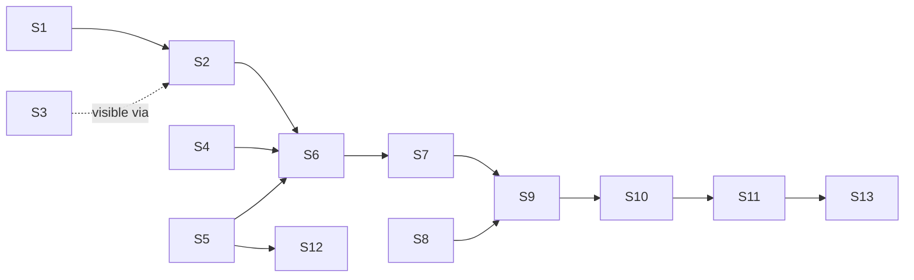

# jump-cannon Transformation Timeline — Solution C1: Transform packages as an importer decorator with a run ledger

**Date:** 2026-09-25
**Status:** Design. Nothing below is implemented; file and symbol names are proposals for an upstream change.
**Starting point:** `.specs/research/jc-timeline-2026-09-25.proposals.c.md`, Approach 1 (lines 68–80).
**Subject:** `~/Repositories/ocasazza/jump-cannon` (Rust workspace).

---

## 0. One-paragraph shape

A *transformation* is an ordinary `format_version = 3` tvix package whose `[parser]` table declares `input = "graph"`; its `expr` is a function of `{ graph, <declared variables> }` and returns the same `toGraphJSON` shape every generator returns today. In Rust the package becomes a `GraphTransform` that decorates any upstream `Importer` (`TransformedImporter`, wrapping the `Box<dyn Importer>` graph-api already constructs): the upstream produces the source graph, the chain of transforms rewrites it, and the composite is what graph-api hosts — so runs belong to the source, node identity is the source's, and every existing seam (`ArcSwap<GraphSnapshot>`, the watcher's single change driver, `/progress`, `x-graph-revision`, the Nodes/Inspector panels) carries the feature without a parallel mechanism. Each application is a **run**: a bounded record in a per-source ledger (in-memory ring of summaries + one JSONL journal, never a graph copy) served at `GET /runs`, with the in-flight run's honest progress and the next scheduled run derived from the source's existing `WatchPlan`. The UI adds a **Runs** panel (past / in-flight / upcoming as a small DAG timeline), animates the canvas *through* a run (removed fade → identity-preserving remount → added pulse; reduced-motion snaps), and replaces the near-empty node focus view with a generic **Facts** section fed by node metadata that is no longer dropped at `RawNode` and `convert_generated_graph`.

---

## 1. Analysis of the proposal

### 1.1 Core insight

The proposal's load-bearing idea is *composition by decoration*: a transform is not a new source kind, a new endpoint family, or a new persistence world — it is a function `Graph → Graph` wrapped around an existing `Importer`, so it inherits the source's identity (`source_kind:source_id:` namespace), its change driver, its progress log, its snapshot swap, and its capability posture. Everything that is genuinely new is (a) the graph-as-input binding on the tvix engine, (b) a record of each application, and (c) the UI that shows those records and the transition between them.

This is the right region of the solution space for three reasons grounded in the code:

- The tvix engine already renders `( <expr> ) { name = <literal>; … }` (`tvix.rs:358-371`) and `eval_seed` already injects a host value through a `let` binding (`lib.rs:416-418`). Adding one more host-bound name is a difference of degree, not kind.
- `rebuild_snapshot` (`watcher.rs:476-535`) already treats `Err` as "keep last snapshot" and `Unchanged` as "no swap, no events". The failure policy a transform needs (never publish a partial graph) is the policy the host already implements — the decorator only has to return the right variant.
- `GraphSnapshot::revision` and `x-graph-revision` (`state.rs:57`, `server.rs:30`) already give every published graph a process-local identity, and the browser already polls it (`main.rs:1191-1212`) and remounts on advance. A run's `output_revision` is that number.

### 1.2 Decisions inherited from C1 (kept)

| Decision | Kept as |
|---|---|
| Transform = tvix package with `input = "graph"` | §4.1 |
| Rust struct is an `Importer` decorator | `TransformedImporter`, §4.4 |
| Ledger = bounded in-memory ring + JSONL beside the packages dir | `RunLedger`, §4.6 |
| Schedule reuses `WatchPlan::Poll` | §4.7 (cron dropped; see §7) |
| Diff computed server-side, served as dense indices | `GET /runs/:id/diff`, §4.8 |
| Runs panel + canvas transition via `set_search_highlights` / `set_positions` | §4.10 |
| Fix metadata loss at `RawNode` and `convert_generated_graph`; generic Facts section | §4.3, §4.10.6 |
| `graph-iter.nix { graph }` functional library | §4.2 |

### 1.3 Gaps the proposal left open (filled here)

1. What a run does on eval error, cap overflow, or wall-clock overrun (§2.1).
2. The exact retention bound (§2.2) and what a "diff" costs.
3. What the UI shows when a run fails or empties the graph (§2.3).
4. How the decorator distinguishes "the source changed" from "the transform is due" inside `Importer::import`, which receives no tick information (§4.7).
5. How node identity survives a transform (existing ids preserved; new ids namespaced under the *source*, not under `tvix:`) so diffs, selection, and provenance are meaningful (§4.5).
6. How the injected graph reaches Nix at scale without a multi-megabyte literal in `render_expression` (§4.2.3).
7. How a remount after a run keeps layout continuity — today `mount_canvas` carries positions only when node counts are equal (`render/mod.rs:182-196`), so every run that adds one node would restart the layout from a sphere (§4.10.4).
8. Where `metrics` for the injected graph come from, given `graph_metrics::compute_all` runs *after* `Importer::import` (`vault_loader.rs:116-119`) (§4.5.1).

---

## 2. Judge feedback, item by item

### 2.1 Terminal failure path (CK-009)

Every run ends in exactly one of the `RunOutcomeKind` variants below, is written to the ledger before `import` returns, and is visible in `GET /runs` and the Runs panel. No path crashes the process, hangs the change driver, or publishes a truncated graph.

| Condition | Detected where | Outcome recorded | What is published |
|---|---|---|---|
| Input graph exceeds `JC_TRANSFORM_MAX_INPUT_NODES` (default 100 000) / `_EDGES` (default 400 000) | `GraphTransform::apply` before serialisation | `Failed { kind: InputTooLarge { nodes, edges, max_nodes, max_edges } }` | per `on_failure` (below) |
| tvix evaluation throws (type error, missing attr, `throw`, `deepSeq` surfacing a thunk error) | `tvix_wasm::eval_graph_bounded` → `eval_to_json` errors (`lib.rs:280-283`) | `Failed { kind: Eval { message } }` (message truncated to 4 KiB) | per `on_failure` |
| Result is not `{ nodes, links }` | `parse_graph_json` (`lib.rs:322-324`) | `Failed { kind: Eval }` | per `on_failure` |
| JSON text exceeds `JC_TRANSFORM_MAX_OUTPUT_BYTES` (default 256 MiB) | new check on `eval_to_json`'s `String::len()` *before* `serde_json::from_str` | `Failed { kind: OutputTooLarge }` | per `on_failure` |
| Output exceeds `min(JC_MAX_NODES, package [limits].nodes)` / edges likewise | `check_caps_against` (`lib.rs:61-78`), called with the package's `[limits]` folded in | `Failed { kind: OutputTooLarge { nodes, edges, max_nodes, max_edges } }` | per `on_failure` |
| Output is empty and the package did not declare `allow_empty = true` | projection step | `Failed { kind: EmptyOutput }` | per `on_failure` |
| Projection fails (invalid local id, upstream schema's required search field missing for a new node) | `convert_transformed_graph` | `Failed { kind: Projection { message } }` | per `on_failure` |
| Wall clock exceeds the run budget (`[parser] budget_ms`, default `JC_TRANSFORM_BUDGET_MS` = 120 000, hard cap 3 600 000) | `tokio::time::timeout(budget, spawn_blocking(eval))` in `TransformedImporter::import` | `Failed { kind: TimedOut { budget_ms } }` and the transform enters **quarantine** | per `on_failure` |
| Blocking task panics | `JoinError` arm (precedent `tvix.rs:652-659`, `server.rs:772`) | `Failed { kind: Panicked { message } }` | per `on_failure` |
| Transform is quarantined (a previous timed-out evaluation thread has not yet finished) | `RunPlan::decide` before any work | `Skipped { reason: Quarantined }` | previous snapshot untouched |

**Budget mechanism.** tvix-eval has no fuel or step limit (`lib.rs:27`), and a `spawn_blocking` task cannot be aborted. The budget is therefore a *wall-clock ceiling on waiting*, not on computing: `TransformedImporter::import` awaits `tokio::time::timeout(budget, handle)`. On `Elapsed` the `JoinHandle` is dropped (the blocking thread keeps running to completion and its result is discarded), the run is recorded `TimedOut`, and the transform's `quarantine: Arc<AtomicBool>` is set; the abandoned closure clears it as its last statement. While quarantined, later ticks record `Skipped { Quarantined }` and do no work — so at most **one** runaway evaluation thread can exist per transform at any time, and the number of transforms is bounded by the catalog (`MAX_IMPORTER_CATALOG_SOURCES` × `MAX_TRANSFORMS_PER_SOURCE` = 128 × 4). A global `tokio::sync::Semaphore` (`JC_TRANSFORM_MAX_CONCURRENT_EVALS`, default 2) bounds concurrent evaluations across sources; a tick that cannot acquire it within 0 ms records `Skipped { Overlap }`. Output-size caps are enforced *inside* the blocking closure (before the string leaves the thread), memory is bounded by `JC_TRANSFORM_MAX_OUTPUT_BYTES` on the serialized text and by the input caps on the injected text; there is no heap ceiling on intermediate thunks, and the document says so rather than pretending otherwise.

**Where enforced.** All of the above lives in `crates/importer/src/transform/apply.rs` (`GraphTransform::apply`, synchronous, run inside `spawn_blocking`) and `crates/importer/src/transform/importer.rs` (`TransformedImporter::import`, which owns the timeout, the semaphore, the quarantine flag, and the ledger write). The native `spawn_blocking` precedent is `POST /generate` (`server.rs:751-773`) and `TvixImporter::import` (`tvix.rs:642-660`).

**`on_failure` policy** (catalog binding field, default `retain`):

- `retain` — the decorator returns `Err(ImportError::Map { message })`; `rebuild_snapshot` logs "reload failed; keeping last snapshot" (`watcher.rs:491-500`) and the previous complete revision stays served. `RunRecord.published = PreviousRetained`.
- `passthrough` — the decorator returns `Loaded(upstream)` unchanged; `published = UpstreamPassthrough`.
- At boot there is no previous snapshot, so `retain` is impossible: the first run falls back to `passthrough` and the record says so (`published = UpstreamPassthrough`, `note = "no prior snapshot; passthrough applied at boot"`). This keeps `load_with_progress` at startup (`lib.rs:43`) from failing the process because of a transform.

### 2.2 Retention bound (CK-008)

The ledger keeps, per hosted source, at most **`JC_RUNS_RETAIN` (default 256) run records in memory — each a fixed-shape summary (≈ 300 B plus a failure message capped at 4 KiB, never a graph) — plus the full node-id diff for only the newest `JC_RUNS_DIFF_RETAIN` (default 8) runs, each diff capped at `JC_RUNS_DIFF_MAX_IDS` (default 200 000 ids, beyond which only counts are kept and `diff_truncated = true`), and appends each summary as one line to `<packages_dir>/runs/<source_id>.jsonl`, rotated at 4 MiB with one predecessor file kept.** Worst case per source: 256 × 4.3 KiB ≈ 1.1 MiB of records + 8 × 200 000 × ~48 B ≈ 77 MiB of diffs (a transform that touches every node of a 200k graph eight runs running) — the diff cap is the knob operators turn down for large graphs. Beyond that the decorator holds exactly **one** cached upstream `Arc<LoadResult>` (needed when the transform is due but the source is `Unchanged`, §4.7) and one `NodeLineage` map (`BTreeMap<NodeId, { first_run, last_run, last_change }>`, one entry per *current* node, entries dropped when a node is removed). There are no per-run graph copies anywhere on the server; historical graph frames exist only in the browser's `RunFrameRing` (§4.10.5), which is bounded by frame count (4) and bytes (64 MiB) and is discarded on page reload.

### 2.3 Failed / timed-out / empty-graph UI states (CK-015)

| Run outcome | Canvas | Runs panel | Graph panel overlay |
|---|---|---|---|
| `Failed { Eval / OutputTooLarge / Projection / … }`, `published = PreviousRetained` | unchanged — revision did not advance, the probe does not remount, selection/camera/positions persist | row with red `failed` badge, failure kind, first line of the message; "show details" expands the truncated message; a `retry now` button (→ `POST /runs/trigger`) | none |
| `Failed { TimedOut }` | unchanged | row `timed out after 120 s`; the transform row above the list shows a `quarantined` chip until the flag clears (polled with `/runs`) | none |
| `Failed`, `published = UpstreamPassthrough` (boot, or policy) | shows the *untransformed* source graph; the transition animation runs normally because the revision advanced | row badge `failed · passthrough` — the copy names what is on screen: "canvas shows the source without this transform" | none |
| `Skipped { Quarantined / Overlap }` | unchanged | grey `skipped` row with reason; skipped rows collapse into one "N skipped" row when consecutive | none |
| `Applied` with `output_nodes = 0` (`allow_empty = true`) | empty scene mounted; the Graph panel body shows the existing empty-graph state plus one line: "run *r* removed every node — ◀ step back" | row `applied · 0 nodes`, removed count | as left |
| In-flight | unchanged until the swap | top row `running`, `ProgressBar` with the run's stage (determinate only for inject/project/diff; eval is explicitly indeterminate with elapsed/budget text) | none (the existing `building` overlay is for source builds, not runs) |

Rule: **the previous state is retained, never blanked.** The only case the canvas changes on a non-`Applied` run is `passthrough`, which is a deliberate, recorded publication of a real graph.

### 2.4 Knowledge-map update (CK-013)

Same change as the code, in `charts/jump-cannon/knowledge/`:

- **`Importer Runtime.md`** — new section "Transformations" after "Parameterised sources": `input = "graph"`, the `transforms:` binding, schedule kinds, `on_failure`, the run ledger and its bounds, quarantine. Wikilinks: `[[Backend API]]`, `[[Import and Generate]]`, `[[Runs and Transformations]]`.
- **`Backend API.md`** — `GET /runs`, `GET /runs/:id/diff`, `POST /runs/trigger`, the `x-graph-revision` semantics of a diff, the new `NodeMeta` lineage fields on `/node/*id`.
- **`Import and Generate.md`** — one paragraph: generators and transformations are the same package model; shipped transform packages listed.
- **`Frontend.md`** — Runs panel, the transition animation and its reduced-motion variant, the `RunFrameRing`, the Facts section.
- **`Nodes Search and Documents.md`** — the Facts section replaces the "source identity, path, content state" description of the focus view; lineage rows.
- **`Runs and Transformations.md`** (new, `doctype: guide`, `area: data`, `audience: [user, developer, operator]`) — the user-facing guide: authoring a transform, binding it, reading the Runs panel, what failed/skipped/quarantined mean, how to write `graph-iter.nix` code in O(n). Linked from `[[Start Here]]` and `[[Import and Generate]]`.
- **`Start Here.md`** — add `[[Runs and Transformations]]` to the data section so the new note is reachable (rule in `Maintaining This Map.md:11-13`).
- **`Troubleshooting.md`** — entries for `timed out` / `quarantined` / `InputTooLarge` with the env knobs.
- **`Helm Deployment.md`** — the `transforms:` block in `importers.sources[*]` and the env knobs' `values.yaml` keys.

### 2.5 panel-kit loading (CK-006)

- Runs panel: `let store = loading_store("runs", "loading runs…");` `store.begin()` before the first `GET /runs`, `store.succeed()` on the first successful payload, `store.fail(message)` on error; later polls update signals silently (the `history.rs:21-65` pattern). Body gated with `LoadingGate { store, … }`; the top bar's `GlobalLoadingBar` aggregates it.
- Run diff fetch (on selecting a run): `loading_store("run-diff", "loading run diff…")` around `GET /runs/:id/diff`; the highlight is applied on `succeed`.
- In-flight run progress inside the panel: `panel_kit::loading::ProgressBar { fraction, label, detail }` fed from `/runs.in_flight.stage` — `fraction: Some(f)` only when the server reported one, otherwise `None`. No hand-rolled `loaded` signal, no bare `Spinner`.
- Facts section: no new store — it renders from `ctx.meta` behind the existing `meta_busy` skeleton; the skeleton itself is changed from `Spinner` to `ProgressBar { fraction: None, label: "loading node…" }` in `focused_node` (`nodes.rs:753-754`) to comply with the rule at `AGENTS.md:200`.

### 2.6 Scheduling semantics (D5)

Fully specified in §4.7. Summary: a binding's `schedule` is `with_source` (default: run whenever the upstream publishes a fresh graph) or `every: <ms>` (additionally run on an interval even if the source is `Unchanged`). No new tokio task per transform: the composite importer *derives* one `WatchPlan` from the upstream plan and the schedule, and the watcher's existing single driver (`spawn_poll`, the debounced filesystem watcher with its periodic rescan, `spawn_push`) ticks it; `TransformedImporter::import` decides on each tick what is due. Missed intervals **coalesce** (tokio `MissedTickBehavior::Skip`, `watcher.rs:283`; one late tick → one run, never a replay). Self-overlap is **impossible by construction** for driver-initiated runs (one sequential driver per source; `RescanGate::SkipInFlight` for gated alternates) and **refused** for the only concurrent entry, `POST /runs/trigger` (409 while a run holds the source's `run_slot`). `JUMP_CANNON_IMPORTER_POLL_INTERVAL_MS` stays the upstream poll period; the composite period is `gcd(upstream_ms, every_ms)` clamped to ≥ 100 ms by `spawn_poll`.

### 2.7 Phase list (D7)

§5: five phases, each landing on an existing seam with user-visible value, each with acceptance and kill criteria.

### 2.8 Reduced motion (CK-004)

A new `app/ui/src/motion.rs` exposes `motion::reduced() -> bool`, read once from `window.matchMedia("(prefers-reduced-motion: reduce)")` via `web_sys::Window::match_media` and refreshed on the query's `change` event into a `GlobalSignal<bool>`. Under reduced motion: the removed-node fade (400 ms) and the added-node pulse (1.2 s) become an immediate swap with a *static* highlight that persists until the user clears it (`Esc` or clicking "clear"); the in-flight pulse dot in the Runs DAG is replaced by a static ring; the current-frame marker jumps instead of sliding; new nodes are placed at their neighbour centroid with no ease. All panel animations are declared in `app.css` under the existing `@media (prefers-reduced-motion: reduce)` block (`app.css:62-64`) as `animation: none; transition: none;`.

### 2.9 Honest progress (CK-005)

Stages emitted through `ImportProgress` (so they flow to `/progress` and to the `in_flight.stage` field of `/runs`):

| Stage | `fraction` | `detail` |
|---|---|---|
| `Injecting graph` | `Some(serialised_nodes / total_nodes)` | `"48 000 / 96 000 nodes, 12.4 MB"` |
| `Evaluating <package>` | `None` — tvix has no progress hook | `"elapsed 12 s · budget 120 s"` (elapsed is measured; the ratio is a time budget, labelled as such, never shown as a completion percentage) |
| `Projecting graph` | `Some(projected / output_nodes)` | node counts |
| `Diffing against r<input_revision>` | `Some(compared / max(input, output))` | counts |

The UI's `ProgressBar` shows the percentage when `fraction` is `Some` and the explicit indeterminate bar otherwise.

### 2.10 Nix-side composition (CK-010)

Both new library files take the graph library as an explicit parameter and never import across a second level: `graph-iter.nix` is `{ graph }: let inherit (graph) emptyGraph toNodeList toEdgeList …; in { … }`, `transform.nix` is `{ graph }: …` and re-exports nothing from `graph-combinators.nix` (a package that wants both imports both, each with `{ graph = lib; }`). Neither file uses `birds.nix` or the `Y` combinator; recursion needed by `iterate`/`fixpoint` is written with an explicit `let go = …; in go` inside the same file (the `graph-combinators.nix:25-26` workaround). The package convention documented for authors is `{ graph, … }: let lib = import /jc/src/graph.nix {}; iter = import /jc/src/graph-iter.nix { graph = lib; }; in …` — data is `graph`, the library is `lib`, so the two never shadow.

### 2.11 No eval-time filesystem or network (CK-014)

Evaluation stays the pure `Evaluation::builder(io).enable_import()` build (`lib.rs:273-276`): no impure builtins, no `readFile`, no `getEnv`, no `currentTime`. Every external value is a **declared, typed input bound by the host before evaluation**: the graph arrives as the declared `input = "graph"` (served as an in-memory VFS *overlay file* `/jc/input/graph.nix` that is part of the evaluation request, not a filesystem read — §4.2.3), and wall-clock or revision values arrive as declared variables with a `host` binding (`host = "now_ms" | "input_revision" | "run_seq"`, §4.1) that the host renders as ordinary literals into `( <expr> ) { … }`. A package cannot ask for anything the manifest did not declare; `deny_unknown_fields` on `TvixParserToml` (`tvix.rs:149`) rejects any other key.

### 2.12 Pure graph vocabulary (CK-002)

Shared core types, endpoints, panels, and Nix files use only: transform, run, schedule, trigger, source, revision, node, edge, metadata, diff, added/removed/changed, lineage, budget, quarantine. Grep-checked terms that must not appear in `crates/{importer,data-loader,graph-api,tvix-wasm}`, `app/ui/src/{api.rs,panels/runs.rs,facts.rs}`, or `proto/graph.proto` for this feature: `session`, `agent`, `tool call`, `goal`, `omp`, any local filesystem path. The only package that names a specific projection remains `omp-auto-loop.toml` (a pest package), untouched by this change; the shipped transform packages (§4.1.3) are `transform-label-depth`, `transform-contract-edges`, `transform-attach-orphans`, each meaningful for a vault, a Kubernetes graph, an httpjson graph, and a generated graph.

---

## 3. Subproblems and dependencies

| Id | Subproblem | Owner file(s) | Depends on |
|---|---|---|---|
| S1 | Metadata fidelity on the wire (`RawNode` keeps `metadata`; `to_graph_json` round-trips it) | `crates/tvix-wasm/src/lib.rs` | — |
| S2 | `convert_generated_graph` maps metadata → `frontmatter`/`title`/`tags` | `crates/importer/src/tvix.rs` | S1 |
| S3 | Facts section in the node focus view; shared helpers moved out of `inspector.rs` | `app/ui/src/facts.rs`, `panels/nodes.rs`, `panels/inspector.rs` | — (S2 makes it *visible* for tvix graphs) |
| S4 | Bounded evaluation request: VFS overlay, output-byte cap, package limits folded into caps | `crates/tvix-wasm/src/lib.rs` | — |
| S5 | Package model: `input = "graph"`, `host` variable bindings, `budget_ms`, `allow_empty`, `input_metadata` | `crates/importer/src/tvix.rs` | — |
| S6 | Injection projection `VaultGraph → /jc/input/graph.nix` and output projection back with identity rules | `crates/importer/src/transform/{inject.rs,project.rs}` | S1, S2, S4, S5 |
| S7 | `GraphDiff` + `NodeLineage` | `crates/importer/src/transform/diff.rs` | S6 |
| S8 | `RunLedger`, `RunRecord`, JSONL journal | `crates/importer/src/transform/ledger.rs` | — |
| S9 | `GraphTransform::apply`, `TransformedImporter`, `RunPlan`, quarantine, semaphore | `crates/importer/src/transform/{apply.rs,importer.rs,schedule.rs}` | S6, S7, S8 |
| S10 | Catalog binding `transforms:` + validation; construction in `main.rs`/`source_host.rs`; `TransformHost` on `AppState`; watcher glue | `crates/graph-api/src/{importer_catalog.rs,main.rs,source_host.rs,state.rs,watcher.rs}` | S9 |
| S11 | Endpoints `/runs`, `/runs/:id/diff`, `/runs/trigger`; `/node/*id` lineage; proto | `crates/graph-api/src/server.rs`, `proto/graph.proto` | S10 |
| S12 | `graph-iter.nix`, `transform.nix`, shipped transform packages, contract tests | `crates/tvix-wasm/src/nix/`, `charts/jump-cannon/packages/` | S4, S5 |
| S13 | UI: `api.rs` types, Runs panel, `motion.rs`, transition animation, identity-preserving remount, `RunFrameRing` | `app/ui/src/{api.rs,motion.rs,panels/runs.rs,graph_canvas.rs,main.rs,render/mod.rs}` | S11 |
| S14 | Knowledge notes | `charts/jump-cannon/knowledge/` | each phase |



---

## 4. The solution

### 4.1 Package manifest shape

A transform is a tvix package. New `[parser]` keys (all rejected on any other engine by the existing `deny_unknown_fields`):

```toml
# charts/jump-cannon/packages/transform-label-depth.toml
format_version = 3

[metadata]
id = "transform.label-depth"
name = "Label nodes with path depth"
version = "1.0.0"
description = "Adds `depth` (number of `/` segments in the node path) to every node's metadata and tags nodes deeper than `max_depth` with `deep`."

[limits]
nodes = 200000          # output cap folded into check_caps_against (min with JC_MAX_NODES)
edges = 800000

[parser]
engine = "tvix"
input = "graph"          # NEW: "none" (default, generator) | "graph" (transformation)
input_metadata = "full"  # NEW: "full" (identity + metadata + degree metrics) | "identity" (id + type only)
budget_ms = 120000       # NEW: wall-clock ceiling per run; default JC_TRANSFORM_BUDGET_MS
allow_empty = false      # NEW: an empty output is a Failed{EmptyOutput} unless true
expr = '''
{ graph, max_depth, now_ms }:
let
  lib  = import /jc/src/graph.nix { };
  iter = import /jc/src/graph-iter.nix { graph = lib; };
  depthOf = path: builtins.length (builtins.filter builtins.isString (builtins.split "/" path));
  label = n:
    let d = depthOf (n.metadata.path or n.id);
    in n // {
      metadata = n.metadata // { depth = d; labelled_at_ms = now_ms; };
      type = if d > max_depth then "deep" else n.type;
    };
in
  lib.toGraphJSON (iter.mapNodes label graph)
'''

[[parser.variables]]
name = "max_depth"
type = "integer"
default = "3"
min = 0
max = 64
description = "Nodes with more path segments than this receive the `deep` type."

[[parser.variables]]
name = "now_ms"
type = "integer"
host = "now_ms"          # NEW: value supplied by the host at run time, never at eval time
description = "Run start time (ms since epoch), bound by the host."
```

Rust-side manifest additions (`crates/importer/src/tvix.rs`):

```rust
pub(crate) struct TvixParserToml {
    pub engine: String,
    pub expr: String,
    #[serde(default)] pub variables: Vec<TvixVariableToml>,
    #[serde(default = "default_input")] pub input: String,           // "none" | "graph"
    #[serde(default = "default_input_metadata")] pub input_metadata: String, // "full" | "identity"
    #[serde(default)] pub budget_ms: Option<u64>,
    #[serde(default)] pub allow_empty: bool,
}

pub(crate) struct TvixVariableToml { /* existing */ #[serde(default)] pub host: Option<String> }

#[derive(Debug, Clone, Copy, PartialEq, Eq)]
pub enum TvixInput { None, Graph }

#[derive(Debug, Clone, Copy, PartialEq, Eq)]
pub enum InputMetadata { Full, Identity }

#[derive(Debug, Clone, Copy, PartialEq, Eq)]
pub enum HostBinding { NowMs, InputRevision, RunSeq }   // rendered as integer literals

pub struct TvixVariable { /* existing */ pub host: Option<HostBinding> }

pub struct TvixEngineConfig {
    pub expr: String,
    pub variables: Vec<TvixVariable>,
    pub input: TvixInput,
    pub input_metadata: InputMetadata,
    pub budget_ms: Option<u64>,
    pub allow_empty: bool,
}
```

Validation rules added to `validate_config`: a `host`-bound variable must be `type = "integer"`, may not carry `default`/`min`/`max`, may not be supplied by the administrator (`resolve_variables` rejects it as "host-bound"); `host` bindings are permitted only when `input = "graph"` (a generator has no run); `budget_ms` is 1 000..=3 600 000; the reserved name `graph` may not be declared as a variable. `render_expression` is unchanged for generators; for transforms `render_transform_expression(config, resolved, host_values)` renders `( <expr> ) { graph = graph; name = <literal>; … }` and the wrapper binds `graph` (§4.2.3).

`validate_package_schema` (`tvix.rs:293-307`) still rejects a `[schema]` body for tvix packages in this change — a transform's output rides on the *upstream's* schema (§4.5.2), so there is nothing for it to declare.

#### 4.1.1 Catalog binding

`ImporterSourceDefinition` (`importer_catalog.rs:173-194`) gains:

```rust
#[serde(default, skip_serializing_if = "Vec::is_empty")]
pub transforms: Vec<ImporterTransformBinding>,

#[derive(Debug, Clone, PartialEq, Eq, Serialize, Deserialize)]
#[serde(rename_all = "camelCase", deny_unknown_fields)]
pub struct ImporterTransformBinding {
    pub package: String,                                  // filename under packages_dir (same bounds as tvix.package)
    #[serde(default)] pub variables: BTreeMap<String, String>,
    #[serde(default)] pub schedule: TransformSchedule,    // WithSource | Every { ms }
    #[serde(default)] pub on_failure: OnFailure,          // Retain | Passthrough
}

#[derive(Debug, Clone, Copy, PartialEq, Eq, Serialize, Deserialize, Default)]
#[serde(rename_all = "snake_case", tag = "kind")]
pub enum TransformSchedule { #[default] WithSource, Every { ms: u64 } }

#[derive(Debug, Clone, Copy, PartialEq, Eq, Serialize, Deserialize, Default)]
#[serde(rename_all = "snake_case")]
pub enum OnFailure { #[default] Retain, Passthrough }
```

`validate_source` adds: ≤ `MAX_TRANSFORMS_PER_SOURCE` (4) bindings; `Every.ms` in 1 000..=`MAX_POLL_INTERVAL_MS`; `Every` rejected when the source kind's upstream plan is `Push` (message names the reason); package filename bounded like `tvix.package`. `runnable()` is unchanged — a transform never makes an un-runnable source runnable. Helm: `importers.sources[*].transforms` maps 1:1; a runtime overlay entry (`catalog.local.json`) may carry the same key.

#### 4.1.2 Deployment default

The rollout-selected default source is built in `graph-api/src/main.rs` around line 460 today; the same `transforms` list from the selected catalog entry is applied there through one helper shared with `source_host::build_alternate`: `importer::transform::wrap_with_transforms(importer: Box<dyn Importer>, bindings, packages_dir, ledger, plan_clock) -> Result<Box<dyn Importer>, ImportError>`. No new `--flag`; the catalog is the binding.

#### 4.1.3 Shipped transform packages (all source-neutral)

- `transform-label-depth.toml` — above.
- `transform-contract-edges.toml` — `{ graph, edge_type }:` contracts every edge whose metadata `type` (or endpoint node `type` pattern) matches, merging target into source (uses `graph-combinators.nix`'s `contractRule` semantics rewritten O(e) in `graph-iter.nix`). Meaningful on Kubernetes owner chains, OKF relationship bundles, and generated cluster graphs.
- `transform-attach-orphans.toml` — `{ graph, hub_id, hub_type }:` adds one hub node and an edge from every degree-0 node (degree comes from injected `metadata.degree`). Meaningful on a vault ("inbox"), an API graph, a generated random graph.

Each gets a parametrised case in `crates/importer/tests/packages.rs` (rstest, like the httpjson packages: a fixture input graph → expected added/removed/changed counts), and a tvix-wasm evaluation test alongside `all_demos_evaluate`.

### 4.2 Nix-side module layout

```
crates/tvix-wasm/src/nix/
  birds.nix              (unchanged)
  graph.nix              (unchanged public API; one addition: `mkNode`, `mkEdge`, `addNodes`, `addEdges` batch helpers, O(k) for k additions via one `//` of a listToAttrs)
  graph-combinators.nix  (unchanged)
  seed.nix               (unchanged)
  graph-iter.nix         (NEW)  { graph }: functional library over attrset graphs
  transform.nix          (NEW)  { graph }: transform-shaped helpers and the contract doc
/jc/input/graph.nix      (per-evaluation VFS overlay, host-written, never embedded)
```

#### 4.2.1 `graph-iter.nix { graph }`

All node/edge traversals are one `attrValues` → list op → one `listToAttrs`; nothing folds `addNode` (the soupGen lesson, `graph-combinators.nix:112-116`).

```nix
{ graph }:
let
  inherit (graph) emptyGraph toNodeList toEdgeList;
  entries = f: xs: builtins.listToAttrs (builtins.map (x: let y = f x; in { name = y.id; value = y; }) xs);
in rec {
  # node-level
  mapNodes     = f: g: g // { nodes = entries f (toNodeList g); };
  filterNodes  = p: g: pruneDangling (g // { nodes = entries (x: x) (builtins.filter p (toNodeList g)); });
  foldNodes    = f: z: g: builtins.foldl' f z (toNodeList g);
  # edge-level
  mapEdges     = f: g: g // { edges = entries f (toEdgeList g); };
  filterEdges  = p: g: g // { edges = entries (x: x) (builtins.filter p (toEdgeList g)); };
  foldEdges    = f: z: g: builtins.foldl' f z (toEdgeList g);
  # combined
  pruneDangling = g: filterEdges (e: g.nodes ? ${e.source} && g.nodes ? ${e.target}) g;
  groupBy      = key: g: builtins.groupBy key (toNodeList g);                 # { <key> = [node]; }
  degrees      = g: builtins.foldl' (acc: e: acc // { ${e.source} = (acc.${e.source} or 0) + 1;
                                                     ${e.target} = (acc.${e.target} or 0) + 1; }) { } (toEdgeList g);
  withMetadata = extra: n: n // { metadata = n.metadata // extra; };
  addNodes     = ns: g: g // { nodes = g.nodes // entries (x: x) ns; };
  addEdges     = es: g: g // { edges = g.edges // entries (x: x) es; };
  removeNodes  = ids: g: pruneDangling (g // { nodes = builtins.removeAttrs g.nodes ids; });
  pipe         = fs: x: builtins.foldl' (acc: f: f acc) x fs;
  iterate      = n: f: x: let go = i: y: if i == 0 then y else go (i - 1) (f y); in go n x;   # bounded, no Y
  contractEdges = p: g: /* O(e): one pass building a redirect map, one mapEdges, one removeNodes */ …;
}
```

Note `degrees` is O(e) but does attrset merges per edge; it exists for convenience on small graphs — the host already injects `metadata.degree/indegree/outdegree` when `input_metadata = "full"`, and the doc for authors says to prefer those.

#### 4.2.2 `transform.nix { graph }`

Documents the contract in its header (the `seed.nix` style) and provides: `identity = graph: graph`, `compose = fs: pipe fs`, `mkNode = id: type: metadata: { inherit id type metadata; }`, `mkEdge = id: source: target: metadata: { inherit id source target metadata; directed = true; }`, `finish = lib.toGraphJSON` (so a package's last line reads `tr.finish (…)`).

Contract (also the header comment):

```
transform : { graph, <variables> } -> toGraphJSON graph
  graph.nodes.<id> = { id; type; metadata = { title; tags; path; folder; doctype; source_id;
                                              degree; indegree; outdegree; <frontmatter keys…> }; }
  graph.edges.<id> = { id; source; target; directed; metadata = { }; }
Node ids are the SOURCE's full ids. Keep an id to keep the node; drop it to remove the node;
emit a new id (no ':' namespace) to create a node under the source's namespace.
```

#### 4.2.3 Injection: the VFS overlay

`render_expression`'s string stays O(bindings). The graph is served through the in-memory `EvalIO`: `GraphNixIO` gains an `overlay: HashMap<PathBuf, String>` consulted before the embedded files. The evaluation wrapper for a transform becomes

```
let graph = import /jc/input/graph.nix; in
let __r = ( ( <expr> ) { inherit graph; max_depth = 3; now_ms = 1758758400000; } ); in
builtins.deepSeq __r (builtins.toJSON __r)
```

and `/jc/input/graph.nix` contains `builtins.fromJSON ''<json>''` with `''` and `${` escaped (`'''`, `''${`). `fromJSON` and `import` are both available in the pure build (`import` via `.enable_import()`, `lib.rs:275`). The JSON is produced by `transform::inject::write_input_nix(&LoadResult, &InputOptions, &dyn InputEnricher, progress) -> Result<String, RunFailure>` in one streaming pass with a `String` pre-sized from node/edge counts; it emits the attrset-shaped graph (`{"nodes":{"<id>":{…}},"edges":{"<id>":{…}}}`), not the `toGraphJSON` list shape, so the expression indexes nodes in O(1) exactly as `graph.nix` expects. Only metadata is injected — never a node body.

### 4.3 tvix-wasm changes

```rust
/// One bounded evaluation. `inputs` are VFS overlay files (`/jc/input/*.nix`).
pub struct EvalRequest<'a> {
    pub expr: &'a str,
    pub inputs: &'a [(PathBuf, String)],
    pub caps: EvalCaps,
}
#[derive(Clone, Copy)]
pub struct EvalCaps { pub max_nodes: usize, pub max_edges: usize, pub max_json_bytes: usize }
impl EvalCaps { pub fn from_env() -> Self /* JC_MAX_NODES / JC_MAX_EDGES / JC_TRANSFORM_MAX_OUTPUT_BYTES */ ; pub fn min_with(self, nodes: Option<usize>, edges: Option<usize>) -> Self }

pub fn eval_graph_bounded(req: EvalRequest<'_>) -> Result<GeneratedGraph, EvalFailure>;

pub enum EvalFailure { Eval(String), OutputTooLarge { nodes: usize, edges: usize, max_nodes: usize, max_edges: usize }, JsonTooLarge { bytes: usize, max_bytes: usize } }

/// Metadata now survives the wire.
pub struct GenNode { pub id: String, pub kind: Option<String>, pub metadata: serde_json::Map<String, serde_json::Value> }
pub struct GenEdge { pub source: String, pub target: String, pub metadata: serde_json::Map<String, serde_json::Value> }
#[derive(Serialize, Deserialize)]
struct RawNode { id: String, #[serde(rename = "type", skip_serializing_if = "Option::is_none")] kind: Option<String>, #[serde(flatten)] metadata: serde_json::Map<String, serde_json::Value> }
```

`eval_graph(expr)` remains as `eval_graph_bounded(EvalRequest { expr, inputs: &[], caps: EvalCaps::from_env() })` mapped to `String` so the browser Generate panel and `POST /generate` are untouched; `check_caps_against` is called with the request's caps instead of `max_nodes()/max_edges()`. `to_graph_json` serialises the flattened metadata back, so the server-side generate response and the client's `parse_graph_json` round-trip it (the client conversion ignores keys it does not use — today's behaviour).

### 4.4 `crates/importer/src/transform/` — Rust types

```rust
// mod.rs — public surface (feature = "native")
pub use ledger::{RunLedger, RunRecord, RunId, RunOutcomeKind, RunFailure, Published, RunTrigger, RunStats, LedgerBounds};
pub use schedule::{RunPlan, RunPlanStatus, Upcoming, Trigger};
pub use diff::{GraphDiff, NodeChange, NodeLineage};
pub use importer::{TransformedImporter, TransformHost, InputEnricher, wrap_with_transforms};

// apply.rs
pub struct GraphTransform {
    pub id: TransformId,                 // { package_id, version, index_in_chain }
    spec: TransformSpec,
}
pub struct TransformSpec {
    pub expr: String,                    // rendered callable expression minus host values
    pub host_bindings: Vec<(String, HostBinding)>,
    pub input_metadata: InputMetadata,
    pub input_caps: InputCaps,           // JC_TRANSFORM_MAX_INPUT_NODES / _EDGES
    pub eval_caps: EvalCaps,             // env ∧ package [limits]
    pub budget: Duration,
    pub allow_empty: bool,
    pub on_failure: OnFailure,
    pub config_hash: u64,                // hash(package text, resolved variables) — in every RunRecord
}
pub struct RunContext { pub run_id: RunId, pub seq: u64, pub started_ms: u64, pub input_revision: u64 }
pub enum ApplyOutcome {
    Applied { graph: LoadResult, diff: GraphDiff, stats: RunStats },
    Unchanged { stats: RunStats },       // diff empty
    Failed { failure: RunFailure, stats: RunStats },
}
impl GraphTransform {
    /// Synchronous and CPU-bound; the caller runs it under spawn_blocking with a timeout.
    pub fn apply(&self, input: &LoadResult, upstream_ns: &Namespace, schema: &ImporterSchema,
                 enricher: &dyn InputEnricher, ctx: &RunContext, progress: &dyn ImportProgress) -> ApplyOutcome;
}

// diff.rs
pub struct GraphDiff {
    pub added_nodes: Vec<String>, pub removed_nodes: Vec<String>, pub changed_nodes: Vec<String>,
    pub added_edges: u64, pub removed_edges: u64,
    pub truncated: bool,                 // ids dropped beyond JC_RUNS_DIFF_MAX_IDS; counts stay exact
}
#[derive(Clone, Copy)] pub enum NodeChange { Added, Changed }
pub struct NodeLineage { pub first_run: RunId, pub last_run: RunId, pub last_change: NodeChange }

// ledger.rs
pub type RunId = String;                 // "{started_ms}-{seq}" — unique per process, sortable
pub struct RunRecord {
    pub id: RunId,
    pub transform: TransformId,
    pub config_hash: u64,
    pub trigger: RunTrigger,             // Boot | SourceChange | Interval | Manual
    pub started_ms: u64, pub finished_ms: Option<u64>,
    pub input_revision: u64, pub output_revision: Option<u64>,
    pub outcome: RunOutcomeKind,
    pub published: Published,            // Transformed | PreviousRetained | UpstreamPassthrough | NotYet
    pub stats: RunStats,
    pub diff_available: bool,
    pub note: Option<String>,
}
pub enum RunOutcomeKind {
    Running { stage: String, fraction: Option<f32>, detail: String },
    Applied { added_nodes: u64, removed_nodes: u64, changed_nodes: u64, added_edges: u64, removed_edges: u64 },
    Unchanged,
    Failed { kind: RunFailure, message: String },
    Skipped { reason: SkipReason },      // Quarantined | Overlap
}
pub enum RunFailure { InputTooLarge {..}, Eval, OutputTooLarge {..}, JsonTooLarge {..}, EmptyOutput, Projection, TimedOut { budget_ms: u64 }, Panicked }
pub struct RunStats { pub input_nodes: u64, pub input_edges: u64, pub output_nodes: u64, pub output_edges: u64,
                      pub inject_ms: u32, pub eval_ms: u32, pub project_ms: u32, pub diff_ms: u32, pub input_bytes: u64, pub output_bytes: u64 }
pub struct LedgerBounds { pub records: usize, pub diffs: usize, pub diff_max_ids: usize, pub journal_rotate_bytes: u64 }
pub struct RunLedger {
    bounds: LedgerBounds,
    inner: Mutex<LedgerInner>,           // VecDeque<RunRecord>, VecDeque<(RunId, Arc<GraphDiff>)>, Option<RunRecord> in_flight, u64 seq
    journal: Option<Mutex<Journal>>,     // <packages_dir>/runs/<source_id>.jsonl (+ .1)
    lineage: RwLock<BTreeMap<String, NodeLineage>>,
}
impl RunLedger {
    pub fn open(source_id: &str, packages_dir: Option<&Path>, bounds: LedgerBounds) -> Self;   // replays the tail of the journal
    pub fn begin(&self, record: RunRecord) -> RunGuard;    // in-flight; RunGuard::finish(outcome, diff) writes + journals
    pub fn records(&self, limit: usize) -> Vec<RunRecord>;
    pub fn in_flight(&self) -> Option<RunRecord>;
    pub fn diff(&self, id: &RunId) -> Option<Arc<GraphDiff>>;
    pub fn lineage(&self, node_id: &str) -> Option<NodeLineage>;
    pub fn update_stage(&self, stage: &str, fraction: Option<f32>, detail: &str);
}

// importer.rs
pub trait InputEnricher: Send + Sync { fn metrics(&self, node_id: &str) -> Option<NodeMetrics>; }
pub struct TransformHost {                 // one per hosted source; shared Arc between the importer and AppState
    pub ledger: Arc<RunLedger>,
    pub plan: Arc<RunPlan>,
    pub run_slot: tokio::sync::Mutex<()>,  // manual trigger vs driver
    pub quarantine: Vec<Arc<AtomicBool>>,  // per transform
    enricher: RwLock<Option<Arc<dyn InputEnricher>>>,
    pub evals: Arc<tokio::sync::Semaphore>,// global, JC_TRANSFORM_MAX_CONCURRENT_EVALS
}
pub struct TransformedImporter {
    upstream: Box<dyn Importer>,
    chain: Vec<GraphTransform>,
    host: Arc<TransformHost>,
    last_upstream: Mutex<Option<Arc<LoadResult>>>,   // the ONE cached input
    last_upstream_at: Mutex<Option<Instant>>,
    descriptor: ImporterDescriptor,                  // upstream's, with derived WatchPlan + one InMemory read capability per transform
}
impl Importer for TransformedImporter { fn descriptor(&self) -> ImporterDescriptor; fn import(...) ; fn read_body(&self, path) -> Option<String> { self.upstream.read_body(path) } }
pub fn wrap_with_transforms(upstream: Box<dyn Importer>, bindings: &[ImporterTransformBinding], packages_dir: &Path, source_id: &str, bounds: LedgerBounds, evals: Arc<Semaphore>) -> Result<(Box<dyn Importer>, Arc<TransformHost>), ImportError>;
```

`TransformedImporter::import` (the run loop, per tick):

1. `decision = host.plan.decide(now, last_upstream_at)` → `{ upstream_due: bool, transforms_due: Vec<usize>, trigger }`.
2. If `upstream_due` (always true for `with_source` on a source-driven tick, and on boot): `upstream.import(progress)`. `Loaded(l)` → cache `Arc::new(l)`, mark all transforms due with `trigger = SourceChange`. `Unchanged` → keep the cache. `Err(e)` → return `Err(e)` (upstream failure is the upstream's failure; no run is recorded).
3. If nothing is due → return `Ok(Unchanged)`.
4. For each due transform in chain order: acquire `evals` (else `Skipped{Overlap}`), check quarantine (else `Skipped{Quarantined}`), `ledger.begin(record)`, then `tokio::time::timeout(budget, spawn_blocking(move || transform.apply(...)))`. Map `Ok(Ok(outcome)) / Ok(Err(join)) / Err(elapsed)` to the ledger outcome. The output of transform *i* is the input of *i+1*; a failed transform ends the chain for this tick.
5. `Applied` → `ledger` gets `output_revision` filled in *after* the swap: the decorator cannot see `GraphSnapshot::revision`, so graph-api's `rebuild_snapshot` calls `state.inner.transforms.as_ref().map(|h| h.ledger.set_output_revision(run_ids, snapshot.revision))` right after `state.inner.snapshot.store(snapshot)` (`watcher.rs:528`). Return `Ok(Loaded(output))`.
6. `Failed` → per `on_failure` (§2.1). `Unchanged` (empty diff) → `Ok(Unchanged)` if the upstream was also unchanged, else `Ok(Loaded(output))`.

### 4.5 Identity, injection, and projection

#### 4.5.1 Injection (`VaultGraph → graph.nix`)

For each upstream node: `id` = the full node id (`obsidian:vault:Notes/foo`), `type` = `meta.doctype` if present else the first tag else `"node"`, `metadata` = `{ title, tags, path, folder, doctype, source_id, content_readable }` ∪ `meta.frontmatter` (frontmatter keys never overwrite the reserved keys; a colliding frontmatter key is emitted under `fm_<key>`) ∪ `{ degree, indegree, outdegree }` computed in the injection pass (O(e)) ∪ `{ pagerank, community, kcore, wcc, betweenness }` from `InputEnricher::metrics(id)` when available (`identity` mode injects `id` and `type` only). graph-api's enricher reads the *currently served* snapshot's `NodeMetrics` (`SnapshotEnricher(Weak<AppStateInner>)`, attached after `AppState` construction); on the boot run there is no snapshot, so the heavy metrics are absent and the doc says so — degree-family metrics are always present. Edges: `id = "<source>\u{1}<target>"` (the `VaultEdge` has no id), `directed = true`, `metadata = {}`.

#### 4.5.2 Projection (`GeneratedGraph → LoadResult`) and identity rules

`transform::project::convert_transformed_graph(generated, input: &LoadResult, upstream_ns, schema, ctx) -> Result<(LoadResult, GraphDiff), RunFailure>`:

- **Existing id** (present in `input.graph.nodes`): the node is *kept*. `NodeMeta` = upstream's, with `frontmatter` overlaid by the output metadata (reserved keys `title/tags/doctype/folder/path` update their typed fields instead; `source_id`, `content_*`, `mtime` are never overwritten by a transform), `tags` = output `type` ∪ output `metadata.tags` (string array) if present, else upstream tags with the output `type` prepended when it differs from the upstream doctype. The upstream `SearchDocument` is reused with `title`/`tags` rewritten so the "core identity must match the canonical node" rule (`Importer Runtime.md:54`) holds.
- **New id** (not in input): namespaced as `upstream_ns.node_id(local)` — under the *source's* namespace, never `tvix:`, so `ImporterSchema.source_kind` stays satisfied. `NodeMeta { source_id: upstream source_id, title: metadata.title or local, tags: [type] ∪ metadata.tags, frontmatter: metadata minus reserved keys, doctype: metadata.doctype or type, path: local, content_readable: false }`. Its `SearchDocument` carries `id/title/tags` plus any other schema-declared field whose key appears in the output metadata with a valid value; a schema-`required` field with no default and no value is a `Projection` failure naming the field.
- **Absent id**: removed, with all incident edges.
- **Edges**: the output edge set is authoritative; endpoints must resolve (an edge to an unknown id is dropped and counted in `stats`, mirroring `convert_generated_graph:556`).
- **Diff**: `added` = new ids, `removed` = input ids absent from output, `changed` = kept ids whose `title`, `tags`, `doctype`, `folder`, or `frontmatter` differ (metrics excluded — they are recomputed downstream). Edge counts from set differences on `(source, target)`.
- **Lineage**: `ledger.lineage` is updated in the same pass: added → `{ first_run: id, last_run: id, Added }`, changed → `last_run/last_change`, removed → entry dropped.

The whole transform's output is projected before anything is published — a projection failure discards the output (`Failed { Projection }`), never a half-merged graph.

#### 4.5.3 `convert_generated_graph` (generators, S2)

The same metadata mapping applies to plain generators: `frontmatter = node.metadata` (minus reserved keys mapped to `title/tags/doctype`), `path = node.id`, `doctype = metadata.doctype or "generated"`. Search documents keep the fixed tvix schema (`tvix_schema()`), so no schema change is needed for metadata to appear in the node view.

### 4.6 Storage layout and retention

```
<JUMP_CANNON_IMPORTER_PACKAGES_DIR>/
  catalog.local.json          (existing overlay)
  variables.local.json        (existing overlay)
  runs/
    <source_id>.jsonl         one RunRecord per line, newest last; rotated at 4 MiB → <source_id>.jsonl.1 (one kept)
```

- The journal holds **summaries only** (`RunRecord` as JSON, `diff_available` forced to `false` on replay since diffs are memory-only). Boot replays the newest `bounds.records` lines so the Runs panel shows history across restarts.
- With no packages dir (bare `graph-api --source …`), the ledger is memory-only and `GET /runs.persistence = "memory"` says so.
- Bounds are one sentence (§2.2); the numbers are env-tunable (`JC_RUNS_RETAIN`, `JC_RUNS_DIFF_RETAIN`, `JC_RUNS_DIFF_MAX_IDS`) and surfaced in `/runs.retain` so the UI can say "showing the last 256 runs; diffs kept for the last 8".
- Per-source alternates (`SourceHost`) own their `TransformHost` inside their `AppState`; eviction of an alternate drops the ring and lineage, the journal stays.

### 4.7 Scheduling semantics

**Plan derivation** (`schedule::RunPlan::derive(upstream: &WatchPlan, bindings) -> (WatchPlan, RunPlan)`):

| Upstream plan | Bindings | Composite `WatchPlan` | Who ticks |
|---|---|---|---|
| any | all `with_source` | upstream's plan unchanged | the upstream's existing driver |
| `Static` | any `every{e}` | `Poll { interval_ms: min(e_i) }` | `spawn_poll` |
| `Poll { p }` | any `every{e}` | `Poll { interval_ms: gcd(p, e_1, …) }` (≥ 100 ms via `spawn_poll`) | `spawn_poll`; the decorator runs the upstream only when `elapsed ≥ p − tick/2` |
| `Filesystem { root }` | any `every{e}` | `Filesystem { root }`; graph-api folds `min(e_i)/1000` into `filesystem_rescan_seconds` (`spawn_filesystem`'s periodic rescan; `source_host.rs:1948-1952`, `main.rs`) | debounced watcher + its rescan interval |
| `Push` | any `every{e}` | rejected at catalog validation | — |

`RunPlan::decide(now)` is pure over `{ last_upstream_at, last_run_at[i], schedules, quarantine }` and unit-tested with a fake clock; `import` never inspects tokio.

**Missed intervals.** All tokio intervals in the watcher use `MissedTickBehavior::Skip` (`watcher.rs:283, 294`), so a run that outlasts its period causes the next tick to be skipped and the following one to run once: **coalesce, never replay**. `RunPlanStatus.coalesced_ticks[i]` counts them and `/runs.plan` shows the count; no `Skipped` records are written for coalesced ticks (they would be noise), only for `Quarantined`/`Overlap`.

**Self-overlap.** Driver-initiated runs are sequential by construction (one driver task per source awaits `periodic_reload`/`change_reload`; gated alternates additionally drop `SkipInFlight`). The only concurrent entry is `POST /runs/trigger`, which `try_lock`s `TransformHost::run_slot` and answers 409 if a run holds it; the driver path locks the same slot around its runs so a manual run and a tick never interleave. A filesystem change-driven reload racing the periodic rescan is already serialised inside the single `select!` loop.

**Upcoming.** `RunPlan::upcoming(now) -> Vec<Upcoming { transform, at_ms: Option<u64>, trigger: Trigger }>`: `Interval` → `last_run_at + e`; `SourcePoll` → `last_upstream_at + p` (Poll upstreams); `SourceChange` → `at_ms: None` with a human `trigger` string ("on next source change"); `Rescan` → next filesystem rescan. The UI renders `at_ms` as a relative time and refreshes on each `/runs` poll.

**Manual.** `POST /runs/trigger { transform?: usize }` sets `host.plan.force[i]` and calls `watcher::reload(&state)` inline (the same `rebuild_snapshot` path), answering `202 { run_id }` once the ledger has an in-flight record or `409` on overlap. Default-source-only, like every write route (`DefaultSource` extractor).

**Env.** `JUMP_CANNON_IMPORTER_POLL_INTERVAL_MS` keeps its meaning (the httpjson upstream's `p`); no new scheduler task, no cron parser.

### 4.8 graph-api integration and endpoints

`AppStateInner` gains `pub transforms: Option<Arc<TransformHost>>` (set by `wrap_with_transforms` in `main.rs` and `build_alternate`). `rebuild_snapshot` fills `output_revision` after the swap (§4.4 step 5) and, on the `Err` arm, leaves the ledger's already-written `Failed` record as is.

| Endpoint | Method / extractor | Response | Why it exists |
|---|---|---|---|
| `/runs` | `GET`, `SourceSelection` (read posture, per selected source) | JSON `{ source, persistence, retain: {records, diffs, diff_max_ids}, transforms: [{ index, package_id, version, schedule, on_failure, quarantined, config_hash }], plan: { coalesced_ticks: [..] }, in_flight: RunRecord?, runs: [RunRecord…newest first], upcoming: [Upcoming…] }`, `x-graph-revision` header | One poll feeds the whole Runs panel (list, in-flight progress, upcoming, quarantine chips). JSON because it is control-plane, like `/progress` and `/importers`. |
| `/runs/:id/diff` | `GET`, `SourceSelection` | JSON `{ run_id, output_revision, revision: <current>, added_idx: [u32], changed_idx: [u32], removed_ids: [String ≤ 1000], added_edges, removed_edges, truncated, stale: bool }`, `x-graph-revision` | Highlights need dense indices against the *current* snapshot (`id_to_idx`); removed nodes have no index. `stale = true` when `revision != output_revision` (later runs changed the graph; indices are still resolved by id, so they remain correct for surviving nodes). 404 `diff evicted` when outside the diff retention — the record still lists counts. |
| `/runs/trigger` | `POST`, `DefaultSource`, body `{ transform?: usize }` | `202 { run_id }` / `409` in-flight / `404` no transforms | Operator "run now" and the phase-1 acceptance path; reuses `rebuild_snapshot`, so there is no second execution path. |
| `/node/*id` | unchanged route | `NodeMeta` gains `first_run_id`, `last_run_id`, `last_run_change` (`added`/`changed`) from `ledger.lineage(id)` | Provenance in the Facts section without a second request. |
| `/importers` | unchanged route | each item gains `transforms: [{ package, schedule, onFailure }]` (sanitized; no variables) | The Importers panel can show that a source is transformed and by what. |

Proto (`crates/graph-api/proto/graph.proto`), additive field numbers:

```proto
message NodeMeta {
  // … existing 1–28 …
  optional string first_run_id = 29;
  optional string last_run_id = 30;
  optional string last_run_change = 31;   // "added" | "changed"
}
```

This regenerates `app/ui/src/proto.rs` and the session-manager's copy (both build from the same file); fields are optional, so older clients ignore them.

### 4.9 Watcher glue

- `spawn_with_gate` is unchanged: it dispatches on the *composite* descriptor's `WatchPlan` (§4.7 table).
- `spawn_filesystem` callers pass `min(filesystem_rescan_seconds, transforms.min_every_secs())` — a two-line change at `source_host.rs:1948` and the default-source call in `main.rs`.
- `rebuild_snapshot`: after `state.inner.snapshot.store(snapshot)` (`watcher.rs:528`) → `if let Some(h) = &state.inner.transforms { h.ledger.set_output_revision(snapshot.revision) }`.
- `watch_is_authorized`: the composite descriptor carries the upstream's watch capabilities verbatim, so existing grants keep working.

### 4.10 UI integration

#### 4.10.1 `api.rs`

New types mirroring the JSON: `RunRecord`, `RunOutcome` (tagged), `RunFailureKind`, `Published`, `Upcoming`, `RunsResponse`, `RunDiff`; functions `runs() -> ApiResult<RunsResponse>`, `run_diff(id) -> ApiResult<Revisioned<RunDiff>>`, `trigger_run(transform: Option<usize>) -> ApiResult<TriggerResponse>` (gated by `on_default_source()`). All through `get_json`/`with_source_header`.

#### 4.10.2 Runs panel (`app/ui/src/panels/runs.rs`, `Panel::Runs`, title "Runs")

Layout, top to bottom: (1) transform strip — one chip per transform with schedule text, `quarantined` state, and a `run now` button (default source only); (2) the **timeline DAG**: an SVG column per transform, a node per run (colour by outcome), edges `input_revision → output_revision` between consecutive runs and across the chain within one tick; the in-flight run pulses (CSS, none under reduced motion); "upcoming" nodes are dashed with the relative time; (3) the run list (newest first) with badges, counts (`+12 −3 ~40 nodes · +15 −3 edges`), duration, trigger, and `published`; a failed row expands to its message; (4) the selected run's detail: `diff` fetch → `render::set_search_highlights(added ∪ changed)`, removed ids as inert pills ("no longer in graph"), a `clear` button; `◀ ▶` step buttons over the `RunFrameRing` (§4.10.5); `stale` note when the diff's revision predates the current graph. Polling: 1.5 s while a run is in flight or a `Running` record exists, 5 s otherwise (the History panel's cadence). Loading per §2.5.

Default layout: minimized into the dock next to Timeline (the tray-parity convention, `main.rs:405-409`); the Timeline panel keeps its position-scrubbing role unchanged.

#### 4.10.3 Transition animation (`app/ui/src/run_transition.rs`)

Hooked into `reload_graph` (`main.rs:1006`), which the revision probe already calls on every advance:

1. Before `begin_server_graph_load`: snapshot the current frame into the `RunFrameRing` (`ids`, `edges`, `positions_cpu` via `render::with_host`, `colors`).
2. `graph_canvas::load()` resolves → compute client-side `removed = prev.ids ∖ new.ids`, `added = new.ids ∖ prev.ids` (no server round trip; `changed` comes later from `/runs/:id/diff` if the panel is open).
3. If `removed` is non-empty and `!motion::reduced()`: `set_search_highlights(survivors)` (removed nodes drop to 0.18 alpha — the existing seam), wait 400 ms.
4. `commit_server_graph` with identity-preserving positions (§4.10.4).
5. If `added ∪ changed` is non-empty: `set_search_highlights(added ∪ changed)`; after 1.2 s clear (or keep static under reduced motion until the user clears).

Steps 3 and 5 are skipped entirely under reduced motion except for the static highlight. Nothing here blocks the fetch; a failed load leaves the previous frame mounted as today.

#### 4.10.4 Identity-preserving remount

`graph_canvas::load()` gains `load_with_previous(prev: Option<&FramePositions>)`: for each new id present in `prev`, seed its position from the previous live `positions_cpu`; for a new id, seed at the centroid of its already-placed neighbours (from the new edge list) plus a small deterministic offset, else on the sphere shell. This replaces the length-equality carry in `mount_canvas` (`render/mod.rs:182-196`) with an id-keyed carry supplied by the caller; `mount_canvas`'s own equal-length fallback stays for the minimize/restore case. Result: a run that adds three nodes no longer restarts the whole layout — which is what makes the transition readable at all.

#### 4.10.5 `RunFrameRing` (browser-local, bounded)

`Vec<Frame { revision: Option<u64>, ids: Rc<[String]>, edges: Rc<[u32]>, positions: Rc<[f32]>, colors: Rc<[f32]>, bytes }>`, newest last, capped at 4 frames and 64 MiB (oldest evicted first; a frame larger than the cap is not stored). `◀` mounts the previous frame as `GraphOrigin::Historical { revision }` — a new variant next to `Server`/`ClientGenerated` (`main.rs:66-69`): `is_server_backed()` stays true (node meta still resolves by id for surviving nodes; `/node` answers a stub for removed ids, which the focus view labels "removed in run r…"), a new `is_live()` gates writes (Document save) and the layout stream; `set_sim_running(false)` freezes positions while historical. `▶` toward the head replays §4.10.3 between adjacent frames. This is the only place any historical *graph* exists, and it dies with the tab.

#### 4.10.6 Facts section (`app/ui/src/facts.rs`)

`facts::FactsSection { ctx, meta: &proto::NodeMeta, idx: Option<u32> }` renders, in this order, from data the wire already carries plus the lineage fields:

1. Identity: kind (`doctype`), title, id, path, folder, `source_id`, content state chip.
2. Properties: `badges::node_badges` + `badges::frontmatter_chips`, then the leftover grid — `frontmatter_grid` moves from `inspector.rs:538-587` to `facts.rs` (with `GRID_SKIP_KEYS`, `chip_walker_handles`, `fm_value_cell`) and the Inspector imports it; no second copy. (The assignment's `panels/frontmatter_grid.rs` does not exist in the tree; the grid lives in `inspector.rs`.)
3. Metrics: degree (in/out), pagerank, betweenness, community, kcore, wcc, energy/stability/anomaly when present — the block at `inspector.rs:690-736`, extracted to `facts::metrics_grid` and shared.
4. Lineage: `first seen: run r… · last changed: run r… (added|changed)`; clicking selects the run in the Runs panel (`panels::runs::select_run(id)`).
5. Neighbours: `neighbor_set` + `pill_list` (`inspector.rs:185-297`) made `pub(crate)`.

`focused_node` (`nodes.rs:744-816`) renders `FactsSection` between the header and `document::viewer`, so a metadata-only node (every tvix, Kubernetes, httpjson, pest node) shows its full metadata instead of a header and an empty body. The Inspector keeps its layout but consumes the shared pieces.

#### 4.10.7 Vocabulary and CSS

Class names `runs-*`, `facts-*`; all styling in `app.css`; reduced-motion block extended (§2.8).

### 4.11 Knowledge notes

Per §2.4; every phase in §5 names the notes it touches.

---

## 5. Phased delivery

Each phase lands on an existing seam, is independently shippable, and is user-visible.

### Phase 0 — Node content: metadata survives, Facts section (S1, S2, S3)

*Lands on:* `RawNode`/`GenNode`, `convert_generated_graph`, `focused_node`, `inspector.rs` helpers.
*User sees:* a clicked node in **any** source shows identity, every property, metrics, neighbours in the Nodes panel; `generate-clusters` nodes show their `type` and metadata as properties.
*Acceptance:* (a) `tvix-wasm` test: a demo emitting `metadata = { weight = 3; }` round-trips through `to_graph_json`/`parse_graph_json` with `weight` intact; `all_demos_evaluate` still passes; (b) `crates/importer` test: `convert_generated_graph` puts `weight` in `frontmatter`, `title` from metadata; (c) browser regression (`just test browser-rust`): Nodes focus on an Obsidian note lists ≥ the frontmatter keys the Inspector lists, and on a generated node lists `type`; (d) Inspector renders identically (snapshot test on its DOM class structure).
*Kill:* if `#[serde(flatten)]` on `RawNode` changes parse performance of a 1M-node `/generate` response by > 25 % in the existing perf check, replace flatten with an explicit `metadata: Option<Map>` parse of a second pass — the feature is unchanged.
*Notes:* `Nodes Search and Documents.md`, `Frontend.md`.

### Phase 1 — Transform engine, decorator, ledger, `/runs`, Runs list (S4, S5, S6, S7, S8, S9, S10, S11 minus diff, S12, S13 list only)

*Lands on:* the tvix engine, `Importer` decoration, `rebuild_snapshot`, `SourceSelection` read routes, a new panel.
*User sees:* bind `transforms:` on a catalog source (chart or `catalog.local.json`) → the served graph is the transformed graph; the Runs panel lists past and in-flight runs with outcome, counts, duration, and failures; "run now" re-applies.
*Acceptance:* (a) the three shipped transform packages apply unchanged to `obsidian` (dev vault), `generate.clusters`, and `openalex-works` alternates, each producing the expected diff counts in `crates/importer/tests/packages.rs`; (b) failure matrix test in `crates/graph-api/tests/runs.rs`: expr `throw`, output over `[limits]`, `builtins.genList` beyond `JC_MAX_NODES=1000`, empty output without `allow_empty`, a projection failure (new node missing a required OKF field) → each yields the named `RunFailure`, `published = PreviousRetained`, `x-graph-revision` unchanged, `/runs` shows the record; (c) `TimedOut` with `budget_ms = 1000` against a deliberately quadratic expression → record `TimedOut`, next tick `Skipped { Quarantined }`, no second blocking thread (assert on the semaphore permits); (d) boot with a failing transform → passthrough recorded, process serves the source; (e) Runs panel gate uses `loading_store("runs", …)` (assert `GlobalLoadingBar` clears).
*Kill:* if injecting the 100k-node reference vault takes > 15 s (`inject_ms`) or eval of `transform-label-depth` over it exceeds 60 s on the CI runner, switch the default `input_metadata` to `identity` and gate `full` behind an explicit opt-in before shipping; if `builtins.fromJSON` is unavailable in the pure build at the pinned tvix rev, the overlay file becomes a rendered Nix attrset literal (same `import`, same contract) — see §6 Q2.
*Notes:* `Importer Runtime.md`, `Backend API.md`, `Import and Generate.md`, new `Runs and Transformations.md`, `Start Here.md`, `Helm Deployment.md`.

### Phase 2 — Schedules, upcoming, journal, transition animation (S9 schedule, S8 journal, S13 animation)

*Lands on:* `WatchPlan` derivation and the existing drivers; `reload_graph`; `mount_canvas`.
*User sees:* `every: 300000` on a Static generator re-runs every 5 minutes; the Runs panel shows the next run time; history survives a restart; a run's arrival fades removed nodes, keeps surviving nodes where they were, and pulses added ones; reduced-motion users get an instant swap with a static highlight.
*Acceptance:* (a) `RunPlan::decide` unit tests with a fake clock: gcd derivation, coalescing under a slow run, upstream-due window, quarantine; (b) integration: `every: 1000` with `budget_ms: 3000` and a 2 s expression → exactly one run per ~2 s, `coalesced_ticks` increments, no overlap (single in-flight at all times); (c) journal rotates at 4 MiB and boot replays ≤ 256 records; (d) browser regression: after a run that adds one node, ≥ 95 % of surviving nodes' positions are within 1 wu of their pre-run positions immediately after commit; with `prefers-reduced-motion: reduce` emulated, no `setTimeout` waits are scheduled by the transition (assert via a test hook counter).
*Kill:* if identity-preserving remount cannot be made cheaper than a full remount for 500k nodes (> 200 ms main-thread stall measured by the existing perf harness), keep the animation only below a node-count threshold (`RUN_TRANSITION_MAX_NODES`, default 200k) and snap above it — announced in the panel.
*Notes:* `Importer Runtime.md` (schedules), `Frontend.md`, `Troubleshooting.md`, `Operations.md`.

### Phase 3 — Diffs, lineage, frame ring, Importers surfacing (S7 endpoint, S11 diff + proto, S13 ring)

*Lands on:* `/node/*id` proto, `set_search_highlights`, `GraphOrigin`, `/importers` items.
*User sees:* selecting a past run highlights what it added/changed; removed ids listed; ◀ ▶ steps through the last four graph frames with the transition replayed; Facts shows "first seen / last changed" per node; the Importers panel shows which transforms a source carries.
*Acceptance:* (a) `/runs/:id/diff` returns indices that resolve to the run's added ids under the current `id_to_idx`; `stale` is true after a later run; 404 after eviction; (b) proto regen compiles in `app/ui` and `session-manager`; (c) browser regression: stepping back marks the session `Historical`, disables Document save, freezes the sim; stepping forward re-enables.
*Kill:* if the historical `GraphOrigin` variant causes panel regressions that cannot be closed in the phase (panels asserting `is_server_backed` semantics), ship ◀ ▶ as highlight-only scrubbing (Tier A) and drop frame mounting; the ring code stays for the transition.
*Notes:* `Backend API.md`, `Frontend.md`, `Nodes Search and Documents.md`.

### Phase 4 (optional, gated on demand) — graph-vcs backend where a world exists

*Lands on:* `graph_vcs::Commit` — a run's `Applied` output committed to the world branch with the `RunRecord` in the message metadata, the History panel gaining outcome badges. Not required for any acceptance above.
*Kill:* if commit volume for `every ≤ 60 s` schedules cannot be squashed by policy within the store's existing retention, keep the JSONL ledger as the only backend.

---

## 6. Self-verification

**Q1. `Importer::import` receives no tick information — can the decorator really tell a source tick from a transform tick, and does "Unchanged" from the upstream starve time-based transforms?**
It can, because the decision is time-based, not event-based: `RunPlan::decide(now)` compares `now` with `last_upstream_at + p` and `last_run_at[i] + e_i`; the composite poll period is `gcd(p, e_i)` so both deadlines fall on ticks. On a filesystem source the debounced change path always means `upstream_due` (a change *is* a source event), and the periodic rescan carries the interval. `Unchanged` does not starve anything: the decorator keeps one cached `Arc<LoadResult>` and applies the due transform to it. Exposed gap: on the very first tick after boot the cache is populated by the boot import itself, so there is no "cache empty" state — verified by construction; the doc now says the cache is filled on boot (§4.4 step 2).

**Q2. Is `builtins.fromJSON` (and `import` of an overlay file) available in the pure `default-features = false` tvix build at the pinned rev?**
`import` is: `enable_import()` is what makes `import /jc/src/graph.nix {}` work today (`lib.rs:275`). `fromJSON` is a member of tvix-eval's pure builtin set at every rev this crate has pinned — `[INFERENCE]` from tvix's builtin layout (`pure_builtins` vs `impure_builtins`, the latter being the `readFile/readDir/getEnv` family); the note at `lib.rs:6` only spot-checks `toJSON`. Phase 1's kill criterion covers the negative case explicitly: the overlay becomes a rendered attrset literal — identical contract, one more Rust renderer, no design change. Added to §5 Phase 1.

**Q3. Does "retain the previous snapshot on failure" actually hold through the existing host paths, including boot and gated alternates?**
Through `rebuild_snapshot` yes: `Err` → "reload failed; keeping last snapshot" and no swap (`watcher.rs:491-500`). Through boot no: `load_with_progress` at `lib.rs:43` propagates `Err` and the process (or the alternate build, which then answers `503 failed`) would not start — hence the boot fallback to `passthrough`, recorded as such (§2.1). Exposed and fixed: `on_failure = retain` at boot was silently unimplementable in the first draft; it is now an explicit, recorded degradation.

**Q4. Is the retention bound honest for a transform that touches every node of a large graph?**
Records: 256 × ≤ 4.3 KiB ≈ 1.1 MiB. Diffs: without a per-diff cap a relabel-all transform on 200k nodes retains 8 × 200k ids ≈ 77 MiB — real, so `JC_RUNS_DIFF_MAX_IDS` (default 200 000) caps ids per diff and `truncated = true` keeps counts exact; operators with larger graphs lower it. Lineage: one entry per current node (~ 48 B + id) — O(current graph), not O(runs). The cached upstream `LoadResult` is one extra graph copy — acknowledged in §2.2 rather than hidden. Browser ring: 4 frames / 64 MiB, dies with the tab. Fixed: the first draft omitted the per-diff id cap; §2.2 and §4.4 now include it.

**Q5. Does the client-side transition race the revision probe or the Runs poller, and what happens if the snapshot advanced for a non-run reason (a vault save)?**
The transition is computed from the previous and next `GraphData` inside `reload_graph`, which the probe already serialises (one `spawn(reload_graph)` per advance; `commit_server_graph` rejects stale epochs, `main.rs:966-969`). It therefore works for *every* revision advance — a vault save that adds a note gets the same fade/carry/pulse, which is correct behaviour, not a bug: the animation shows what changed in the graph, and the Runs panel independently shows whether a run caused it. The Runs poller only *adds* the `changed` set when a matching run exists; if `/runs` lags the probe, the pulse covers `added` only and `changed` is applied when the diff arrives. Exposed: the first draft tied the animation to the run record, which would have blanked the animation for non-run advances and raced the poller — §4.10.3 now derives it from the graph pair.

---

## 7. What changed from the original proposal, and why

| Proposal (C1) | This solution | Why |
|---|---|---|
| Graph injected as a Nix attrset literal in `render_expression`, "or at scale" via VFS JSON | VFS overlay file `/jc/input/graph.nix` always; `render_expression` stays O(bindings) | One path; a literal in the rendered expression is quadratic in practice (string build + parse) and leaks the graph into error messages. |
| `schedule = "every 5m" \| "cron …"` | `with_source` \| `every { ms }`, derived into the upstream's `WatchPlan`; cron dropped | The proposal itself flagged cron as scope creep; `every` plus the source's own driver covers interval, filesystem, and poll sources with **no new task** (CK-019). `Push` + `every` is rejected rather than half-supported. |
| `Run { …, outcome: Ok\|Failed{msg}\|Skipped{Unchanged} }` | `RunOutcomeKind` with eight named failure kinds, `Skipped { Quarantined \| Overlap }`, `published` field, budget + quarantine | CK-009: every terminal path is named, bounded, and visible; "skipped because unchanged" is now `Unchanged`, and `Skipped` means the host declined to run. |
| Ring of "last N runs" + JSONL, bound unstated | 256 summaries + 8 diffs (≤ 200k ids each) + 4 MiB journal, one cached upstream graph, one lineage map — stated in one sentence | CK-008. |
| New nodes namespaced `tvix:{source_id}:{local}` (implied by reusing `convert_generated_graph`) | New nodes namespaced under the **upstream** source; existing ids preserved; upstream schema reused | Otherwise the transformed graph would violate `ImporterSchema.source_kind`, break search-document validation, and every run would rename every node (empty "kept" set → no continuity, no meaningful diff). |
| `NodeMeta.provenance { source_id, first_seen_revision, last_run_id }` | `first_run_id`, `last_run_id`, `last_run_change` from the ledger's lineage map; `source_id` already exists (`graph.proto:44`) | Revisions are process-local and not persisted; run ids are. Lineage is O(current nodes), not per-run storage. |
| Tween positions via `set_positions` between two runs | Identity-preserving remount (id-keyed position carry + neighbour-centroid seeding) plus fade/pulse via `set_search_highlights`; a bounded browser `RunFrameRing` for stepping | `set_positions` can only move nodes that exist in the mounted scene; topology changes need a remount, and today's remount discards positions unless counts match — fixing that is the actual animation. |
| Revision scrubber on the Graph panel | Runs panel owns scrubbing; Timeline panel unchanged | The Timeline panel is a *layout* scrubber over a position ring; overloading it would conflate two rings with different lifetimes. |
| Facts section "above the Document viewer" | Same, but built by moving the Inspector's grid/metrics/neighbour helpers into `facts.rs` and having both surfaces consume them | The judges' point: the Inspector already renders these; the fix is sharing, not a second implementation. |
| Metrics for the injected graph unaddressed | Degree family computed at injection; heavier metrics via `InputEnricher` from the served snapshot; `input_metadata = "identity"` for scale | `graph_metrics::compute_all` runs after `import`; the proposal's "inject the current snapshot" would have injected default-zero metrics. |
| No reduced-motion, loading-store, or knowledge-map specifics | §2.8, §2.5, §2.4 | Judge items CK-004, CK-006, CK-013. |
| Approach 2 (graph-vcs commits) as the persistence backend "where a world exists" | Deferred to an optional Phase 4 with a kill criterion | Not needed for any acceptance criterion; keeps the standalone path and the world path on one ledger format first. |
